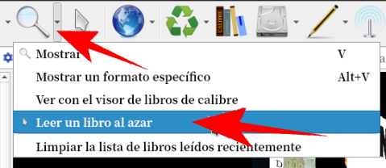

# Abrir libro al azar con Calibre

:material-account: [Walter](https://t.me/Dunhill69){ target=_blank } · :material-link-variant: [Ver el original en Telegraph](https://telegra.ph/Abrir-libro-al-azar-09-19){ target=_blank }
{ .tut-datos }

---

¿No sabemos que leer ? Calibre nos podría sugerir que libro leer

En la barra de herramientas tocamos la flecha lateral de la lupa y tocamos la cuarta opción.

Calibre nos marcará y nos abrirá un libro a elección para leer de forma automática.

ir al mensaje: [https://t.me/calibreconfiguraciones/18616](https://t.me/calibreconfiguraciones/18616)

 

Grupo de Calibre en español: [https://t.me/calibreconfiguraciones](https://t.me/calibreconfiguraciones)

 

## [Volver al inicio](https://telegra.ph/Indice-Calibre-en-Espa%C3%B1ol-10-03)

 

---

[:material-arrow-left: Volver al índice](../../alfabetico.md) · [:fontawesome-brands-telegram: Preguntar en el grupo](https://t.me/calibreconfiguraciones){ target=_blank }
