# Actualizar Calibre portable

:material-account: [Walter](https://t.me/Dunhill69){ target=_blank } · :material-link-variant: [Ver el original en Telegraph](https://telegra.ph/Actualizar-Calibre-portable-Windows-02-16){ target=_blank }
{ .tut-datos }

---

Explicado por @jane\_morris

01) En el calibre portable antiguo antes de hacer nada más, antes de actualizarlo:

Preferencias —\>Miscelanea—\>Abrir carpeta de configuración de calibre

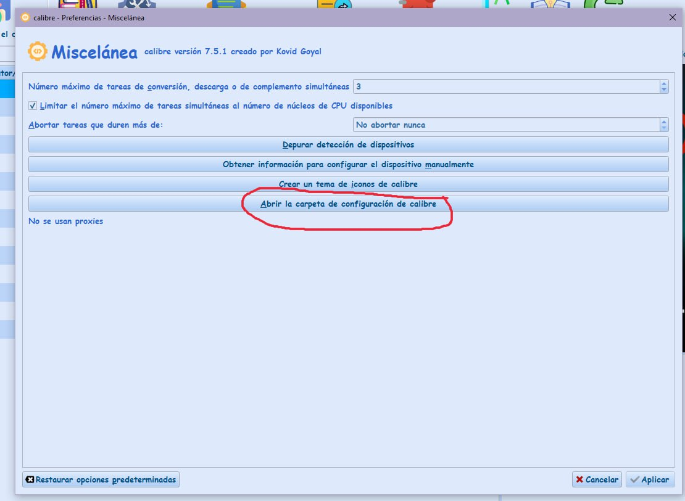

02) Pinchar aquí

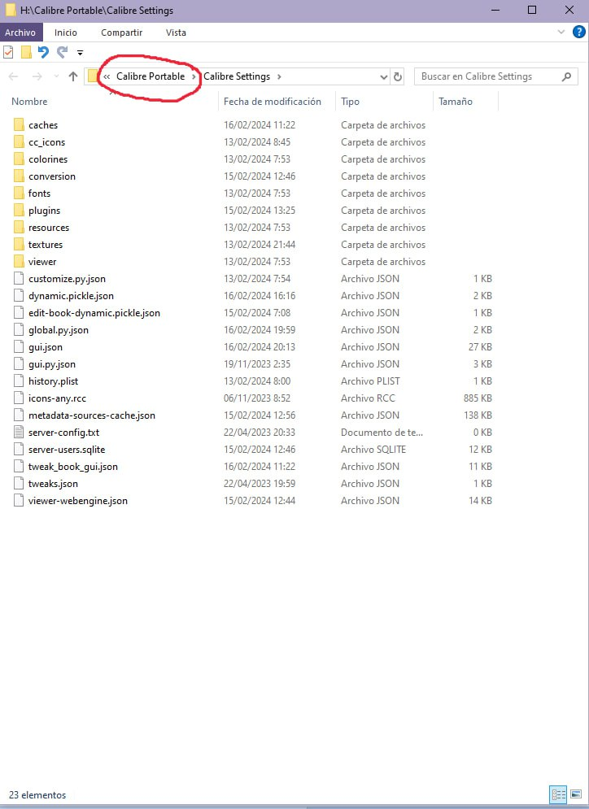

03) Copiar esa carpeta así como está cerrada y pegarla en el escritorio.

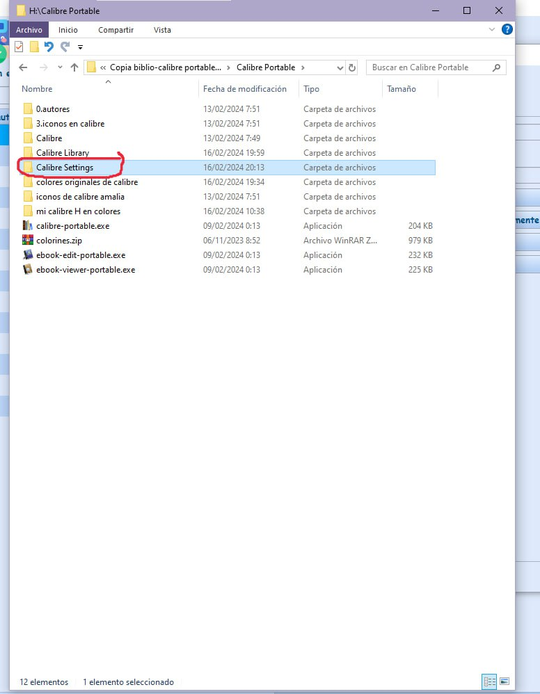

04) Preferencias—\>Apariencia—\>Situada en coloreado de columna, clicar en exportar.

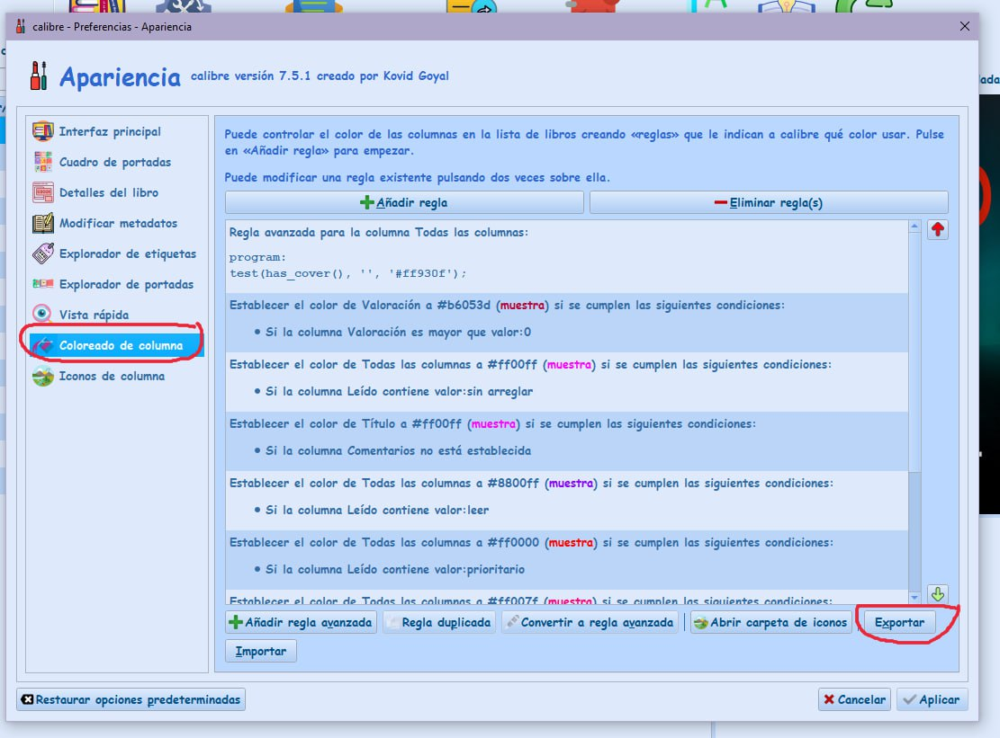

05) guardar el archivo en el escritorio

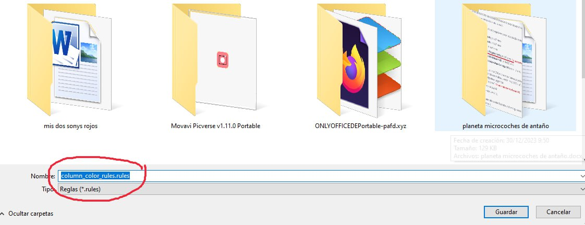

06) Situada en Iconos de columna, clicar en exportar.

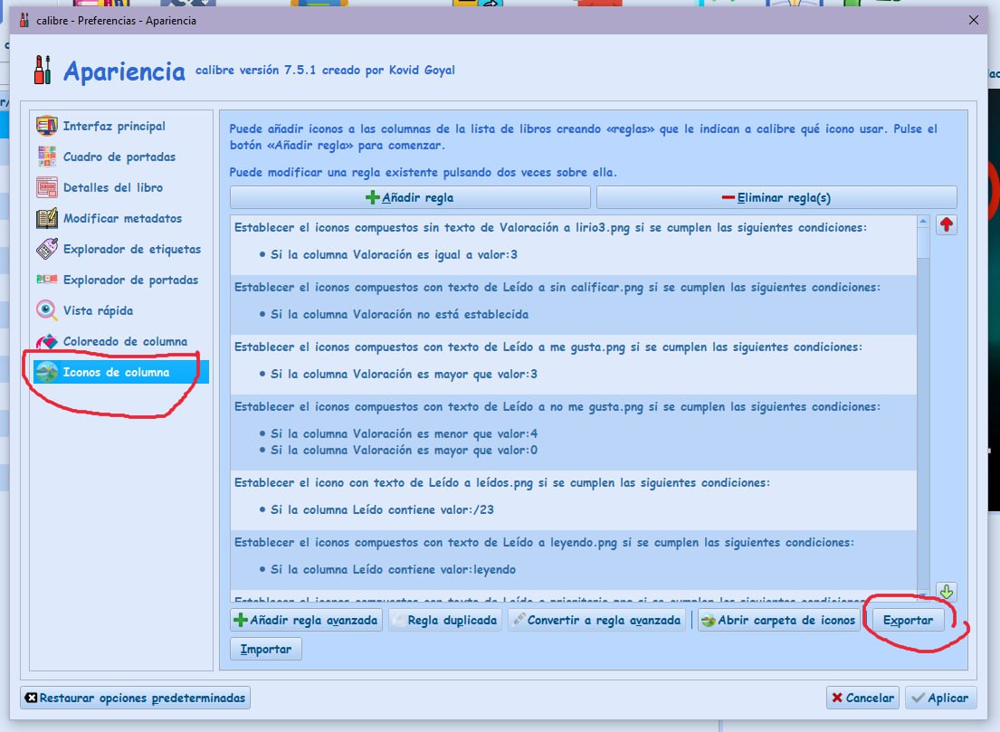

07) guardar el archivo en el escritorio

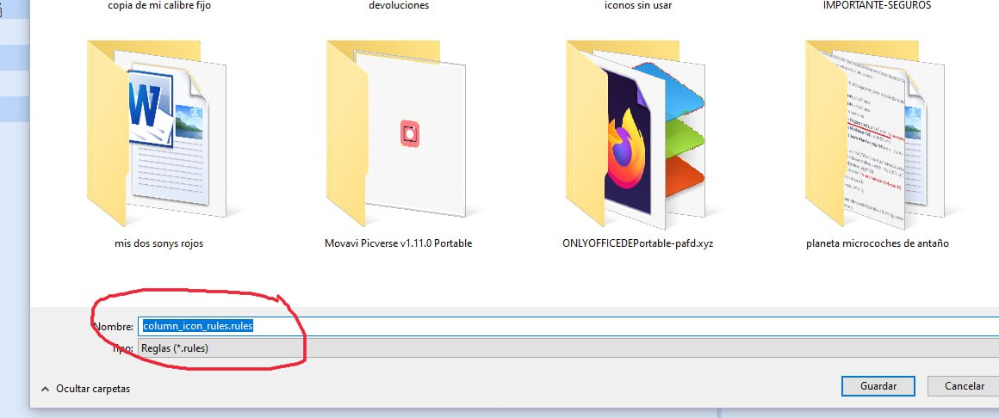

08) eliminar esta carpeta entera de un plumazo y vaciar la papelera luego, pero antes de eliminarla si vuestros iconos de etiquetas los teneis ahí, copiar esa carpeta en el escritorio como las otras que habeis salvaguardado 😉 y cuando tengais el calibre nuevo la pegais donde antes teníais la otra

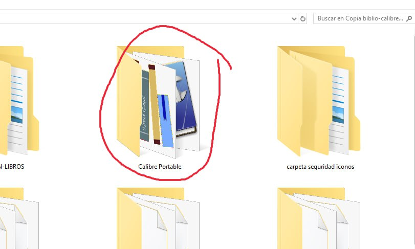

09) descargar calibre portable en el escritorio de aquí

[https://calibre-ebook.com/es/download\_portable](https://calibre-ebook.com/es/download_portable)

Al ejecutarlo e instalarlo le dices que lo guarde donde tenias el otro que has eliminado

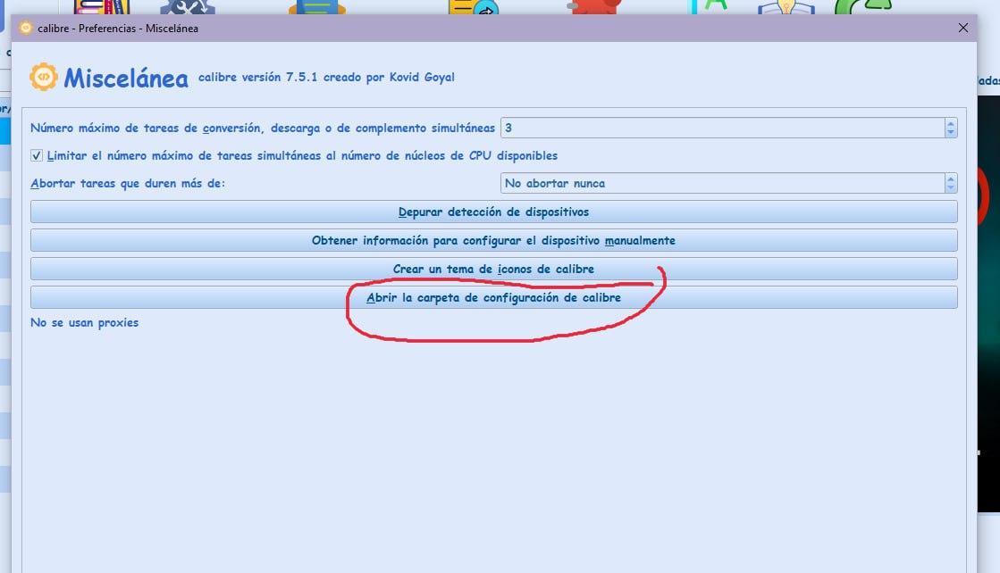

10) Cuando lo tengas instalado vamos a Preferencias/Miscelanea, clicas aqui

11) en la pantalla que te sale clicas aqui

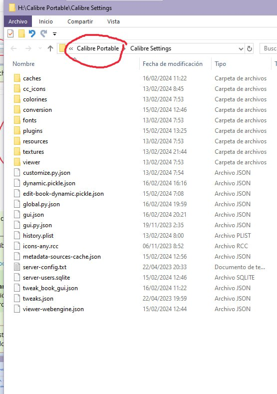

12) en la pantalla que te sale , eliminas la carpeta settings de un plumazo, entera, sin abrir y en su lugar pegas entera la que habias guardado en el escritorio

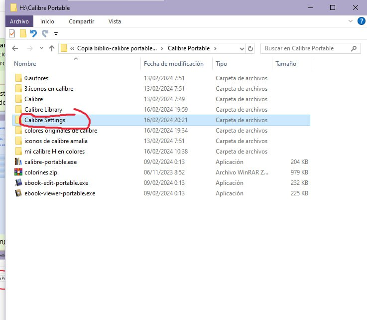

13) te vas a coloreado de columna y clicas en importar

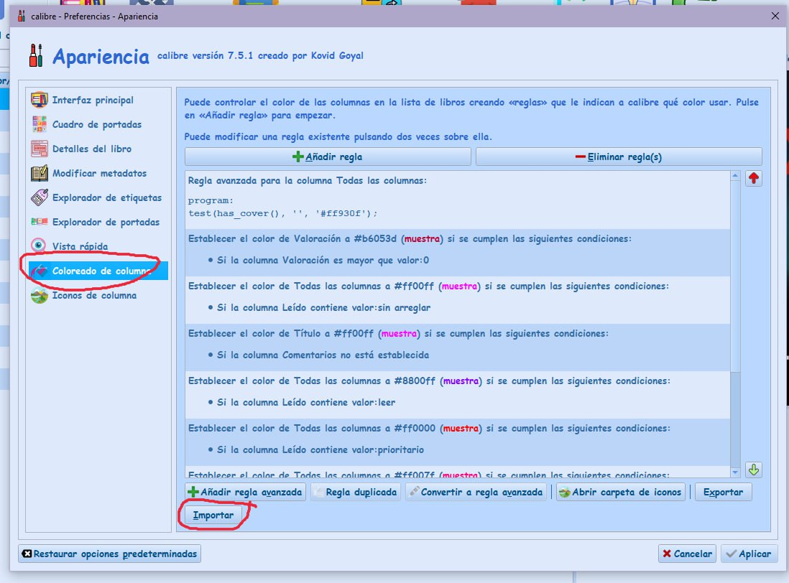

14) buscas en el escritorio el archivo que te habias guardado que se llama

colum color rules

(no te equivoques con el otro, que se llame exatamente asi), le das doble click

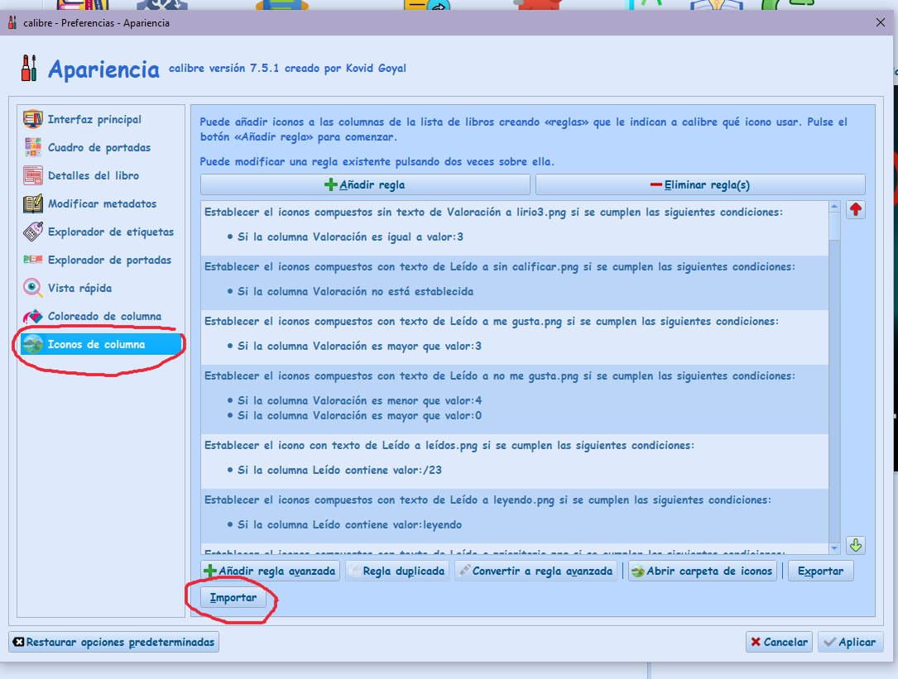

15) en iconos de columna clicas en importar

16) buscas en el escritorio el archivo que se llame

column icon rules

(no te equivoques con el de antes)

doble click

17) y cuando tengas todo esto me haces pantallazo de esto

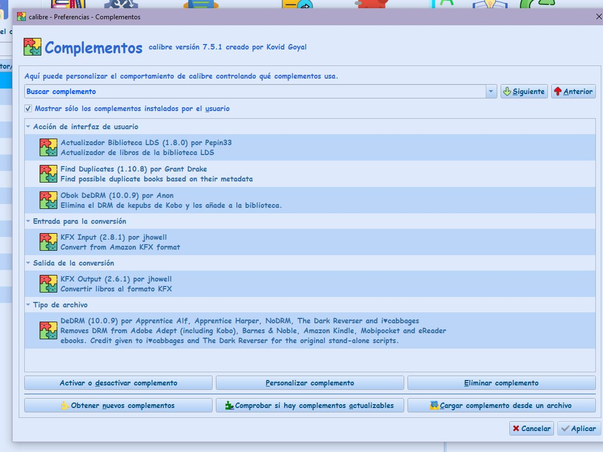

 

Ir al mensaje: [https://t.me/calibreconfiguraciones/112333/157299](https://t.me/calibreconfiguraciones/112333/157299)

## [Volver al inicio](https://telegra.ph/Indice-Calibre-en-Espa%C3%B1ol-10-03)

 

 

---

[:material-arrow-left: Volver al índice](../../alfabetico.md) · [:fontawesome-brands-telegram: Preguntar en el grupo](https://t.me/calibreconfiguraciones){ target=_blank }
