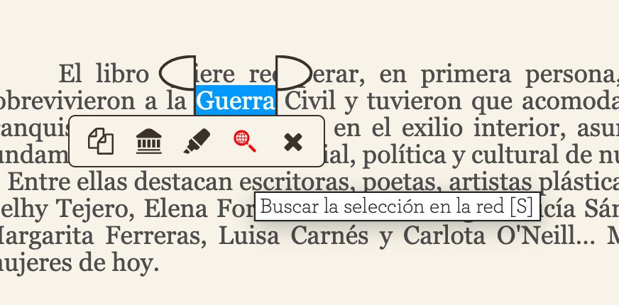
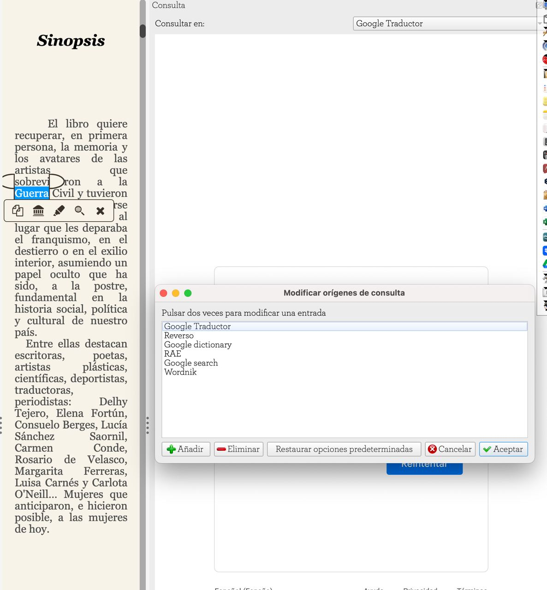
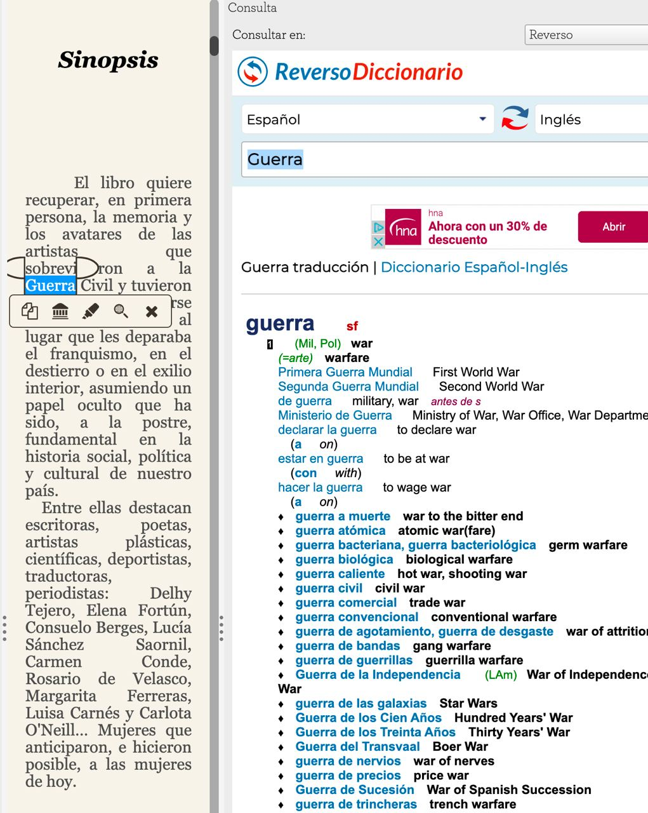
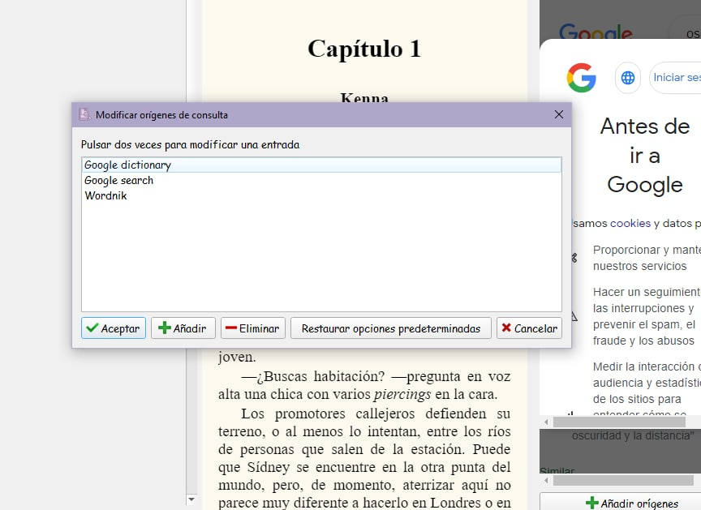
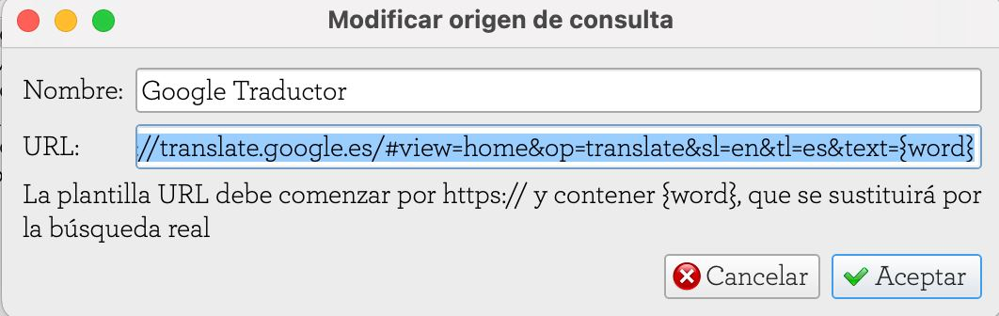
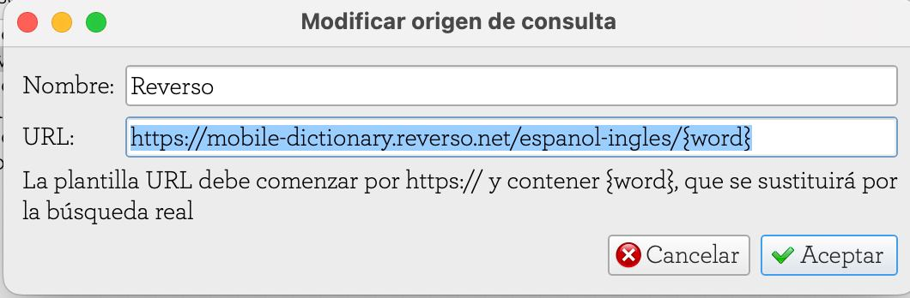
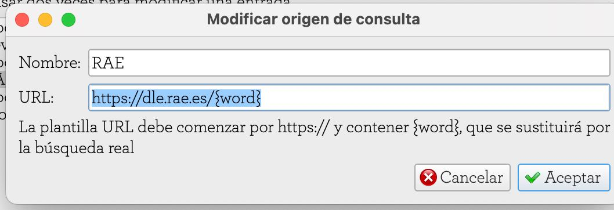
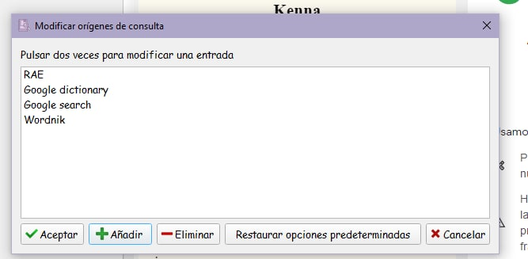

# Añadir un diccionario en Calibre

:material-account: [Walter Paterno](https://t.me/Dunhill69){ target=_blank } · :material-link-variant: [Ver el original en Telegraph](https://telegra.ph/Agregar-diccionarios-a-Calibre-02-01){ target=_blank }
{ .tut-datos }

---

Tras una pregunta de @EspectroErrabundo que preguntaba si se podía agregar un diccionario a Calibre.

ir al mensaje: [https://t.me/calibreconfiguraciones/112333/117180](https://t.me/calibreconfiguraciones/112333/117180)

Y una investigación previa de @Inatxo

Acabo de comprobar que seleccionando una palabra en el lector de Calibre (Ebook-Reader) si pinchas en la lupa (la que está en rojo) te lleva al navegador que uses directamente (o presionando la letra «S») Y desde allí puedes traducir o ver el significado de la palabra que desees.

Y si pinchas en el 2º icono de la izq. te lleva a Google traductor directamente o puedes elegir otras fuentes.

Ir al mensaje:  [https://t.me/calibreconfiguraciones/112333/117189](https://t.me/calibreconfiguraciones/112333/117189)

Y un pantallazo de @jane\_morris

Algo que yo no sabía tampoco 😂 gracias Inatxo! una cosa, porque en modificar orígenes de consulta te salen tantos y a mi tan pocos? ☹️

@EspectroErrabundo descubrio la respuesta:

Dale click en "añadir" y ahí pegas el link de la fuente de búsqueda del diccionario que prefieras

Luego, pegado al link, a la derecha, escribes "{word}"

ir al mensaje: [https://t.me/calibreconfiguraciones/112333/117216](https://t.me/calibreconfiguraciones/112333/117216)

Quedando así:

Ir al mensaje: [https://t.me/calibreconfiguraciones/112333/117235](https://t.me/calibreconfiguraciones/112333/117235)

 

A esto llamo yo un tutorial en equipo 👏🏻👏🏻👏🏻👏🏻👏🏻👏🏻👏🏻

 

## [Volver al inicio](https://telegra.ph/Indice-Calibre-en-Espa%C3%B1ol-10-03)

 

 

 

 

---

[:material-arrow-left: Volver al índice](../../alfabetico.md) · [:fontawesome-brands-telegram: Preguntar en el grupo](https://t.me/calibreconfiguraciones){ target=_blank }
