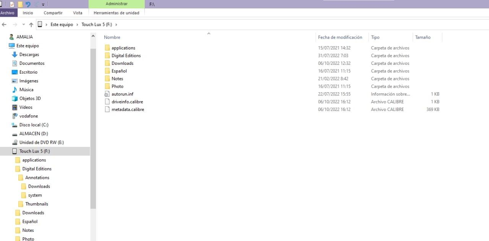
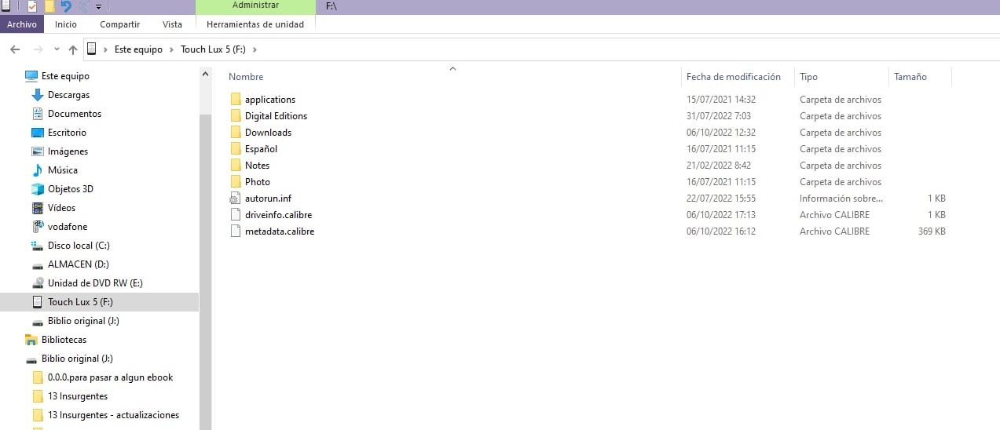
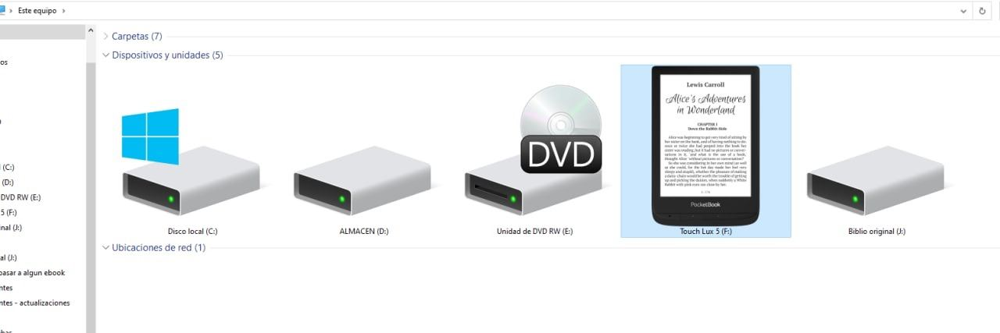
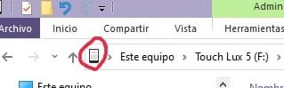
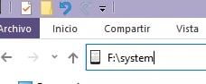
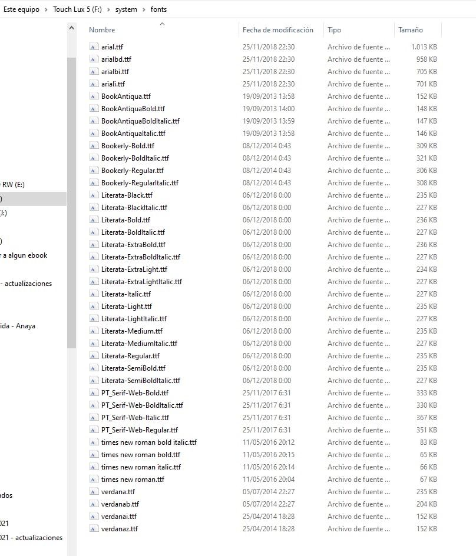
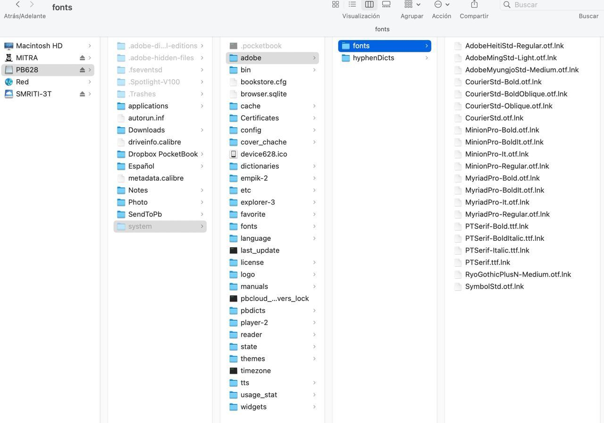
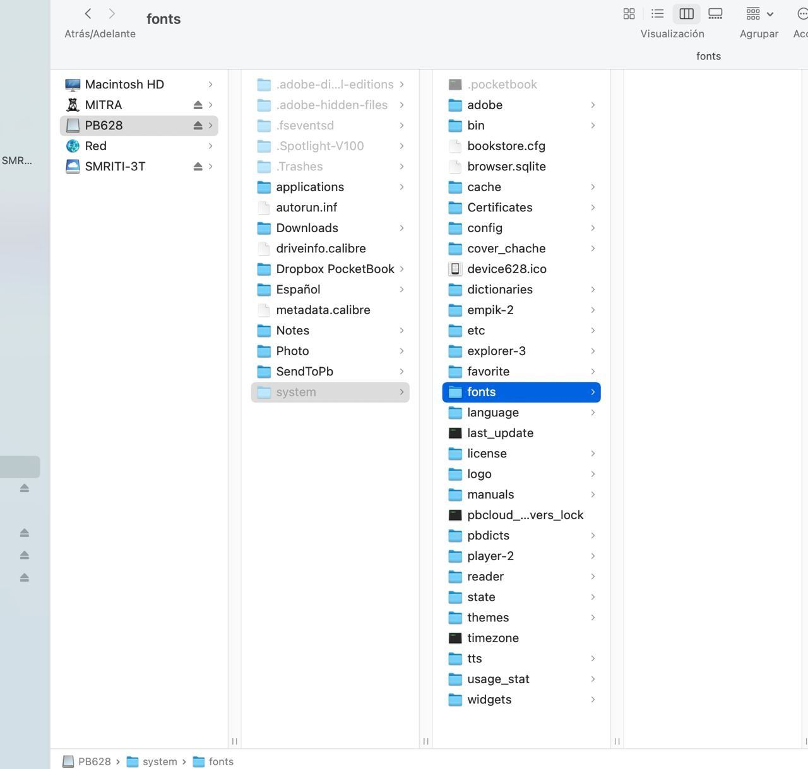

# Agregar fuentes a tu dispositivo de lectura

:material-account: [Walter Paterno](https://t.me/Dunhill69){ target=_blank } · :material-link-variant: [Ver el original en Telegraph](https://telegra.ph/Agregar-fuentes-a-tu-dispositivo-de-lectura-10-07){ target=_blank }
{ .tut-datos }

---

Explicado por por @Inatxo

***En este caso para un pocketbook y en windows:***

Conecta el pocketbook al ordenador por cable y pinchando en el MB sale esto en Windows.

Luego aquí

Escribes lo siguiente:

Y ya te salen las fuentes

Donde tienes que añadir las que desees…

En el Mac se necesita un programa o utilidad que te permita ver los ficheros invisibles

Entonces abres el PB5 y te sale esto

Pero has de ir a la carpeta fuentes de más abajo

y aquí añades las fuentes que quieras.

Luego se sale de la utilidad que te permite ver los ficheros invisibles y desconectas el PB.

Ir al mensaje:[https://t.me/calibreconfiguraciones/104774](https://t.me/calibreconfiguraciones/104774)

## [Volver al inicio](https://telegra.ph/Indice-Calibre-en-Espa%C3%B1ol-10-03)

 

 

---

[:material-arrow-left: Volver al índice](../../alfabetico.md) · [:fontawesome-brands-telegram: Preguntar en el grupo](https://t.me/calibreconfiguraciones){ target=_blank }
