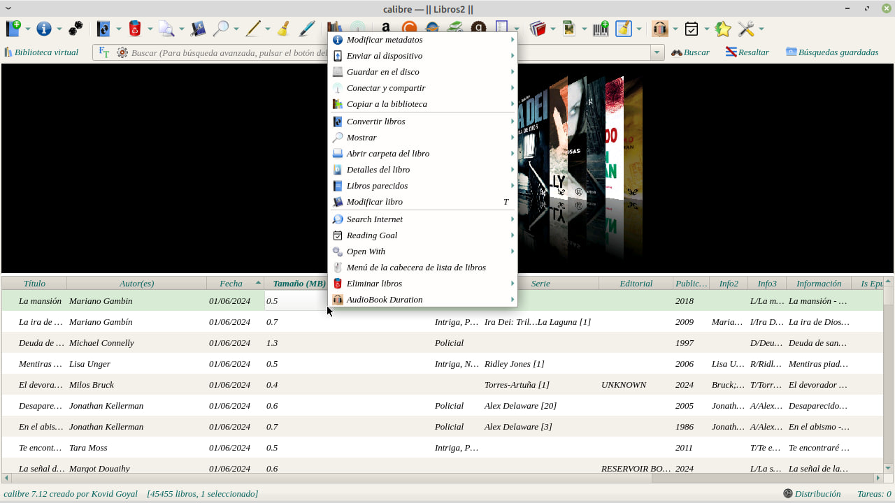
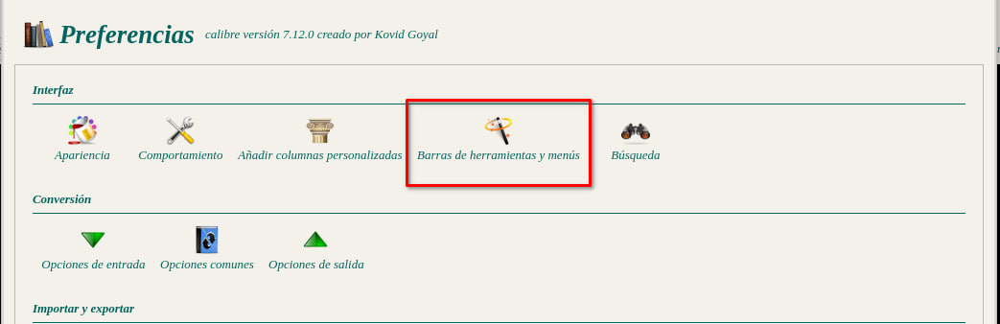
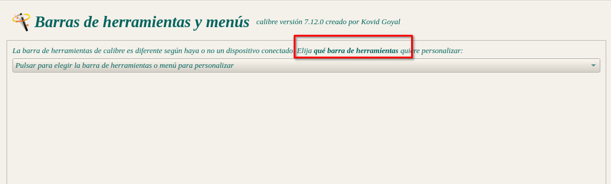
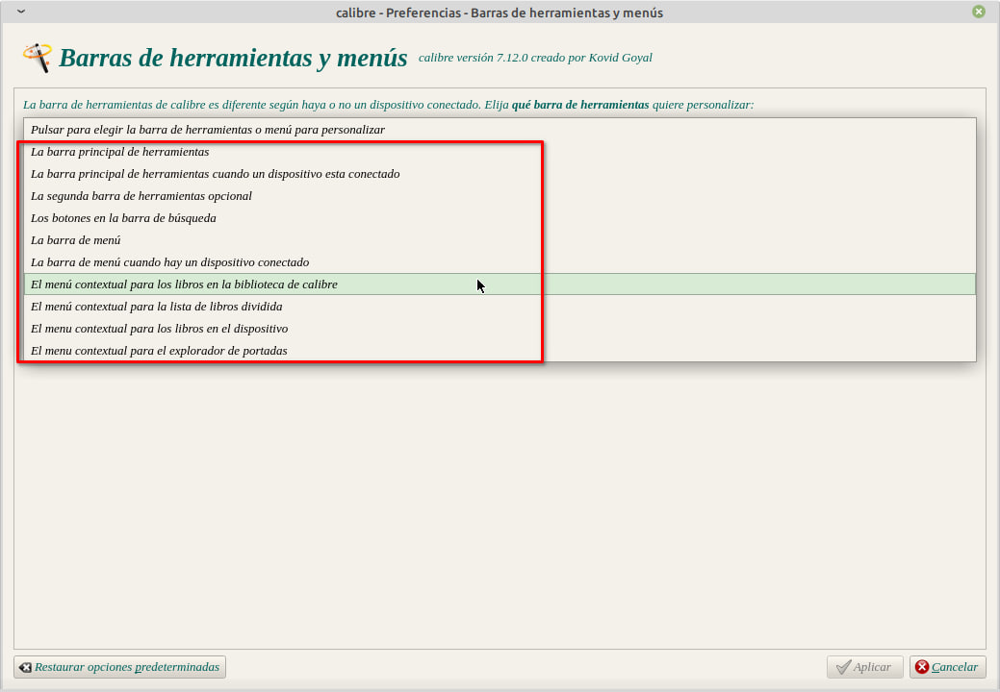
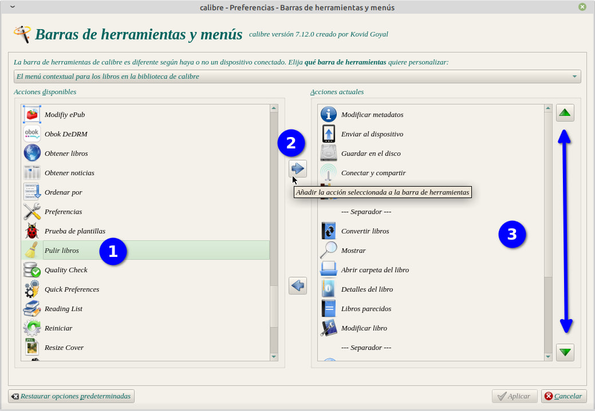
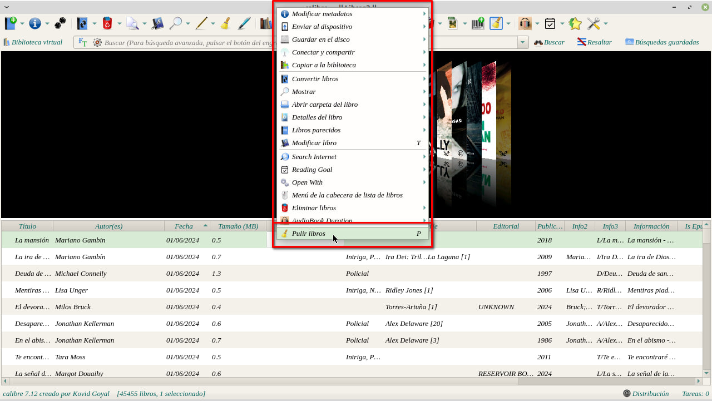

# Agregar íconos en menú contextual

:material-account: [Walter](https://t.me/Dunhill69){ target=_blank } · :material-link-variant: [Ver el original en Telegraph](https://telegra.ph/Agregar-iconos-en-men%C3%BA-contextual-06-03){ target=_blank }
{ .tut-datos }

---

Preguntaron en el hilo de pocketbook como poner un icono en el menú desplegable tocando el botón derecho del mouse dentro de la biblioteca de calibre. Acá van los pasos:

En este menú vamos a incorporar el icono para fijar los metadatos

Debemos ir a preferencias Barras de herramientas y menús

Como dice el título podemos elegir en que barra poder agregar. Pulsamos en elegir barras de herramientas y se nos desplegá un listado.

A nosotros nos interesa "El menú contextual para los libros en la biblioteca de calibre".

En la columna de la izquierda están los iconos de las funciones instaladas, en este caso buscamos la escoba de "Pulir libros", la seleccionamos, con las flechas del medio podemos agregar o quitar y con las flechas superiores e inferiores podemos darle la ubicación en el listado a nuestro gusto, después de estos pasos le damos en el botón de aplicar.

Y ya tendremos el icono de "pulir libros" en el menú al tocar el botón derecho del mouse.

 

Ir al mensaje: [https://t.me/calibreconfiguraciones/112333/165790](https://t.me/calibreconfiguraciones/112333/165790)

 

## [Volver al inicio](https://telegra.ph/Indice-Calibre-en-Espa%C3%B1ol-10-03)

 

---

[:material-arrow-left: Volver al índice](../../alfabetico.md) · [:fontawesome-brands-telegram: Preguntar en el grupo](https://t.me/calibreconfiguraciones){ target=_blank }
