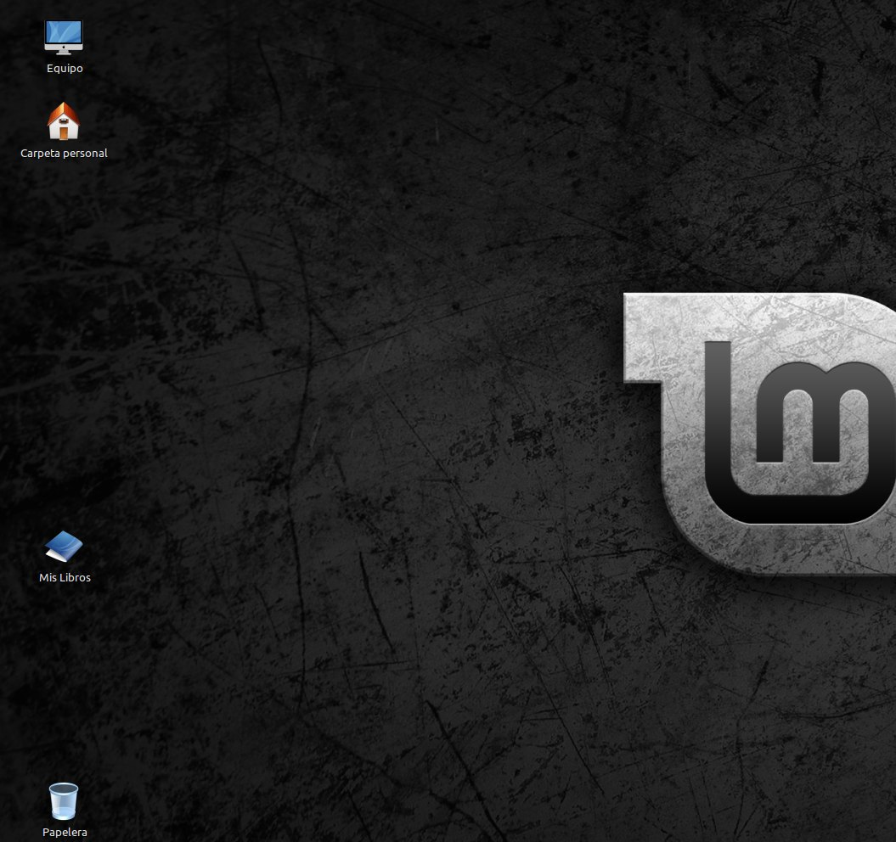
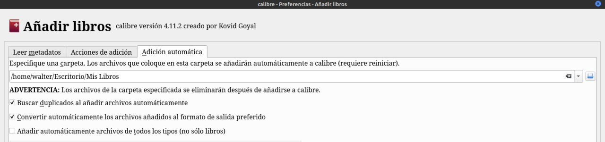

# Agregar libros automáticamente

:material-account: [Walter](https://t.me/Dunhill69){ target=_blank } · :material-link-variant: [Ver el original en Telegraph](https://telegra.ph/Agregar-libros-autom%C3%A1ticamente-08-15){ target=_blank }
{ .tut-datos }

---

Para que se agreguen los libros automáticamente a Calibre, deberemos crear una carpeta, en mi caso cree una en el escritorio y la llame "Mis libros".

En Calibre entramos en preferencias/Añadir Libros y en la ultima solapa "Adición automática", buscamos la ruta de la carpeta que hemos creado para ir poniendo libros para que automáticamente se agreguen al Calibre al iniciar. También podemos marcar que nos indique los duplicados y que los convierta a nuestro formato de salida preferido. Estos archivos a medida que se agreguen a Calibre se irán eliminando de esa carpeta.

Grupo de Calibre en español: [https://t.me/calibreconfiguraciones](https://t.me/calibreconfiguraciones)

## [Volver al inicio](https://telegra.ph/Indice-Calibre-en-Espa%C3%B1ol-10-03)

##  

 

---

[:material-arrow-left: Volver al índice](../../alfabetico.md) · [:fontawesome-brands-telegram: Preguntar en el grupo](https://t.me/calibreconfiguraciones){ target=_blank }
