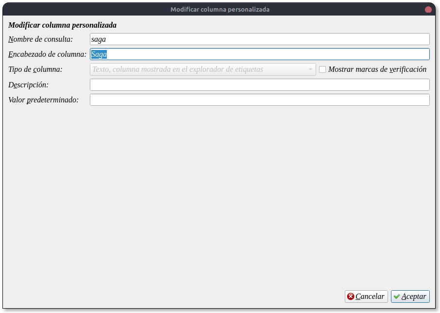
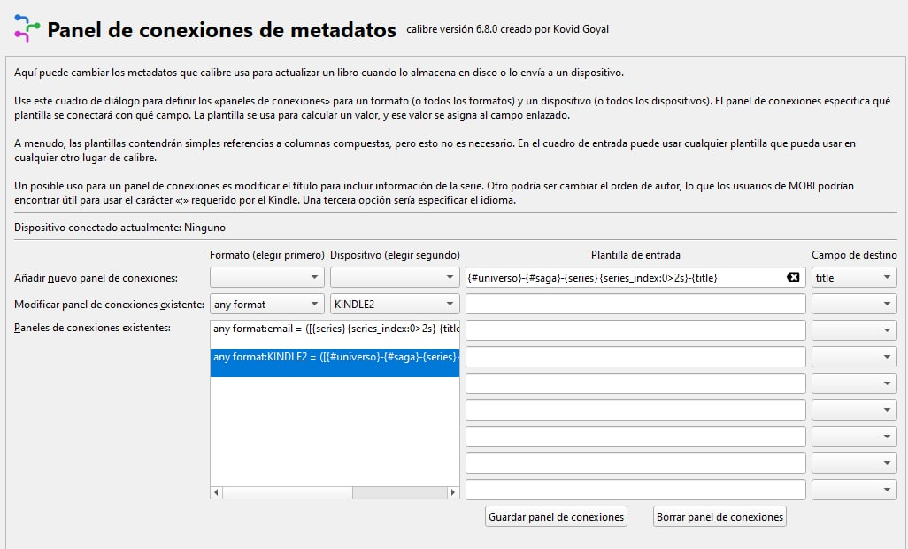
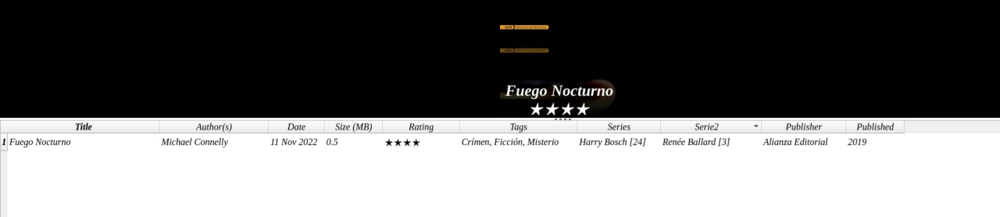
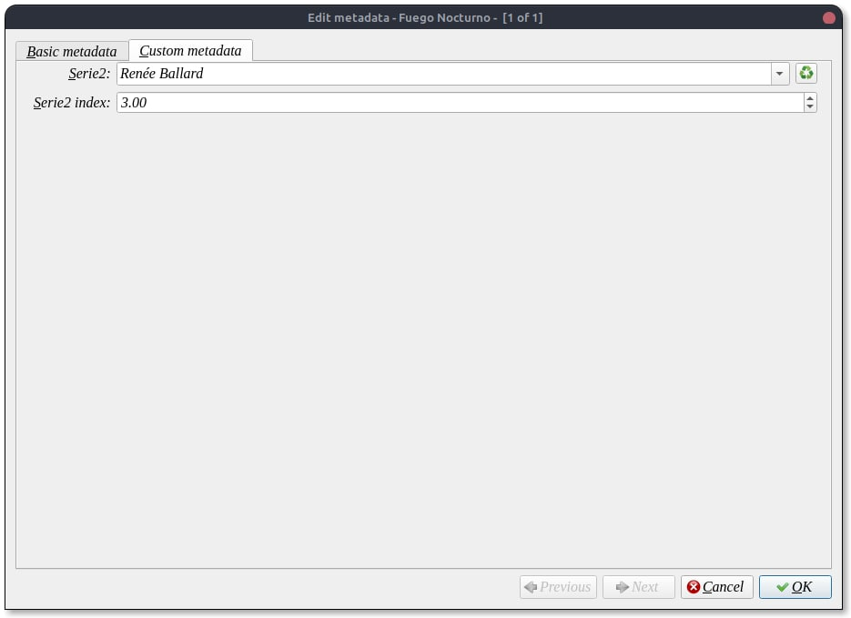
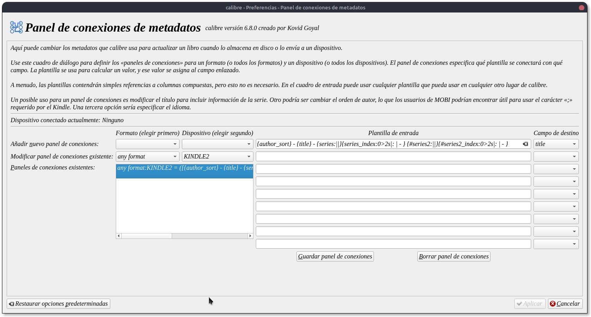

# Kindle - agregar segunda serie

:material-account: [Walter Paterno](https://t.me/Dunhill69){ target=_blank } · :material-link-variant: [Ver el original en Telegraph](https://telegra.ph/Agregar-segunda-serie-para-que-se-vea-en-Kindle-11-12){ target=_blank }
{ .tut-datos }

---

Explicado por @Killo\_3967

Para tener una doble serie en kindle

Debemos crear una columna personalizada:

Pueden ser de dos maneras o formato serie ( y se vera el número en otra columna, como la serie original ) o una con formato texto.

Acá hemos creado la columna saga

Y en el panel de conecciones de metadatos lo debemos cargar así:

En este caso @Killo\_3967 tambien agrego una columna de universo. Las columnas personalizdas deben estar antepuesta por #

---

Yo en mi caso he creado una columna tipo serie, nombrandola serie2

El panel de conecciones de metadatos se verá así:

Y como resultado:

 

## [Volver al inicio](https://telegra.ph/Indice-Calibre-en-Espa%C3%B1ol-10-03)

 

 

---

[:material-arrow-left: Volver al índice](../../alfabetico.md) · [:fontawesome-brands-telegram: Preguntar en el grupo](https://t.me/calibreconfiguraciones){ target=_blank }
