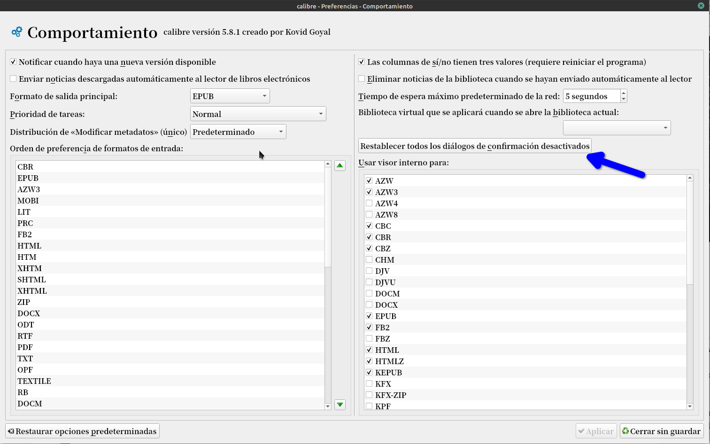
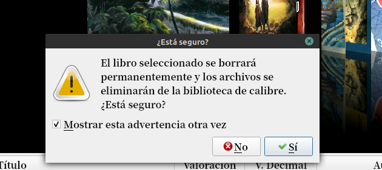

# Alertas en Calibre

:material-account: [Walter](https://t.me/Dunhill69){ target=_blank } · :material-link-variant: [Ver el original en Telegraph](https://telegra.ph/Alertas-en-Calibre-01-06){ target=_blank }
{ .tut-datos }

---

Un amigo me pregunta si no hay alguna opción donde Calibre avise que esta a punto de eliminar un archivo. A veces por error uno toca suprimir y ya no hay paso atrás.

Para eso entramos a Preferencias/Comportamiento

Y tocamos en "Restablecer todos los diálogos de confirmación desactivados"

Le damos en aplicar y cerrar.

Cuando toquemos la próxima vez para eliminar un libro nos saldrá este aviso.

ir al mensaje: [https://t.me/calibreconfiguraciones/27839](https://t.me/calibreconfiguraciones/27839)

[https://telegra.ph/Alertas-en-Calibre-01-06](https://telegra.ph/Alertas-en-Calibre-01-06)

Grupo de Calibre en español: [https://t.me/calibreconfiguraciones](https://t.me/calibreconfiguraciones)

## [Volver al inicio](https://telegra.ph/Indice-Calibre-en-Espa%C3%B1ol-10-03)

##  

##  

---

[:material-arrow-left: Volver al índice](../../alfabetico.md) · [:fontawesome-brands-telegram: Preguntar en el grupo](https://t.me/calibreconfiguraciones){ target=_blank }
