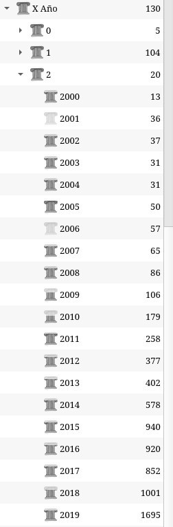
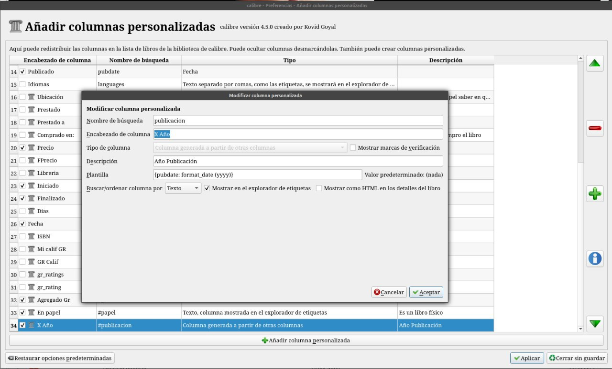
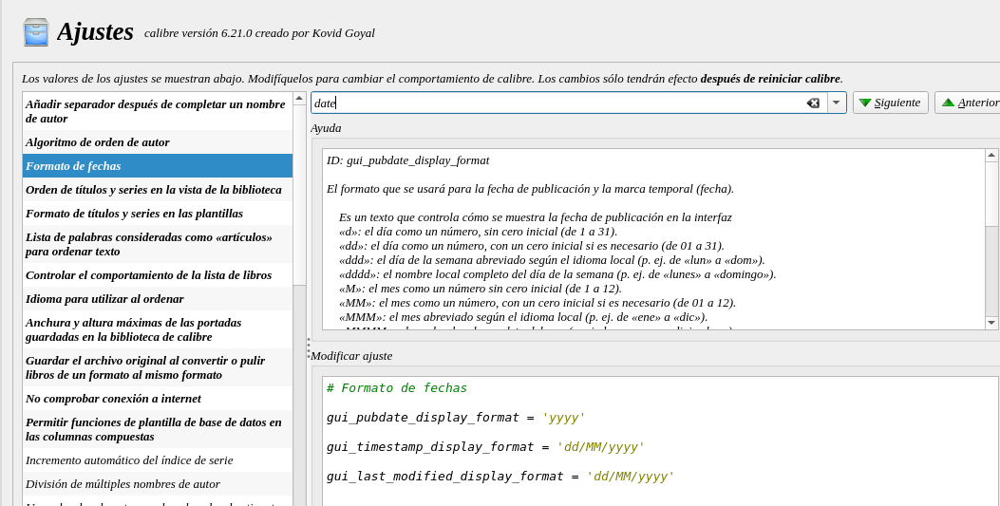

# Año publicado en etiqueta

:material-account: [Walter](https://t.me/Dunhill69){ target=_blank } · :material-link-variant: [Ver el original en Telegraph](https://telegra.ph/A%C3%B1o-publicado-etiqueta-08-15){ target=_blank }
{ .tut-datos }

---

Dedicado a Jane como puedo ver el año de publicación como si fuese una etiqueta ? investigando quedo algo así, me pareció un dato importante a tener en cuenta.

Vamos a Preferencias/Añadir columnas Personalizadas y creamos una columna generada a partir de otra columna y en la plantilla le agregan la formula descrita en la imagen. Aceptamos y reiniciamos Calibre.

## En ajustes debemos poner así el formato de fecha

yyyy

## [Volver al inicio](https://telegra.ph/Indice-Calibre-en-Espa%C3%B1ol-10-03)

##  

 

---

[:material-arrow-left: Volver al índice](../../alfabetico.md) · [:fontawesome-brands-telegram: Preguntar en el grupo](https://t.me/calibreconfiguraciones){ target=_blank }
