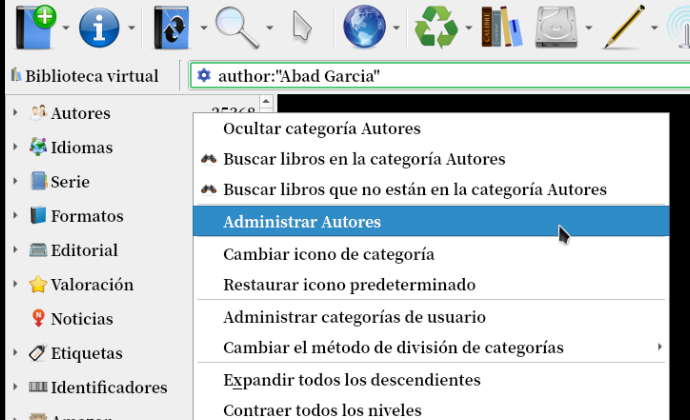
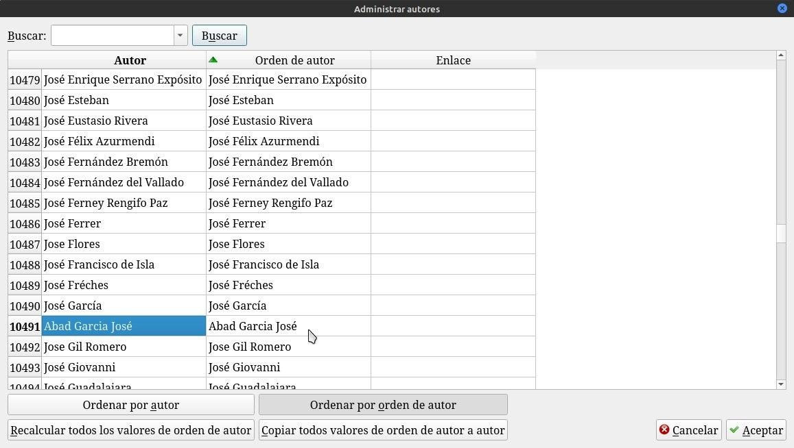
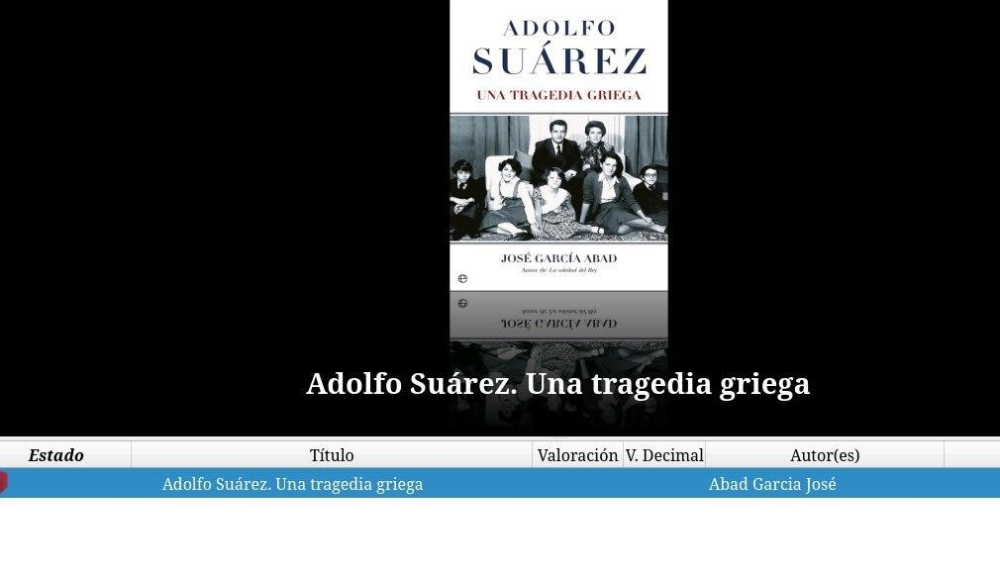

# Apellido de autores

:material-account: [Walter](https://t.me/Dunhill69){ target=_blank } · :material-link-variant: [Ver el original en Telegraph](https://telegra.ph/Apellido-de-Autores-08-16){ target=_blank }
{ .tut-datos }

---

Hay una manera pero es un trabajito manual que deberías hacer con los autores de doble apellido. Vamos a autores a la izquierda de Calibre y le das botón izquierdo del mouse y Administrar Autores.

Buscas el autor y lo escribes de la forma que quieres que Calibre lo reconozca. Tocas recalcular y aceptar. Reinicias Calibre

Buscas el autor y lo escribes de la forma que quieres que Calibre lo reconozca. Tocas recalcular y aceptar. Reinicias Calibre

Así nos queda.

## [Volver al inicio](https://telegra.ph/Indice-Calibre-en-Espa%C3%B1ol-10-03)

##  

 

---

[:material-arrow-left: Volver al índice](../../alfabetico.md) · [:fontawesome-brands-telegram: Preguntar en el grupo](https://t.me/calibreconfiguraciones){ target=_blank }
