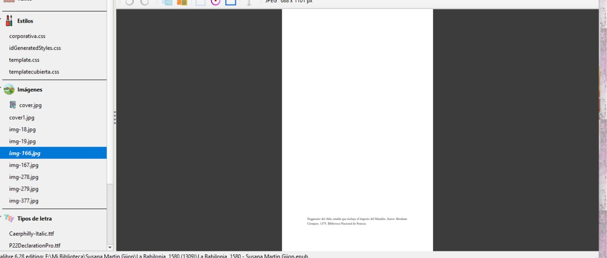
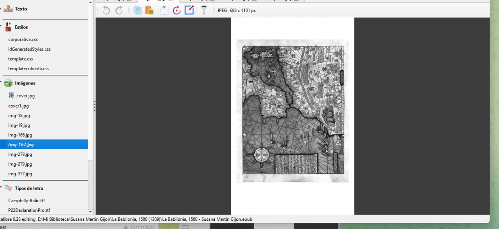
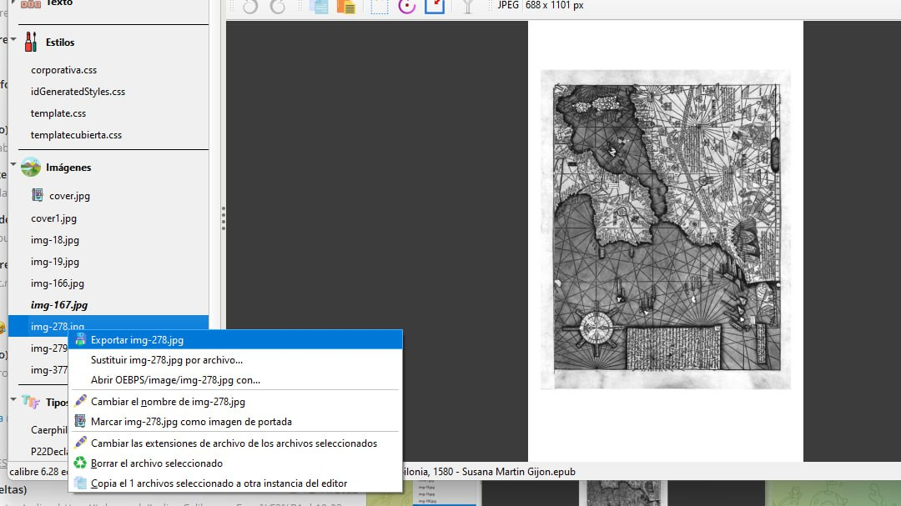
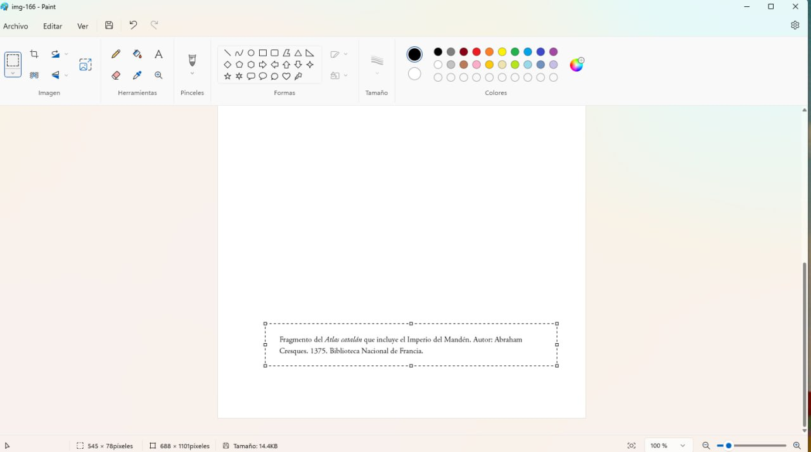
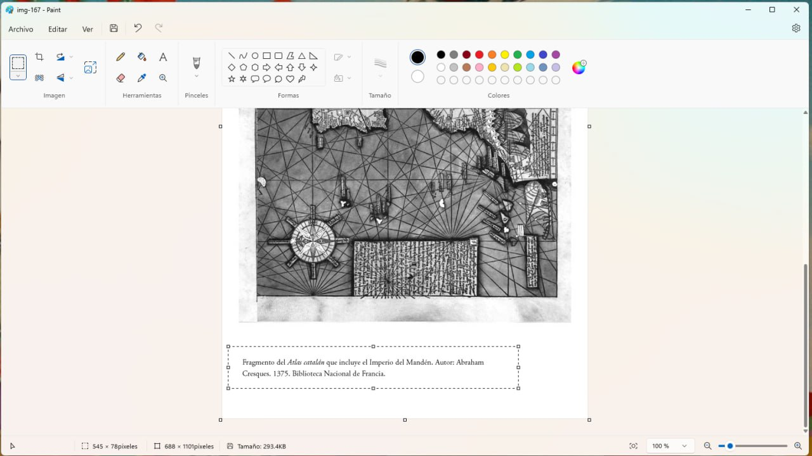
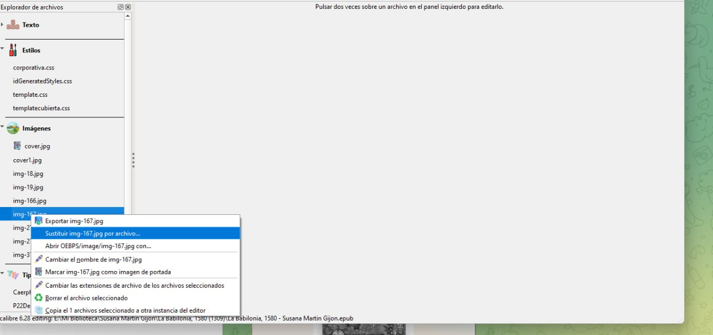
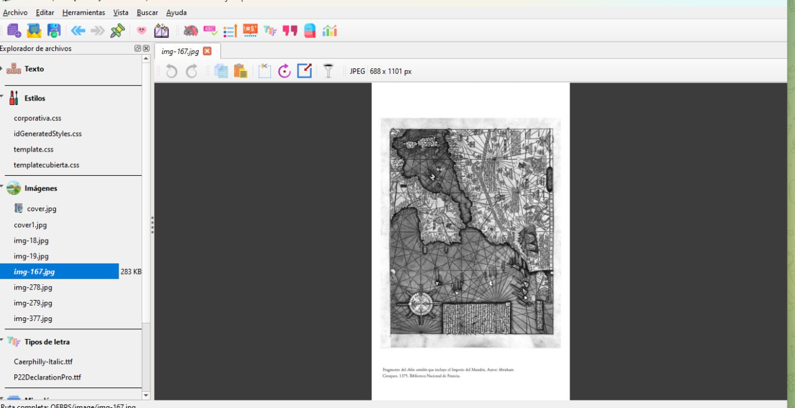

# Arreglo de imágenes dentro del libro

:material-account: [@betty](https://t.me/Dunhill69){ target=_blank } · :material-link-variant: [Ver el original en Telegraph](https://telegra.ph/Arreglo-de-imagenes-dentro-del-libro-02-03){ target=_blank }
{ .tut-datos }

---

Explicado por @betty

Bueno, me lo estoy pasando pipa Maqueteando mi primer libro, por ahora estoy arreglando las imágenes de un libro que no me gustaba como me salían, usaba una página para un mapa y otra para la descripción, usando tu tuto Jane, he conseguido unirlas y ha quedado así:

Imagen con descripción mapa

Solo mapa

Exporto al escritorio las 2 imágenes que quiero fundir

Luego los he abierto con Paint y recortando la descripción, la he copiado y luego pegado en la hoja del mapa.

Sustituyo la imagen anterior por la nueva imagen

y suprimo la que solo tenía la descripción

y me queda así:

 

Ir al mensaje: [https://t.me/calibreconfiguraciones/144967/145323](https://t.me/calibreconfiguraciones/144967/145323)

## [Volver al inicio](https://telegra.ph/Indice-Calibre-en-Espa%C3%B1ol-10-03)

 

 

 

---

[:material-arrow-left: Volver al índice](../../alfabetico.md) · [:fontawesome-brands-telegram: Preguntar en el grupo](https://t.me/calibreconfiguraciones){ target=_blank }
