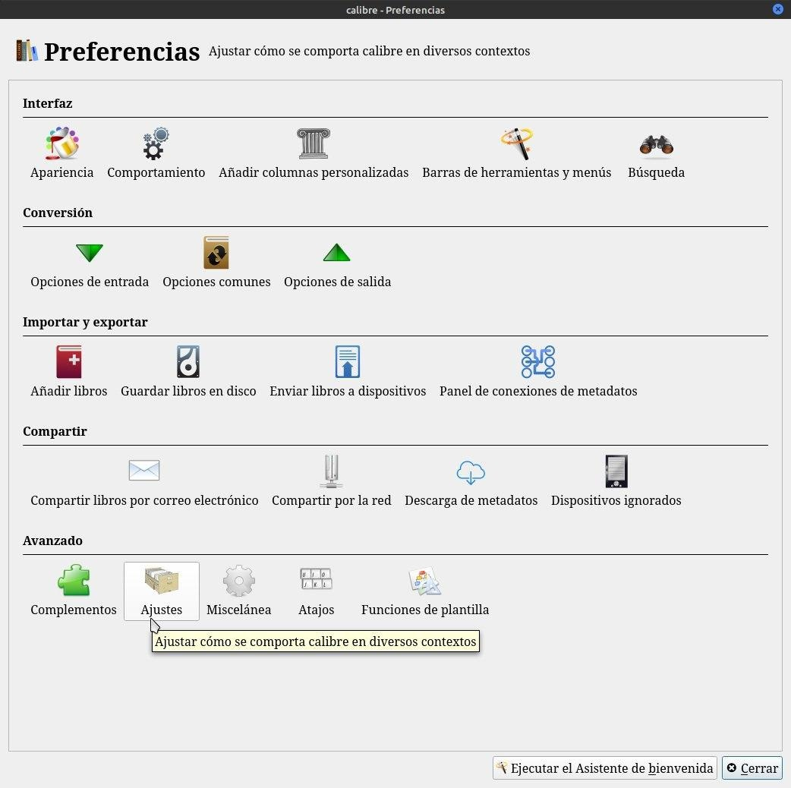
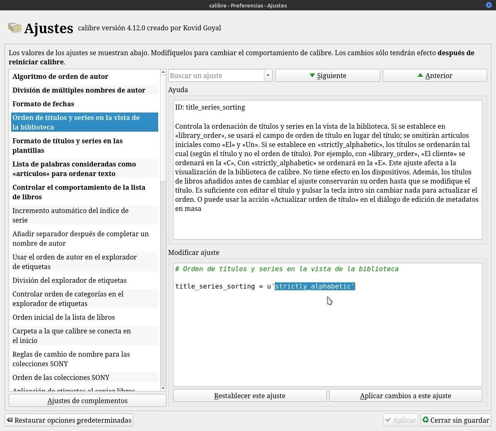
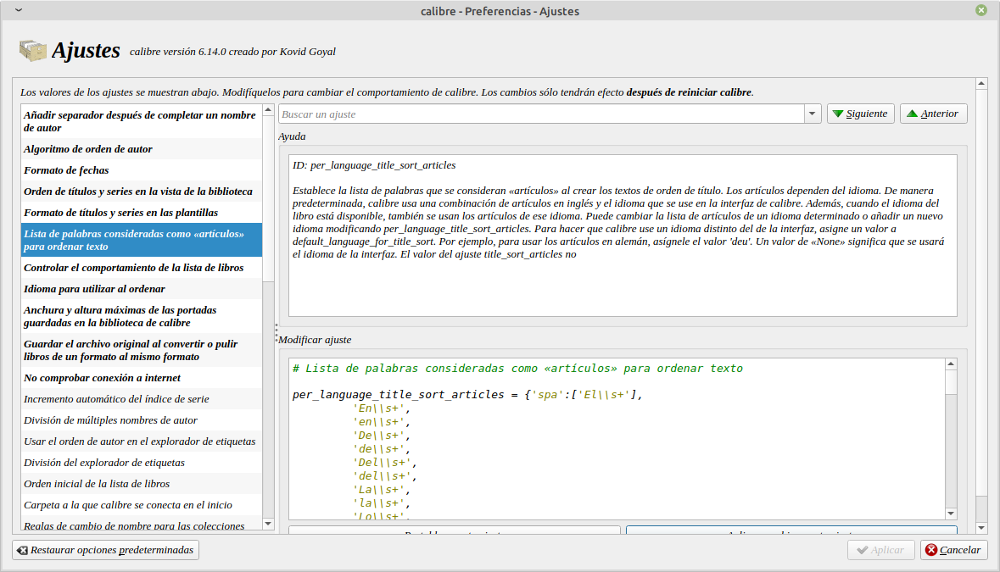
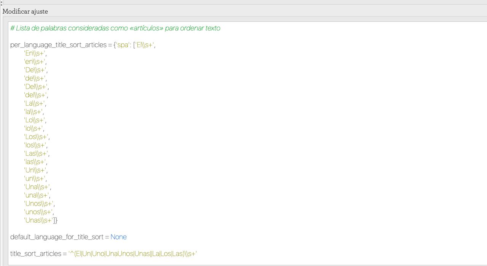

# Artículo en el título

:material-account: [Walter](https://t.me/Dunhill69){ target=_blank } · :material-link-variant: [Ver el original en Telegraph](https://telegra.ph/Articulo-en-el-t%C3%ADtulo-08-16){ target=_blank }
{ .tut-datos }

---

Como solucionar el tema del articulo al final del título: Vamos a Preferencias/Ajustes.

Después seleccionamos, de la lista de la izquierda, "Orden de títulos y series en la biblioteca" y le damos el valor 'strictly\_alphabetic', con las comillas simples incluidas, al parámetro "title\_series\_sorting".Con esto conseguiremos que tanto series como títulos coloquen correctamente el artículo cuando se trata del nombre del libro.

Otra manera seria:

Explicado por @Inatxo

# Lista de palabras consideradas como «artículos» para ordenar texto

 

per\_language\_title\_sort\_articles = {'spa': \['El\\\\s+',

'En\\\\s+',

'en\\\\s+',

'De\\\\s+',

'de\\\\s+',

'Del\\\\s+',

'del\\\\s+',

'La\\\\s+',

'la\\\\s+',

'Lo\\\\s+',

'lo\\\\s+',

'Los\\\\s+',

'los\\\\s+',

'Las\\\\s+',

'las\\\\s+',

'Un\\\\s+',

'un\\\\s+',

'Una\\\\s+',

'una\\\\s+',

'Unos\\\\s+',

'unos\\\\s+',

'Unas\\\\s+'\]}

 

default\_language\_for\_title\_sort = None

 

title\_sort\_articles = '^(El\|Un\|Uno\|UnaUnos\|Unas\|\|La\|Los\|Las)\\\\s+'

 

Ir al mensaje: [https://t.me/calibreconfiguraciones/112333/130497](https://t.me/calibreconfiguraciones/112333/130497)

## [Volver al inicio](https://telegra.ph/Indice-Calibre-en-Espa%C3%B1ol-10-03)

## 

 

 

---

[:material-arrow-left: Volver al índice](../../alfabetico.md) · [:fontawesome-brands-telegram: Preguntar en el grupo](https://t.me/calibreconfiguraciones){ target=_blank }
