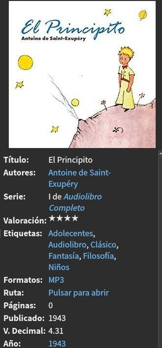
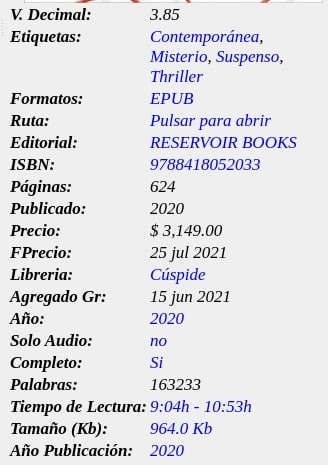

# Audiolibros

:material-account: [Walter](https://t.me/Dunhill69){ target=_blank } · :material-link-variant: [Ver el original en Telegraph](https://telegra.ph/Audiolibros-08-16){ target=_blank }
{ .tut-datos }

---

Puede Calibre almacenar audiolibros ??? Si, por supuesto !! Calibre admite mucho de los archivos de audiolibros como ser:

Los archivos MP3, M3U, M4A y M4B, MPEG, MP4 , 3GP , 3G2 , QT, AAX

Pero como hacemos para completar los metadatos de estos libros si son formatos de audio? Bueno existe un plugin con el cual puedes obtener los metadatos del libro.

Este es el plugin para metadatos de audiolibros ( [https://www.mobileread.com/forums/showthread.php?t=143629](https://www.mobileread.com/forums/showthread.php?t=143629) )

Y así se ven los detalles del libro, nótese el formato del libro.

 

## Por Wiso

He estado tratando lo de añadir audiolibros, creo que lo más sencillo si tienes audiolibros con varios audios (tengo varios así) es crear un archivo .m3u que tenga la lista de audios, y añadir el "índice" .m3u a calibre.

Hecho esto, añadir los audios a la carpeta que crea calibre.

Es un poco rudimentario, y no automatizado...pero funcional.

El índice .m3u lo puedes editar a mano.

1) Creas un archivo por ejemplo título.txt y lo editas con cualquier editor de textos o en tu caso si usas linux directamente abres el .m3u con gedit, nano, vi o el que más te guste

2) la 1a línea #EXTM3U y el resto de líneas los nombres de cada fichero en orden...

#EXTM3U

01.mp3

02.mp3

03.mp3

...

Yo mis audiolibros los tengo en mp3 asi que si el formato es mp3 calibre me dice si es audiolibro en el detalle del libro

Creas una columna personalizada y en plantilla pones esto cambiando el formato a tu elección: program:cmp(count(template('\[\[format\]\]'), ','), 1, 'no', in\_list(template('\[\[format\]\]'), ',', 'Mp3', 'Si', 'no'), 'no')

Ir al mensaje: [https://t.me/calibreconfiguraciones/44383](https://t.me/calibreconfiguraciones/44383)

Código aportado por wiso que abarca todos los formatos de audiolibros

program:cmp(count(template('\[\[format\]\]'), ','), 1, 'no', in\_list(template('\[\[format\]\]'), ',', 'Ogg', 'Si', 'no', ',', 'M3u', 'Si', 'no', ',', 'M4a', 'Si', 'no', ',', 'Mp3', 'Si', 'no'), 'no')

Ir al mensaje: [https://t.me/calibreconfiguraciones/44402](https://t.me/calibreconfiguraciones/44402)

Página web para unir archivos de audio libros aportada por @conversandoentrelibros

https://audio-joiner.com/es/

 

[Volver al inicio](https://telegra.ph/Indice-Calibre-en-Espa%C3%B1ol-10-03)

##  

 

---

[:material-arrow-left: Volver al índice](../../alfabetico.md) · [:fontawesome-brands-telegram: Preguntar en el grupo](https://t.me/calibreconfiguraciones){ target=_blank }
