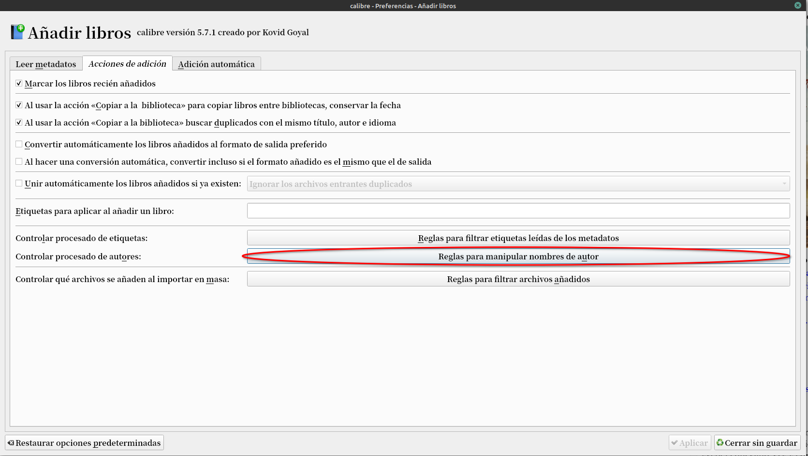
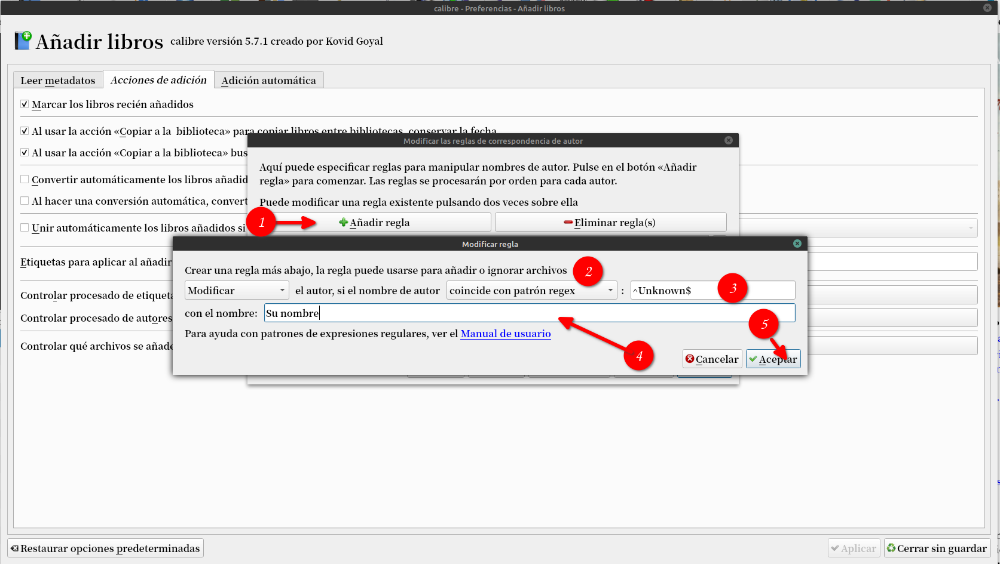

# Autor - Mi nombre

:material-account: [Walter](https://t.me/Dunhill69){ target=_blank } · :material-link-variant: [Ver el original en Telegraph](https://telegra.ph/Autor---Mi-nombre-12-12){ target=_blank }
{ .tut-datos }

---

Les paso un tips para los que manejan calibre con sus apuntes personales y que cuando cargan sus documentos Calibre se los pone con autor desconocido. Para solucionar esto vamos a preferencias/Añadir libros/Acciones de adición y en la opción de controlar el procesado de autores tocamos en reglas para manipular el nombre de autor.

Tocamos en añadir regla. Marcamos "modificar" el autor si el nombre del autor "coincide con patron regex" que seria "^Unknown$" o "^Desconocido$" por el nombre "Nuestro Nombre" Aceptar, Aceptar

Ir al mensaje: [https://t.me/calibreconfiguraciones/26176](https://t.me/calibreconfiguraciones/26176)

[https://telegra.ph/Autor---Mi-nombre-12-12](https://telegra.ph/Autor---Mi-nombre-12-12)

## [Volver al inicio](https://telegra.ph/Indice-Calibre-en-Espa%C3%B1ol-10-03)

##  

 

 

---

[:material-arrow-left: Volver al índice](../../alfabetico.md) · [:fontawesome-brands-telegram: Preguntar en el grupo](https://t.me/calibreconfiguraciones){ target=_blank }
