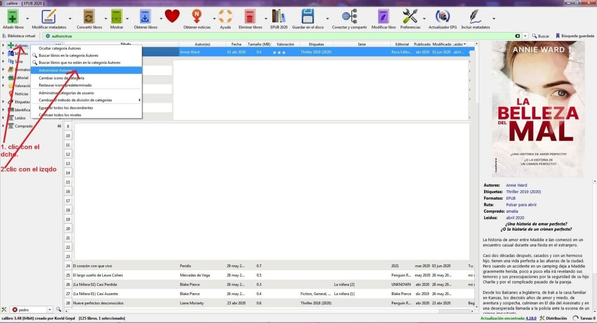
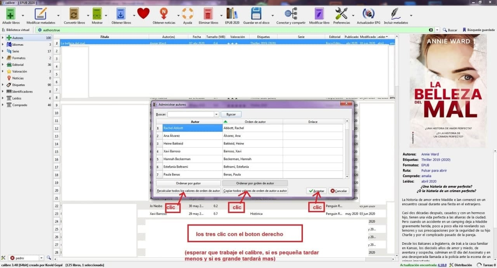
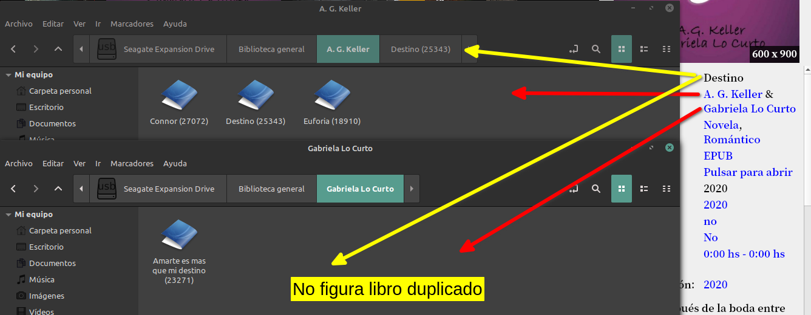

# Autores secundarios - evitar doble carpeta

:material-account: [Walter](https://t.me/Dunhill69){ target=_blank } · :material-link-variant: [Ver el original en Telegraph](https://telegra.ph/Autores-secundarios---evitar-doble-carpeta-12-24){ target=_blank }
{ .tut-datos }

---

Una pregunta de @Begoseal

Como archiva Calibre los libros cuando tienen varios autores?

Calibre genera una carpeta por autor pero para evitar que se dupliquen los libros @dunhill 69 suguire tener en el campo autor de los metadatos al autor principal.

@jane\_morris por otro lado nos muestra lo siguente:

Siguiendo los pasos vemos lo siguiente en las carpetas de los autores

Confirmado lo que ha explicado @jane\_morris @Begoseal. Es recomendable ver el interior de la carpeta de los autores secundarios, para no borras libros de ellos. En este caso el libro se llama "Destino" y si bien en el detalle del libro sale con dos autores en las carpetas de Autores lo registra en el autor principal.

ir al mensaje: [https://t.me/calibreconfiguraciones/26991](https://t.me/calibreconfiguraciones/26991)

[https://telegra.ph/Autores-secundarios---evitar-doble-carpeta-12-24](https://telegra.ph/Autores-secundarios---evitar-doble-carpeta-12-24)

## [Volver al inicio](https://telegra.ph/Indice-Calibre-en-Espa%C3%B1ol-10-03)

##  

 

 

 

---

[:material-arrow-left: Volver al índice](../../alfabetico.md) · [:fontawesome-brands-telegram: Preguntar en el grupo](https://t.me/calibreconfiguraciones){ target=_blank }
