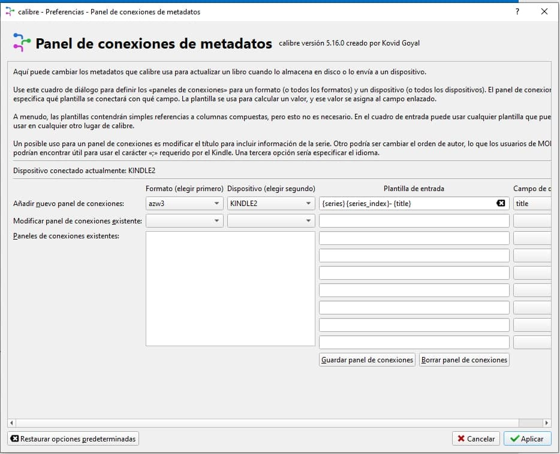

# AZW3: cómo enviarlo al Kindle

:material-account: [@moscon](https://t.me/Dunhill69){ target=_blank } · :material-link-variant: [Ver el original en Telegraph](https://telegra.ph/AZW3-Como-enviarlo-al-Kindle-por-moscon-10-24){ target=_blank }
{ .tut-datos }

---

Hizo fue cambiar en Preferencias, Panel de metadatos y hacer esto, con el kindle conectado:

Ir al mensaje: [https://t.me/calibreconfiguraciones/36621](https://t.me/calibreconfiguraciones/36621)

 

## [Volver al inicio](https://telegra.ph/Indice-Calibre-en-Espa%C3%B1ol-10-03)

##  

 

 

---

[:material-arrow-left: Volver al índice](../../alfabetico.md) · [:fontawesome-brands-telegram: Preguntar en el grupo](https://t.me/calibreconfiguraciones){ target=_blank }
