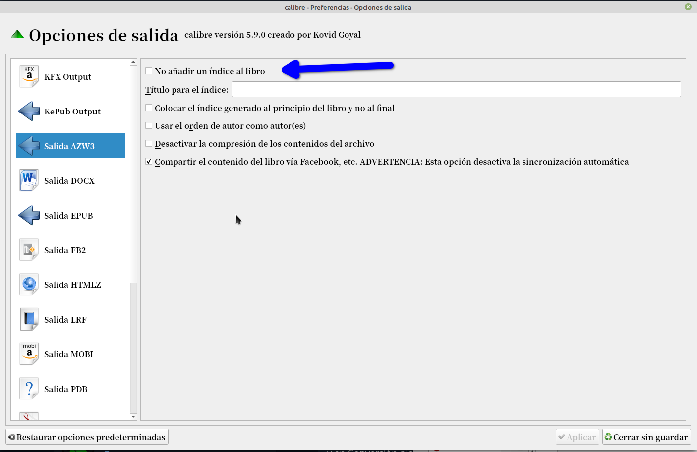

# AZW3: evitar poner índice

:material-account: [Walter](https://t.me/Dunhill69){ target=_blank } · :material-link-variant: [Ver el original en Telegraph](https://telegra.ph/Azw3-evitar-poner-indice-01-14){ target=_blank }
{ .tut-datos }

---

Una pregunta de @moscon

Una pregunta, como puedo hacer en calibre que al convertir por ejemplo de epub a azw3, no me genere ningún índice.

Ya ví la solución. Vas a Herramientas, Preferencias y en Conversión picas en Opciones de salida, te pones en la salida AZW3 y marcas la primera opción que es NO añadir índice al libro, y con eso las conversiones que hagas ya no te lo pone.

Ir al mensaje: [https://t.me/calibreconfiguraciones/28513](https://t.me/calibreconfiguraciones/28513)

[https://telegra.ph/Azw3-evitar-poner-indice-01-14](https://telegra.ph/Azw3-evitar-poner-indice-01-14)

## [Volver al inicio](https://telegra.ph/Indice-Calibre-en-Espa%C3%B1ol-10-03)

##  

 

 

 

---

[:material-arrow-left: Volver al índice](../../alfabetico.md) · [:fontawesome-brands-telegram: Preguntar en el grupo](https://t.me/calibreconfiguraciones){ target=_blank }
