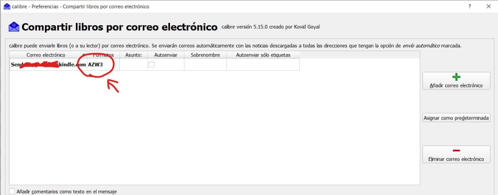
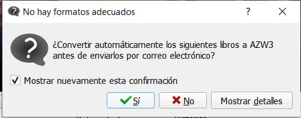

# AZW3: solo por cable

:material-account: [@SrPelosNecios](https://t.me/Dunhill69){ target=_blank } · :material-link-variant: [Ver el original en Telegraph](https://telegra.ph/AZW3-Solo-por-cable-10-24){ target=_blank }
{ .tut-datos }

---

## por @SrPelosNecios

Bueno, a raíz de la solución de Javi para forzar el envío por cable de los archivos AZW3 al Kindle, aplique la misma lógica para hacerlo por correo electrónico y funciona!

En preferencias, ir a "Compartir libros por correo electrónico" y dejar solo AZW3 en la columna "formato"

Cuando seleccionas el envío, si el formato AZW3 no existe, pregunta si quieres convertir. Y listo!

Se envía por mail en formato AZW3. Supongo que es lo mismo para cualquier otro formato de nuestra preferencia.

 

Ir al mensaje: [https://t.me/calibreconfiguraciones/36630](https://t.me/calibreconfiguraciones/36630)

## [Volver al inicio](https://telegra.ph/Indice-Calibre-en-Espa%C3%B1ol-10-03)

##  

 

 

---

[:material-arrow-left: Volver al índice](../../alfabetico.md) · [:fontawesome-brands-telegram: Preguntar en el grupo](https://t.me/calibreconfiguraciones){ target=_blank }
