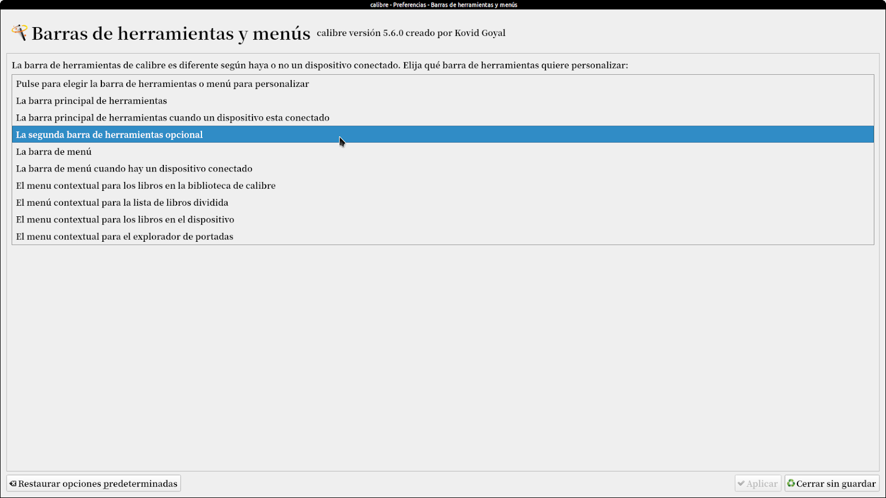
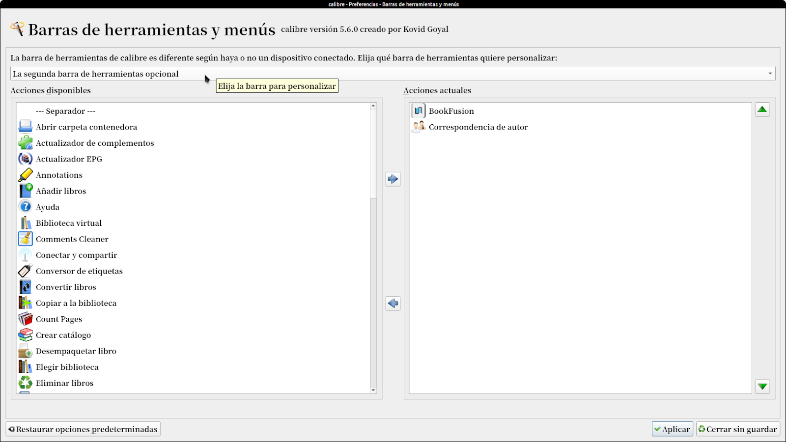
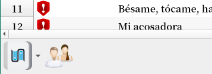

# Barra de herramientas secundaria

:material-account: [Walter](https://t.me/Dunhill69){ target=_blank } · :material-link-variant: [Ver el original en Telegraph](https://telegra.ph/Barra-de-Herramienta-secundaria-10-24){ target=_blank }
{ .tut-datos }

---

Para Activarla vamos a preferencias/ barra de herramientas

Seleccionamos barra secundaria opcional

Y pasamos los iconos que queremos a ella.

Y se ve en la parte inferior izquierda.

ir al mensaje: [https://t.me/calibreconfiguraciones/25725](https://t.me/calibreconfiguraciones/25725)

## [Volver al inicio](https://telegra.ph/Indice-Calibre-en-Espa%C3%B1ol-10-03)

## 

##  

 

---

[:material-arrow-left: Volver al índice](../../alfabetico.md) · [:fontawesome-brands-telegram: Preguntar en el grupo](https://t.me/calibreconfiguraciones){ target=_blank }
