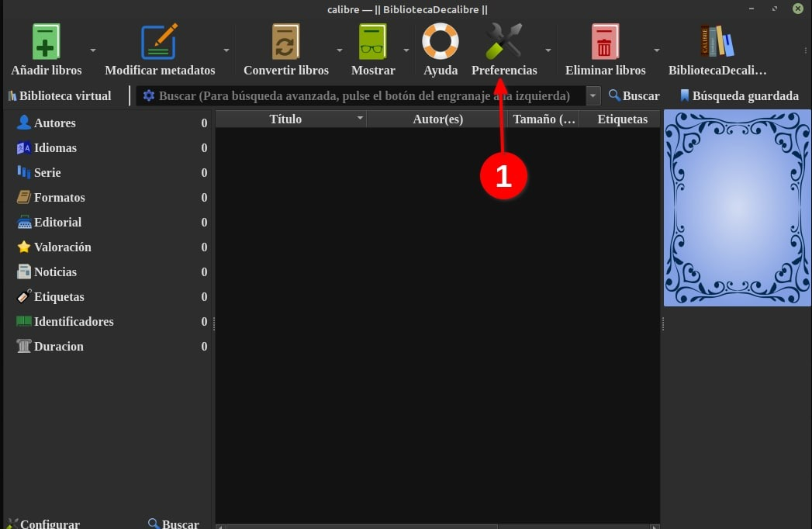
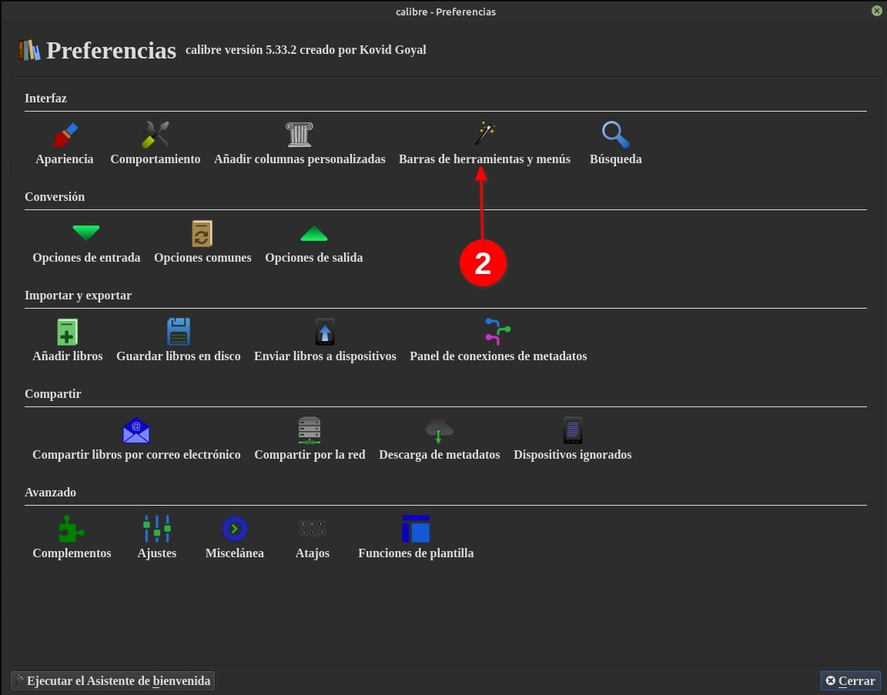
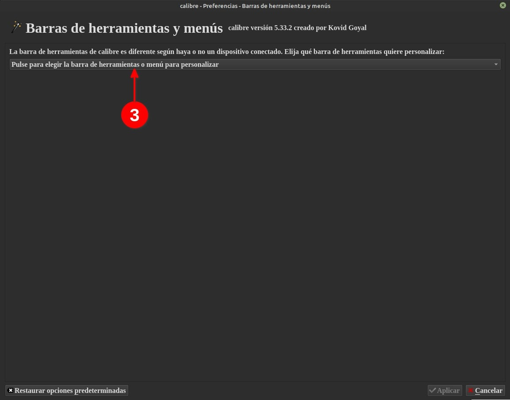
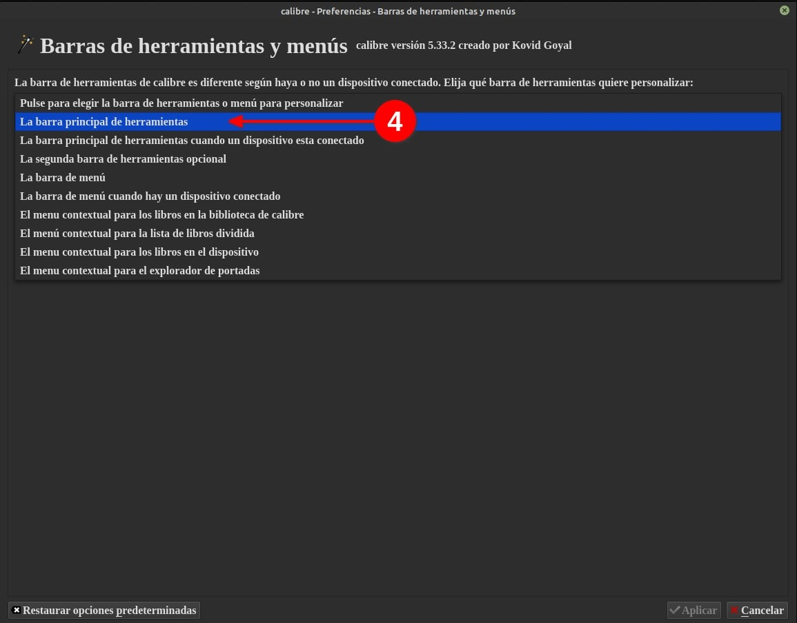
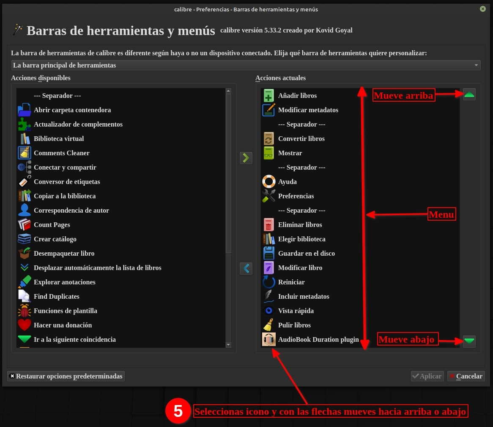

# Barra de herramientas - ubicar íconos

:material-account: [Walter](https://t.me/Dunhill69){ target=_blank } · :material-link-variant: [Ver el original en Telegraph](https://telegra.ph/Barra-de-herramientas-Cambiar-ubicaci%C3%B3n-de-iconos-12-15){ target=_blank }
{ .tut-datos }

---

Explicado por @Llogur

Vamos a preferencia

Buscamos Barra de herramientas.

En barra de herramientas principal.

Seleccionamos barra de herramientas principal.

Seleccionamos el icono de la columna derecha y con los triángulos verdes subimos o bajamos el icono a la ubicación deseada.

Volver al inicio

 

---

[:material-arrow-left: Volver al índice](../../alfabetico.md) · [:fontawesome-brands-telegram: Preguntar en el grupo](https://t.me/calibreconfiguraciones){ target=_blank }
