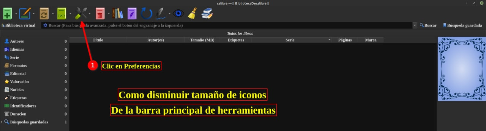
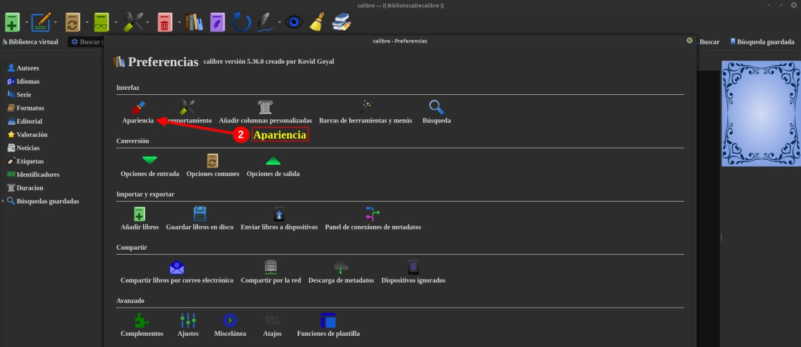
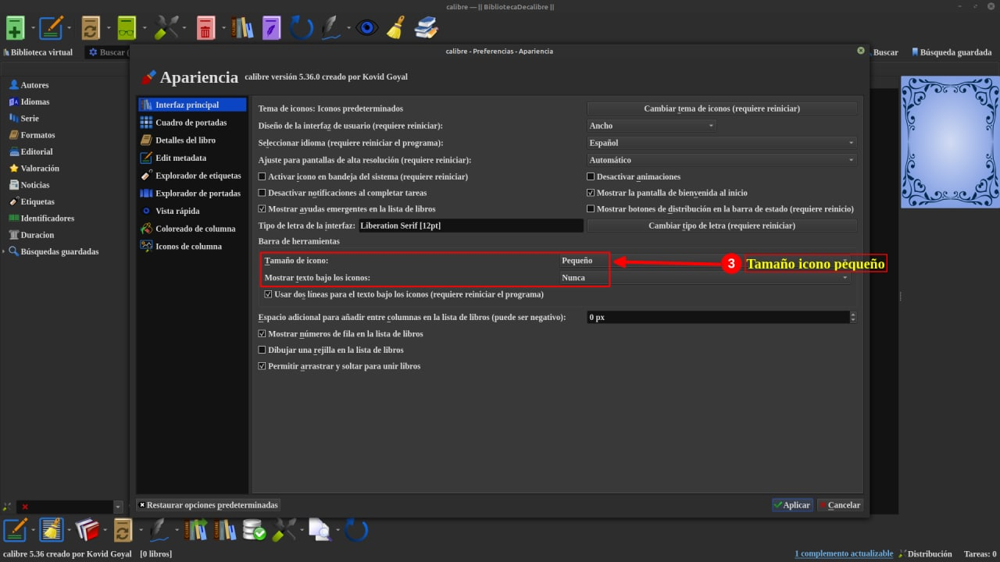
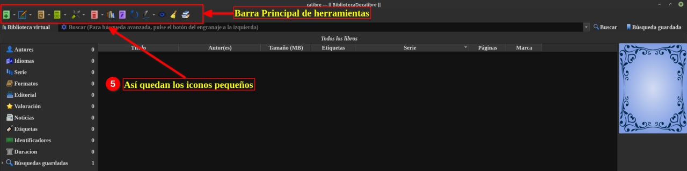

# Barra de herramientas - ver más íconos

:material-account: [@Llogur](https://t.me/Dunhill69){ target=_blank } · :material-link-variant: [Ver el original en Telegraph](https://telegra.ph/Barra-de-herramientas---Ver-m%C3%A1s-iconos-02-06){ target=_blank }
{ .tut-datos }

---

El amigo @Llogur nos envia unas capturas de pantalla de como hacer para que nos entren más iconos, sigamos los siguientes pasos:

Ir al mensaje: [https://t.me/calibreconfiguraciones/66037](https://t.me/calibreconfiguraciones/66037)

## [Volver al inicio](https://telegra.ph/Indice-Calibre-en-Espa%C3%B1ol-10-03)

 

 

---

[:material-arrow-left: Volver al índice](../../alfabetico.md) · [:fontawesome-brands-telegram: Preguntar en el grupo](https://t.me/calibreconfiguraciones){ target=_blank }
