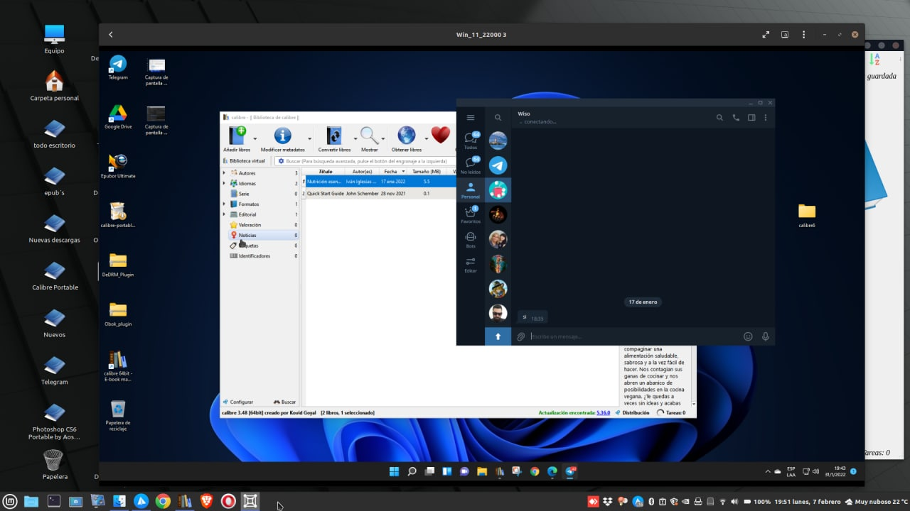
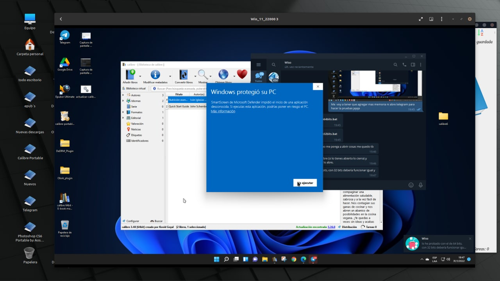
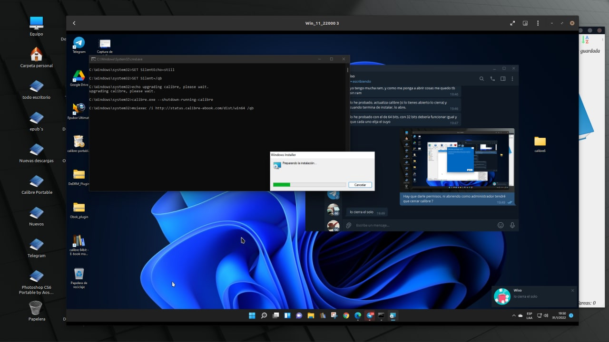
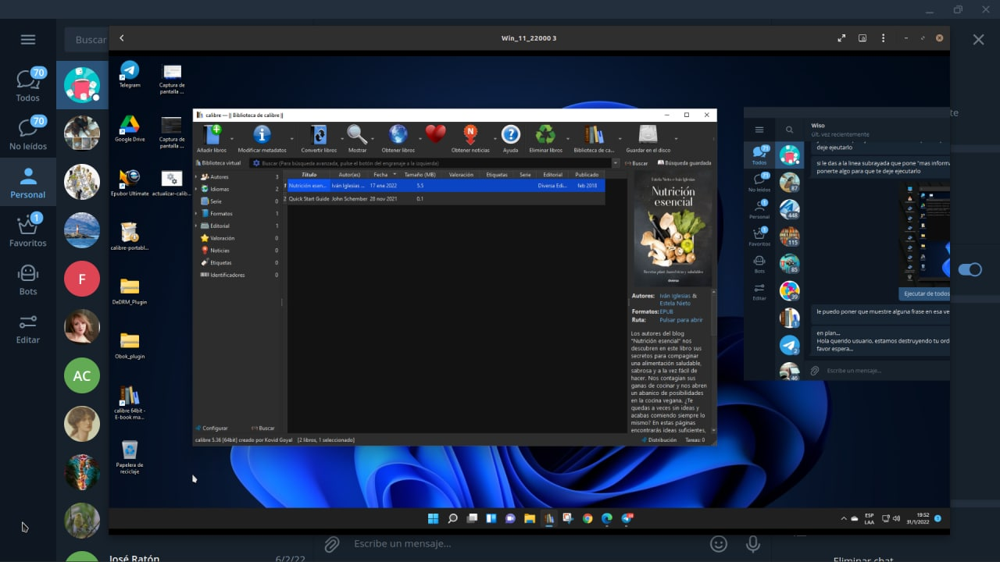

# Bat para actualizar Calibre (Windows)

:material-account: [@wiso\_wolo](https://t.me/Dunhill69){ target=_blank } · :material-link-variant: [Ver el original en Telegraph](https://telegra.ph/Bat-para-autoactualizar-Calibre-Windows-09-04){ target=_blank }
{ .tut-datos }

---

Estuve hablando con @wiso\_wolo , porque encontré un actualizador automático de Calibre, le pase lo encontrado y el hizo su magia. Solo para el grupo de Calibre en Español, por el momento dos .bat para actualizar Calibre con un simple Click. Lo que hacen estos bat es actualizar a la ultima versión de Calibre. Están para versión 32 y 64 bit SOLO PARA WINDOWS.

[:material-play-circle: Ver video](https://telegra.ph/embed/telegram?url=https%3A%2F%2Ft.me%2Fcalibreconfiguraciones%2F66246){ target=_blank }

Calibre 3.48 en windows 11 ( maquina virtual)

Corriendo el bat en modo administrador Tocamos donde dice mas información y Ejecutar de todos modos.

Proceso de actualización...

Calibre actualizado !!

Felicitaciones por tu trabajo @wiso\_wolo !!!

Ir al mensaje:[https://t.me/calibreconfiguraciones/66245](https://t.me/calibreconfiguraciones/66245)

🚨 Esten atentos a los bit de sus windows, demas esta decir que No nos hacemos responsable de un mal funcionamiento aunque todo funciona como se espera 🚨 Jane no lo pruebes porque actualiza de verdad !!!

## [Volver al inicio](https://telegra.ph/Indice-Calibre-en-Espa%C3%B1ol-10-03)

 

---

[:material-arrow-left: Volver al índice](../../alfabetico.md) · [:fontawesome-brands-telegram: Preguntar en el grupo](https://t.me/calibreconfiguraciones){ target=_blank }
