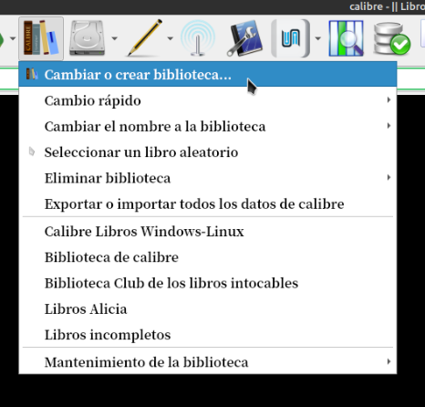
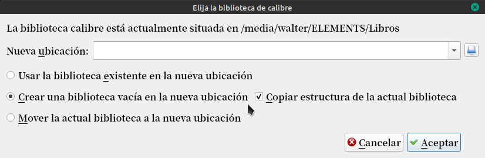

# Biblioteca con características

:material-account: [Walter](https://t.me/Dunhill69){ target=_blank } · :material-link-variant: [Ver el original en Telegraph](https://telegra.ph/Biblioteca-con-caracter%C3%ADsticas-08-16){ target=_blank }
{ .tut-datos }

---

Cuando creamos una biblioteca y ya tenemos otra configurada a nuestro gusto, como hacer para mantener usos patrones.

Primero creamos una carpeta con el nombre de la nueva biblioteca.

Vamos al icono de Biblioteca en Calibre y marcamos Cambiar o Crear biblioteca

Seleccionamos Crear una biblioteca vacía en la nueva ubicación y marcamos Copiar estructura de la actual biblioteca. En donde dice nueva ubicación buscamos con el cuadradito azul el lugar donde esta la carpeta que creamos.

 

## [Volver al inicio](https://telegra.ph/Indice-Calibre-en-Espa%C3%B1ol-10-03)

## 

 

---

[:material-arrow-left: Volver al índice](../../alfabetico.md) · [:fontawesome-brands-telegram: Preguntar en el grupo](https://t.me/calibreconfiguraciones){ target=_blank }
