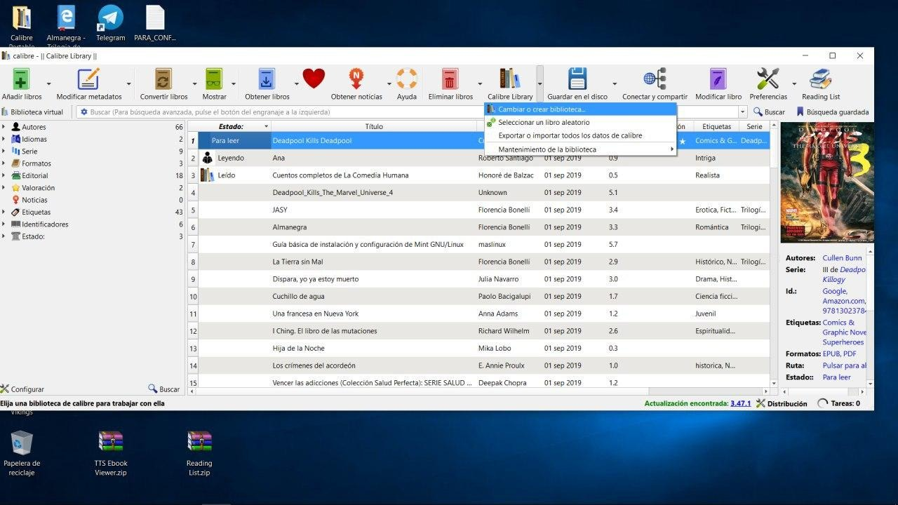
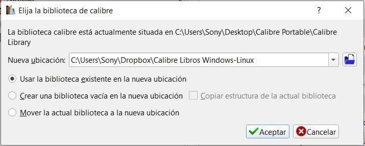
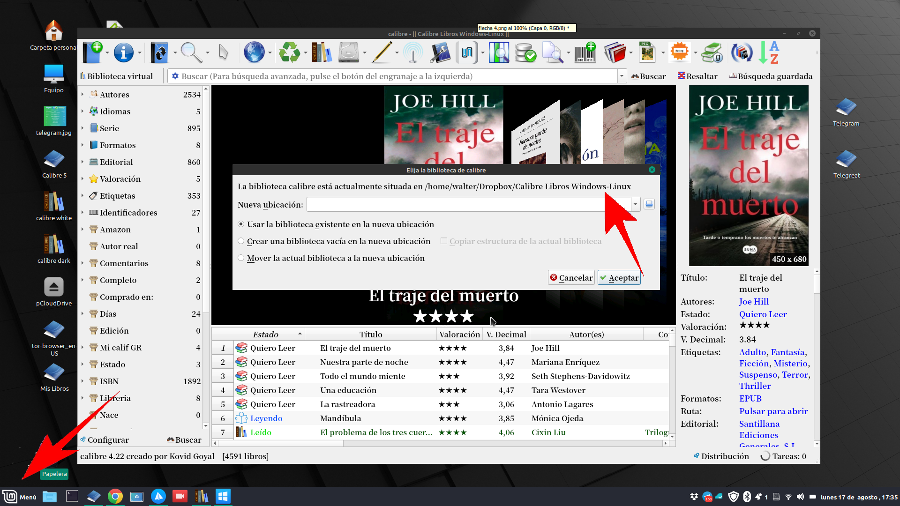

# Biblioteca en la nube

:material-account: [Walter](https://t.me/Dunhill69){ target=_blank } · :material-link-variant: [Ver el original en Telegraph](https://telegra.ph/Biblioteca-en-la-nube-08-17){ target=_blank }
{ .tut-datos }

---

Vamos a pasar la biblioteca a dropbox, el mismo sistema sirve para cualquier servicio de nube que nos de una carpeta en el disco local. Tocamos el icono librería Calibre Flecha lateral - Cambiar o Crear una Biblioteca, marcamos la ultima opción mover la actual biblioteca a una nueva ubicación.

En el renglón de la nueva ubicación ( Carpeta azul ) nos desplazamos hasta el directorio donde este la carpeta de dropbox

Nos tiene que quedar algo así la ruta de la carpeta dropbox, pero con la opción de **mover marcada** tocamos aceptar y esperamos a que se sincronice todo depende del tamaño de la biblioteca que tengamos el tiempo puede variar.

Y para tener calibre en otras maquinas una vez instalado calibre debemos repetir el primer y segundo paso pero en lugar de mover marcaremos USAR BIBLIOTECA EXISTENTE EN LA NUEVA UBICACIÓN y marcamos la misma ruta de la carpeta Dropbox esta sincronización también tarda de acuerdo al tamaño de la biblioteca.

## [Volver al inicio](https://telegra.ph/Indice-Calibre-en-Espa%C3%B1ol-10-03)

##  

 

---

[:material-arrow-left: Volver al índice](../../alfabetico.md) · [:fontawesome-brands-telegram: Preguntar en el grupo](https://t.me/calibreconfiguraciones){ target=_blank }
