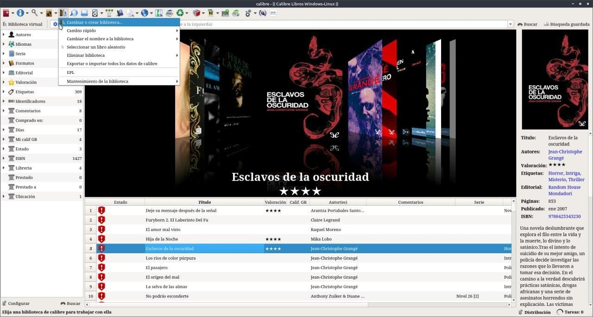
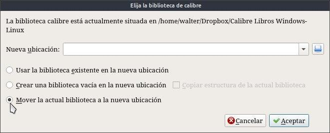

# Biblioteca - moverla de ubicación

:material-account: [Walter](https://t.me/Dunhill69){ target=_blank } · :material-link-variant: [Ver el original en Telegraph](https://telegra.ph/Biblioteca---Moverla-de-ubicaci%C3%B3n-09-05){ target=_blank }
{ .tut-datos }

---

Como mover la biblioteca , ya sea para ponerla en un disco externo o en la carpeta dropbox, solo hay que navegar entre las opciones de configuración. Y hacer clic en el icono de calibre y tocamos en Cambiar o crear una biblioteca, nos salen tres opciones:

Ahora indicaremos la nueva ruta (carpeta) y seleccionaremos la opción que más nos convenga:

 

1-Usar la biblioteca existente en la nueva ubicación: se usa principalmente para agregar una biblioteca preexistente a una instalación de Calibre, por ejemplo, cuando formateas o cambias el ordenador.

2- Crear una biblioteca vacía en la nueva ubicación: sirve para crear una nueva biblioteca de Calibre.

3-Mover la biblioteca actual a la nueva ubicación: esta es la opción que yo quiero en mi caso. Voy a mover la biblioteca que estoy usando a una nueva carpeta que puede estar en otro disco duro o partición. De esta manera los ficheros individuales (los e-books) se moverán a la nueva ubicación, incluido el fichero de base de datos de Calibre donde se guardan todos los metadatos.

## [Volver al inicio](https://telegra.ph/Indice-Calibre-en-Espa%C3%B1ol-10-03)

## 

 

---

[:material-arrow-left: Volver al índice](../../alfabetico.md) · [:fontawesome-brands-telegram: Preguntar en el grupo](https://t.me/calibreconfiguraciones){ target=_blank }
