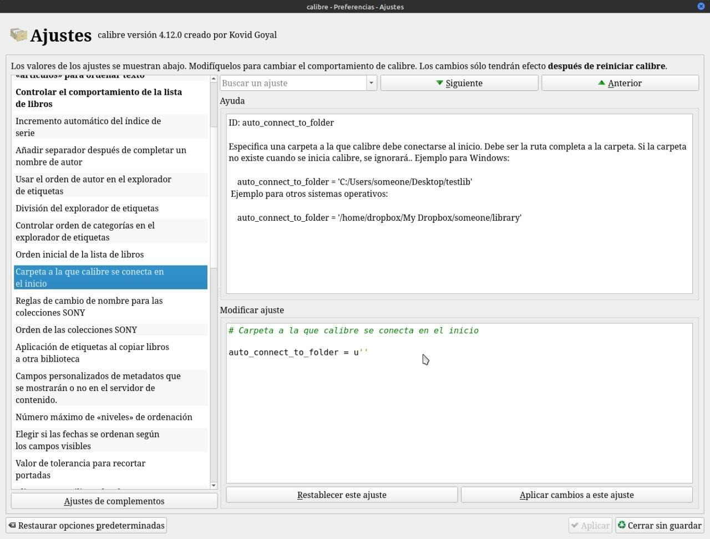

# Biblioteca por defecto

:material-account: [Walter](https://t.me/Dunhill69){ target=_blank } · :material-link-variant: [Ver el original en Telegraph](https://telegra.ph/Biblioteca-por-defecto-08-16){ target=_blank }
{ .tut-datos }

---

Para que cada vez que iniciamos Calibre nos muestre nuestra biblioteca principal, deberemos ir a Preferencias / Ajustes y le pones la ruta de la carpeta de la biblioteca que quieres.

## [Volver al inicio](https://telegra.ph/Indice-Calibre-en-Espa%C3%B1ol-10-03)

## 

 

---

[:material-arrow-left: Volver al índice](../../alfabetico.md) · [:fontawesome-brands-telegram: Preguntar en el grupo](https://t.me/calibreconfiguraciones){ target=_blank }
