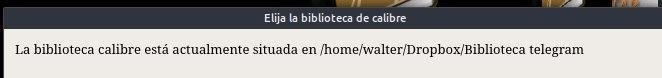
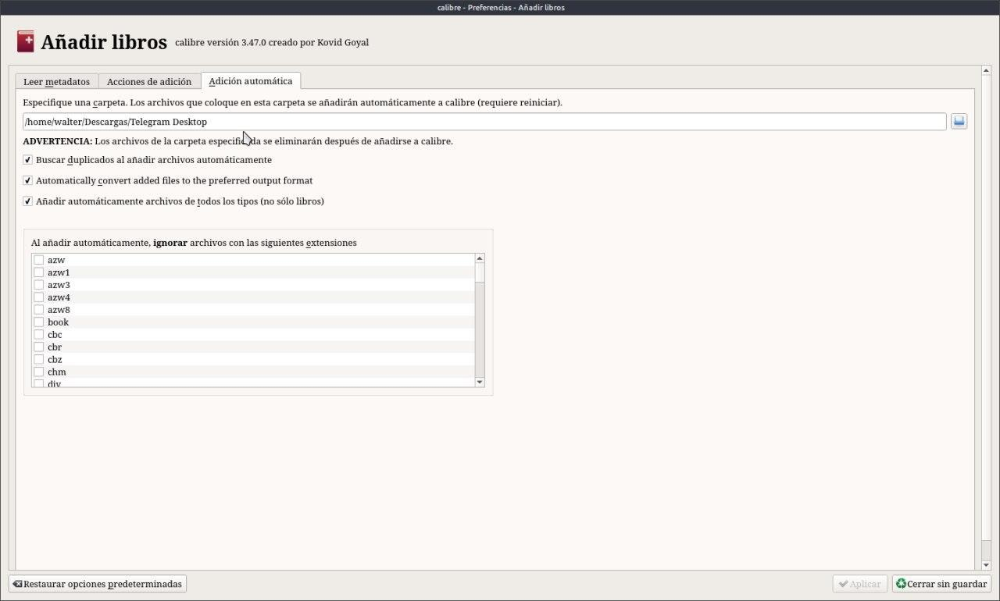
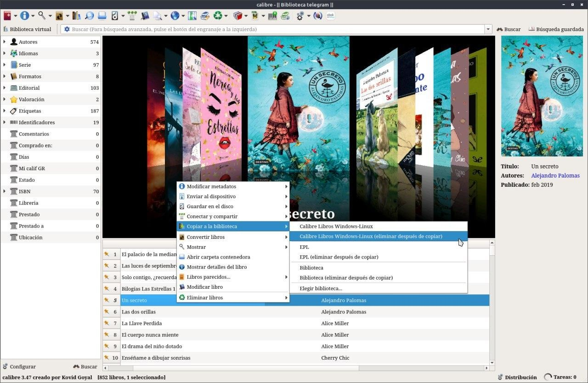

# Biblioteca Telegram

:material-account: [Walter](https://t.me/Dunhill69){ target=_blank } · :material-link-variant: [Ver el original en Telegraph](https://telegra.ph/Biblioteca-Telegram-08-16){ target=_blank }
{ .tut-datos }

---

Hola gente estaba pensando en la manera de automatizar la carga de los libros que descargamos de Telegram y que pasen a la biblioteca de Calibre. Gracias a la interacción de Telegram de la descargas automáticas se me ocurrió lo siguiente. En Calibre cree una nueva Biblioteca que llame "Biblioteca Telegram"

Después entre en Preferencias / Añadir libro y le agregue la ruta donde se descarga las cosas de Telegram en mi caso Descargas/Descargas Telegram. Reiniciamos Calibre y de esta manera cada vez que estemos revisando nuestros grupos de literatura en Telegram se irán cargando los libros que se descarguen de forma automática.

Después selecciono el libro que me interesa y con botón derecho copiar a la biblioteca que tengamos como principal, opción borrar después de copiar.

## [Volver al inicio](https://telegra.ph/Indice-Calibre-en-Espa%C3%B1ol-10-03)

 

---

[:material-arrow-left: Volver al índice](../../alfabetico.md) · [:fontawesome-brands-telegram: Preguntar en el grupo](https://t.me/calibreconfiguraciones){ target=_blank }
