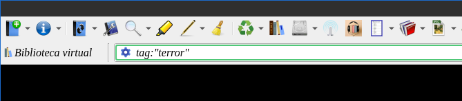
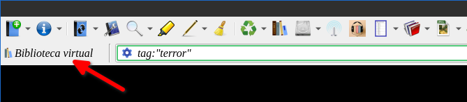
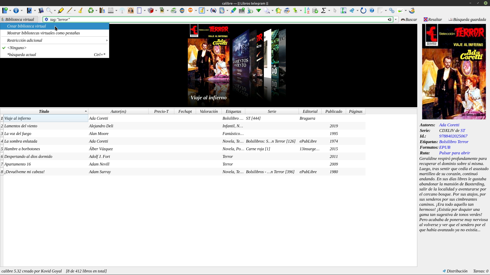
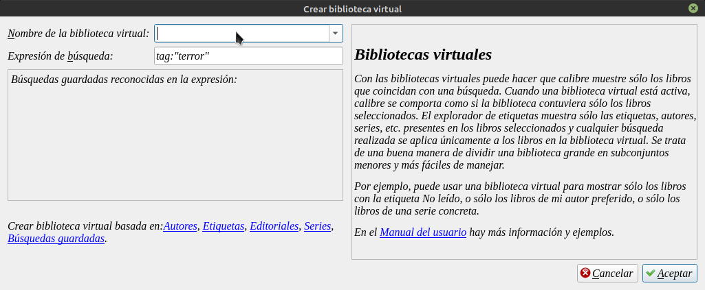
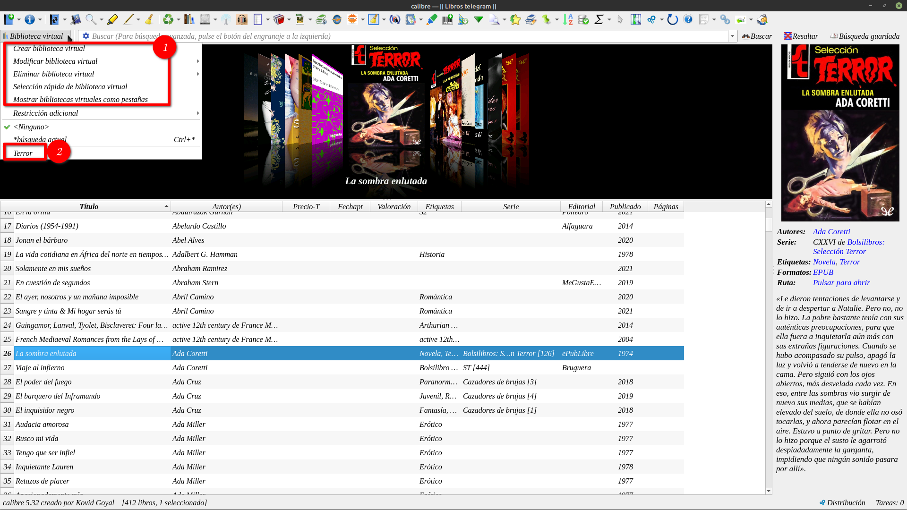
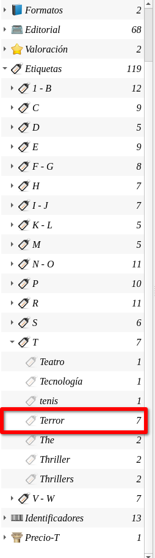
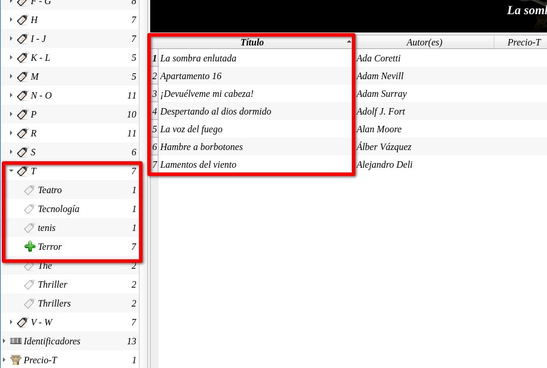

# Bibliotecas virtuales - creación

:material-account: [Walter](https://t.me/Dunhill69){ target=_blank } · :material-link-variant: [Ver el original en Telegraph](https://telegra.ph/Biblioteca-Virtual---Creaci%C3%B3n-11-25){ target=_blank }
{ .tut-datos }

---

En este momento vamos a crear una biblioteca Virtual de Terror, La podremos crear de cualquier etiqueca que quisieramos.

En la barra de busqueda escribimos tag:"Terror" y nos devolverá todas las etiquetas de terror que tengamos.

Ahora tocamos donde dice Biblioteca Virtual

 

Tocamos en crear biblioteca virtual

Nos aparece un cartel para poner un nombre que nos sirva de referencia. Y le damos en Aceptar.

Esto funciona como un filtro que tocando en el boton de Bibliotecas Virtuales aparece un listado de las que hayamos creado.

En los campos superiores todo lo necesario para las modificaciones o eliminarlas.(1)

(2) Listado de las creadas.

Obviamente esto se puede hacer de otra manera en Calibre:

Desde etiquetas seleccionar Terror.

Las dos maneras son provisorias, lo que quiero decir es que si estamos trabajando con una biblioteca virtual al iniciar Calibre aparece la biblioteca "General" digamos no abre calibre con una Biblioteca Virtual.

ir al mensaje: [https://t.me/calibreconfiguraciones/55054](https://t.me/calibreconfiguraciones/55054)

## [Volver al inicio](https://telegra.ph/Indice-Calibre-en-Espa%C3%B1ol-10-03)

 

 

---

[:material-arrow-left: Volver al índice](../../alfabetico.md) · [:fontawesome-brands-telegram: Preguntar en el grupo](https://t.me/calibreconfiguraciones){ target=_blank }
