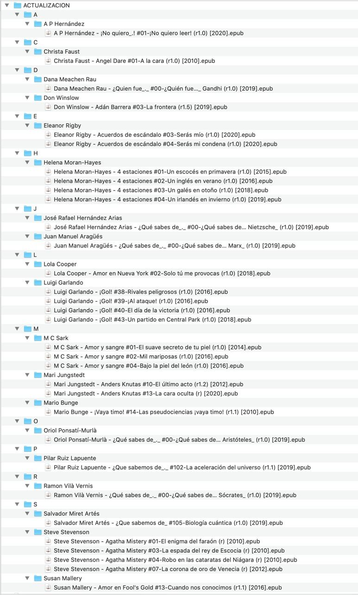

# Bibliotecas virtuales - búsquedas guardadas

:material-account: [@Inatxo](https://t.me/Dunhill69){ target=_blank } · :material-link-variant: [Ver el original en Telegraph](https://telegra.ph/Bibliotecas-Virtuales--Busquedas-guardadas-10-26){ target=_blank }
{ .tut-datos }

---

Explicado por @Inatxo

No sé si me estoy pasando, pero parece que el tema de las búsquedas (y las búsquedas guardadas –convertidas o no en bibliotecas virtuales–) puede ser muy útil a la par que interesante… si así no lo fuera, discúlpame.

Lo presento en plan tutoría, por lo que entiendo que para la mayoría muchos de los conceptos son conocidos

Las utilizo muchísimo sobre todo a la hora de ‘purgar’, si se me permite la expresión, los libros incorporados.

 

A.- Pero primero, las búsquedas…

 

Esencialmente son de dos tipos, las ”Y” (AND) y las  “O” (OR).

 

1) Con las  ”Y” (AND) estamos indicando que TODOS los parámetros que especificamos HAN DE CUMPLIRSE.

Por ejemplo, puedo buscar libros que “no estén en Español”, sean “mayores de 100 páginas” y “pesen más de 20 megas”.

 

La expresión (en la barra de búsquedas) sería:

not languages:"=Español" and #pages:"\>100" and size:"\> 20000000”

Obviamente hay que tener una columna donde se contabilizan las páginas (llamada #pages) y tener otra (donde se contabilice el tamaño de los libros, llamada size) donde en las búsquedas hay que tener en cuenta poner la cantidad en bytes, es decir 1 Mb son 1.000.000 de bytes y así hay que especificarlo

 

El resultado  (en mi biblioteca) son 10 libros

 

2) Con las  “O” (OR) indicamos que se han de cumplir AL MENOS UNO de los parámetros, o los dos, o los tres…

 

Poniendo la misma expresión de búsqueda y cambiando los  “and” por  “or”

not languages:"=Español" or #pages:"\>100" or size:"\> 20000000”

 

Cambian tanto las cosas que me proporciona 2771 resultados de libros que cumplen uno, dos o los tres parámetros

 

 

B.- En el caso que haya búsquedas que repitamos mucho…

Por ejemplo, soy muy constante en buscar libros que carezcan de carátula (portada).

La expresión ha emplear es: cover:false . De este modo puedo buscar la carátula con el mismo CALIBRE (p.e. pinchando en «MODIFICAR METADATOS» en el MENU, o apretando CRTL+D) y eligiendo p.e.  «DESCARGAR SOLO CARÁTULAS»  (luego reviso las descargadas para ver si se ha confundido o nó, a veces da errores en libros que tienen el mismo título y diferente autor)

 

Pues bien, como es una búsqueda que empleo mucho, después de realizar y viéndola expresión en la barra de búsquedas pincho sobre el icono de la derecha del todo de la barra (que es como una cruz blanca sobre un fondo verde, y que si ponemos el cursor encima aparece el mensaje:  “Guardar la búsqueda actual………”) y si pinchamos sobre el icono sin soltar hay tres opciones: Crear búsqueda guardada;  Borrar búsqueda guardada;  Administrar búsquedas guardadas.

 

Elegimos la primera opción y le damos nombre, con lo que en la cajita de búsqueda de su izq, aparece ya la nueva búsqueda guardada y si en el  «EXPLORADOR DE ETIQUETAS» tenemos el epígrafe  “BÚSQUEDAS GUARDADAS” también la veremos allí, de modo que la siguiente vez que nuevamente deseemos buscar libros que no tengan carátula, basta con que hagamos click en uno u otro lugar de los indicados para que aparezcan esos libros…

 

OTRAS BÚSQUEDAS QUE TENGO SISTEMATIZADAS SON

• format:true \[son libros que puedo tener reseñados en la biblioteca pero que no tengo en ningún formato, es decir libros que me gustaría tener\]

 

• authors:"." \[porque le quito el ‘.’ al nombre de los autores\] (en lugar de ?Rogers, Carl R.’ Le quito el punto de después de la R, dejándolo “Rogers, Carl R”)

 

• authors:" y ”  \[porque busco aquellos libros que tienen más de un autor y sustituyo la “y”, o la  “,” o el símbolo  “/”, por  “&”\] (authors:" , ”; authors:" / ” )

 

• authors:”)” \[con esta búsqueda veo los autores que en el nombre incluyen palabras como  “(ed.)” o “(coord.)”, etc\]

 

• languages:false \[con esta búsqueda encuentro aquellos libros en los que no se ha especificado el idioma\]

 

• title:”)” \[con esta búsqueda encuentro los libros que incluyen palabras como  “(Spanish edicton)” o “(versión original)”o “(volumen independiente)”, etc\]

 

• not #formatos:"=EPUB"  \[encuentro los libros que no están en EPUB\] • not #formatos:"=pdf" \[así los que no están en pdf… jajaja\]

 

•not authors:”,” \[Como guardo los autores en formato Apellidos, Nombre\] con esta expresión encuentro aquellos que aún no los he puesto así como me gusta.

Ah! Para ésto hay una funcionalidad muy interesante que se encuentra en la esquina inferior izq de la pantalla. Presionando en el icono de las ruedecitas… se encuentran pas posibilidades de 1) Ordenar por… 2) Tipo de búsqueda… y 3)Administrar Autores, etiquetas…, pues bien pulsando en “Administrar Autores”, sale una tabla muy interesante en el que aparecen dos columnas principalmente  “Autor” y “Orden de autor”, de todos los libros que tienes en la biblioteca, pero que desde hace pocas versiones incluye la opción (mostrar solo autores la biblioteca virtual actual) de señalar un cuadrito que lo restringe a la biblioteca virtual desde la que te has adentrado en esta tabla de “Administrar Autores”. Lo que es muy útil si estas incorporando p.e. un montón de libros simultáneamente y pinchando abajo en  “Recalcular todos los valores de ‘orden de autor’” podemos ponerlos tal como nos gusta… y después, pinchando en  “Copiar todos los valores de ‘orden de autor’ en ‘autor’”, podemos tener si queremos como es mi caso iguales uno y otro.

(NB. Lo que no sé es para que sirve la columna titulada “enlace”)

(NB2. También y desde no hace mucho, la columna de ‘Autor’ te permite ver cómo tenías inscrito al autor anteriormente. P.e. Si escribes: “Poe,” te aparece un desplegable que te pone la opción Poe, Edgar Allan…

 

 

Tal vez me estoy alargando mucho…

 

•#version:false \[Para mí es muy importante conocer la versión a la que pertenecen los libros que tengo por lo que tengo una columna que la recoge. Esta búsqueda me permite poner la versión 1.0 (p.e.) a un nuevo libro que no incluya versión al incorporarlo y, de este modo, cuando encuentre libros repetidos entre la fecha de incorporación y la versión me ayuda a descartar el más inadecuado\]

 

• pubdate:"false" \[Para encontrar e incorporar la fecha de publicación de los libros que al incorporarlos a la biblioteca, no la tienen\]

 

• series:"true" \[Con esta búsqueda selecciono todos los libros que pertenezcan a series y así homogeneizo nombres y compruebo su número en la serie\]

•comments:false \[Me permite encontrar los libros que no tienen argumento o sinopsis\]

•tags:”🍏” \[En las etiquetas tengo señalados los libros de cocina, recetas o de salud, con este símbolo. De esta manera encuentro enseguida esta etiqueta\]…

Bueno. Algo muy interesante, útil e importante para mí es que cualquier búsqueda (incluidas o no las guardadas) se puede convertir en una Biblioteca Virtual temporal y para ello basta apretar las teclas «CRTL» («CMD» en Mac) y «+», por lo que si tengo una columna de  «AÑO» y busco en ella 1955 (#año:“1955”) y luego presiono CRTL+ (o presionando en la 2ª barra del MENU en  “Biblioteca Virtual” elijo ‘Búsqueda Actual’) he creado la biblioteca virtual (temporal) 1955 donde puedo hacer búsquedas o restricciones interesantes… Ahora bien, si quiero tenerla para siempre me basta con elegir la 1ª opción  “Crear Biblioteca Virtual”.

 

Digo ésto porque si tu ordenador soporta manejar bien una biblioteca extensa tal vez sea mejor para tí tener todos tus libros en una única biblioteca. Anteriormente la tenia dividida en una General, otra para Cómics (o novela-gráfica), otra para Cocina y Salud, otra de libros no en Español… y otras más, pero haciendo la búsqueda apropiada, guardándola o no, y luego crear una biblioteca virtual uno evita duplicidades de libros…

(p.e. supongamos que hay un libro llamado  “Coma usted bien”, y que le gusta a mi hijo y a mi pareja y a mí mismo…, podría tener el mismo libro repetido 5 veces: Una en la Biblioteca General, otro ejemplar en la de Cocina y Salud, otro en el de mi pareja, otro en la de mi hijo y otro en la mía particular ¡VAYA LIO!  Y nos lo evitan las Biblioteca Virtuales)

 

Acabo con otra utilidad para estas Bibliotecas… Tengo creadas una para cada una de las letras del abecedario  “A” “B”… de modo que buscando en ellas selecciono p.e. todos los libros de aquellos autores cuyo nombre empiece por  “A” (ya estén como primer, segundo o tercer autor, etc, compartiendo autoría) para esta biblioteca “A” la expresión de búsqueda es: author\_sort:"~(^\\s\*\[ÁaA\])"

 

FINALIZO imaginemos que comparto privadamente mis libros con un grupo de amigos, pero a ellos sólo les interesan los que están en Español, sólo en formato EPUB y no quieren para nada los libros de Cocina y Salud.

 

Para ello puedo tener guardada una búsqueda (convertida en Biblioteca Virtual) que llame NOVEDADES en la que (en un campo/columna llamado ‘Actualizar’ con las opciones ‘+’, ’ya’  y ’no’) la expresión de búsqueda habría sido:

#actualizar:“+” and languages:Español and formats:"=EPUB" and not tags:”=🍏"

 

Una vez encontrados los libros a compartir, los exporto con la opción guardar en disco (en la nube), que habría especificado en las preferencias:

ACTUALIZACION/{authors\[0\]}/{authors}/{authors} - {series:\|\| }{series\_index:0\>2s\| #\|-}{title} (r{#version:\|\|}) {#publicado2:\|\|}

 

De modo que se me guardarían en la carpeta ACTUALIZACION  que tengo sincronizada en la nube, con la estructura en la imagen de la página siguiente…

 

Una vez efectuada la actualización, cambiaría el campo ACTUALIZAR ha ‘YA’ por lo que no entrarían en la siguiente actualización…

 

Captura de pantalla 2020-10-26 a las 10.59.08.png ¬

Ir al mensaje: [https://t.me/calibreconfiguraciones/22027](https://t.me/calibreconfiguraciones/22027)

 

## [Volver al inicio](https://telegra.ph/Indice-Calibre-en-Espa%C3%B1ol-10-03)

##  

 

---

[:material-arrow-left: Volver al índice](../../alfabetico.md) · [:fontawesome-brands-telegram: Preguntar en el grupo](https://t.me/calibreconfiguraciones){ target=_blank }
