# Botones de distribución, cómo se usan

:material-account: [Walter](https://t.me/Dunhill69){ target=_blank } · :material-link-variant: [Ver el original en Telegraph](https://telegra.ph/Botones-de-Distribuci%C3%B3n-10-08){ target=_blank }
{ .tut-datos }

---

Para que sirven los botones de Distribución:

En el vertice inferior derecho al lado de las acciones de tareas hay un botón que dice Distribución.

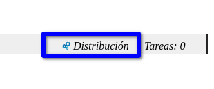

Si tocamos en el aparecen siete opciones, que si estan en gris no estan activas.

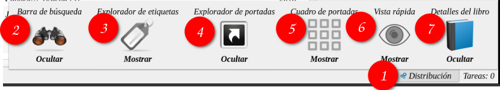

¿Y que hacen estas opciones?

2. Muestra u oculta la Barra de busqueda.

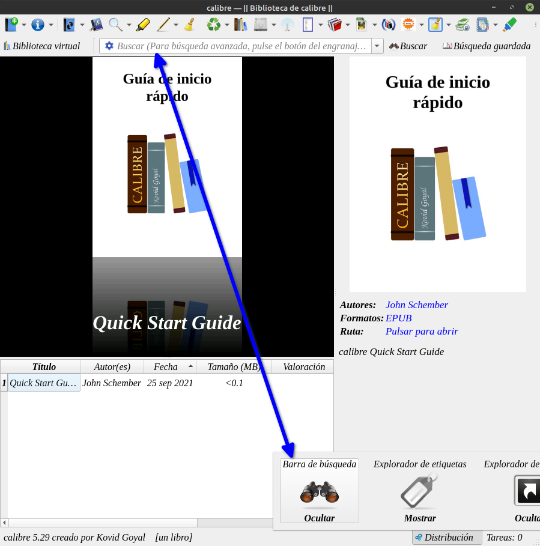

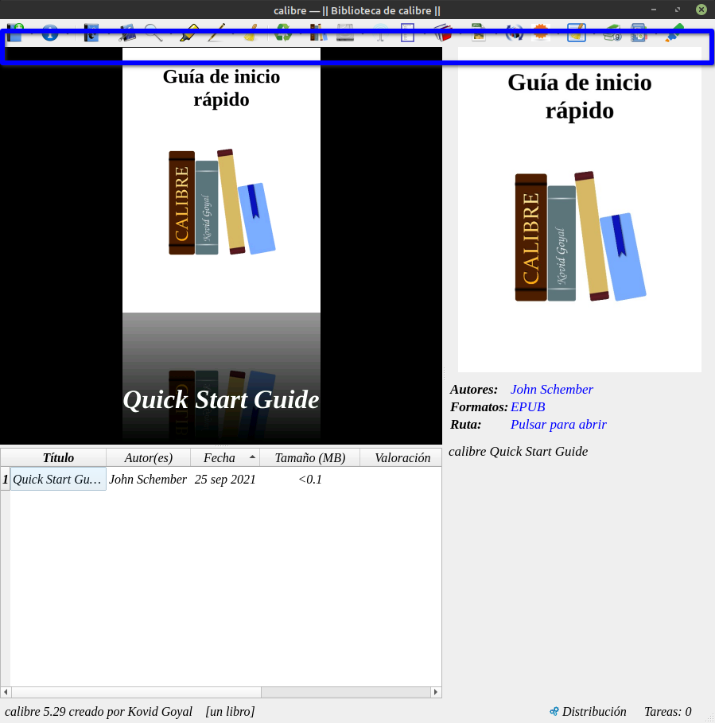

3.Muestra oculta columna de etiquetas.

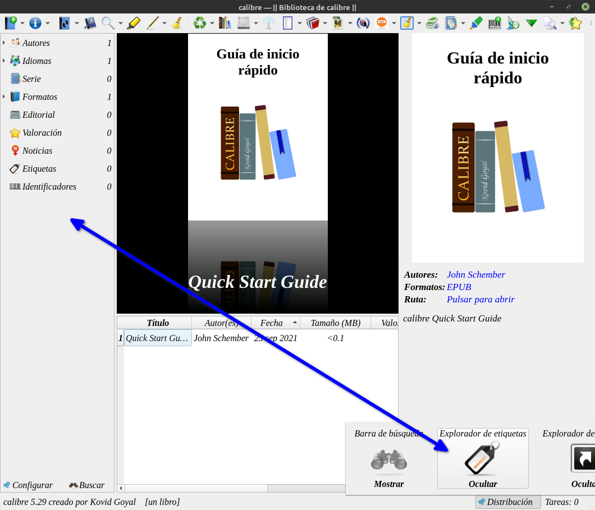

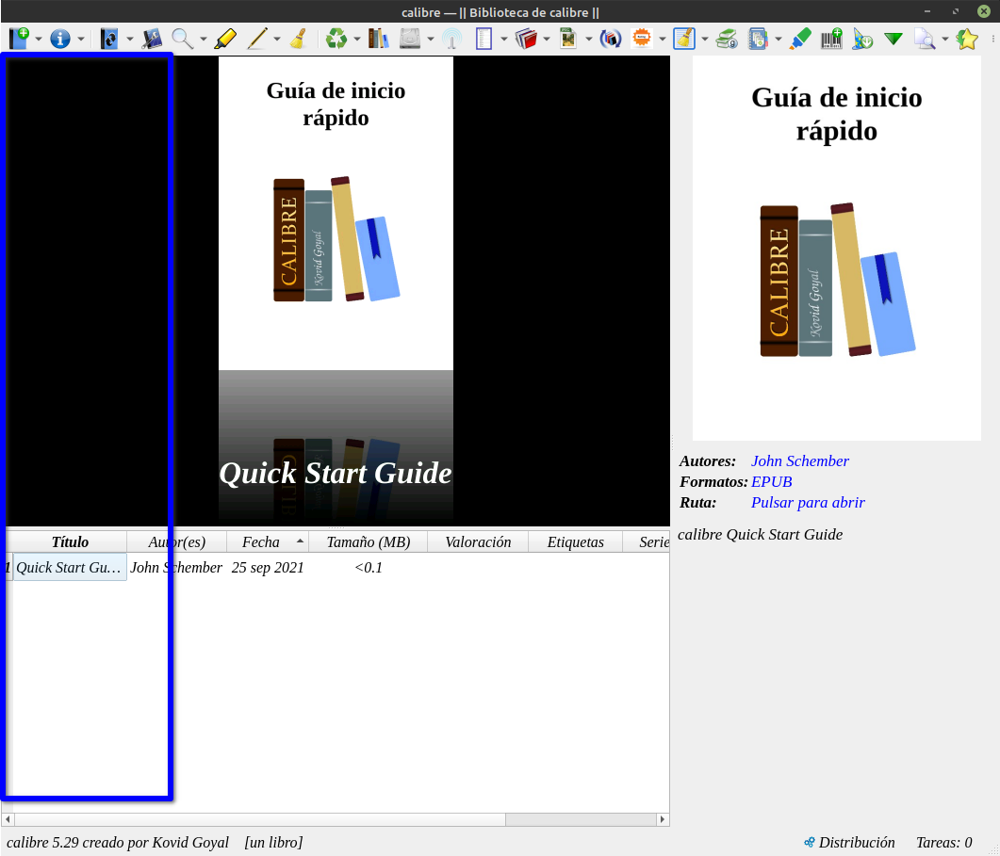

4.Muestra u oculta la muestra de portadas.

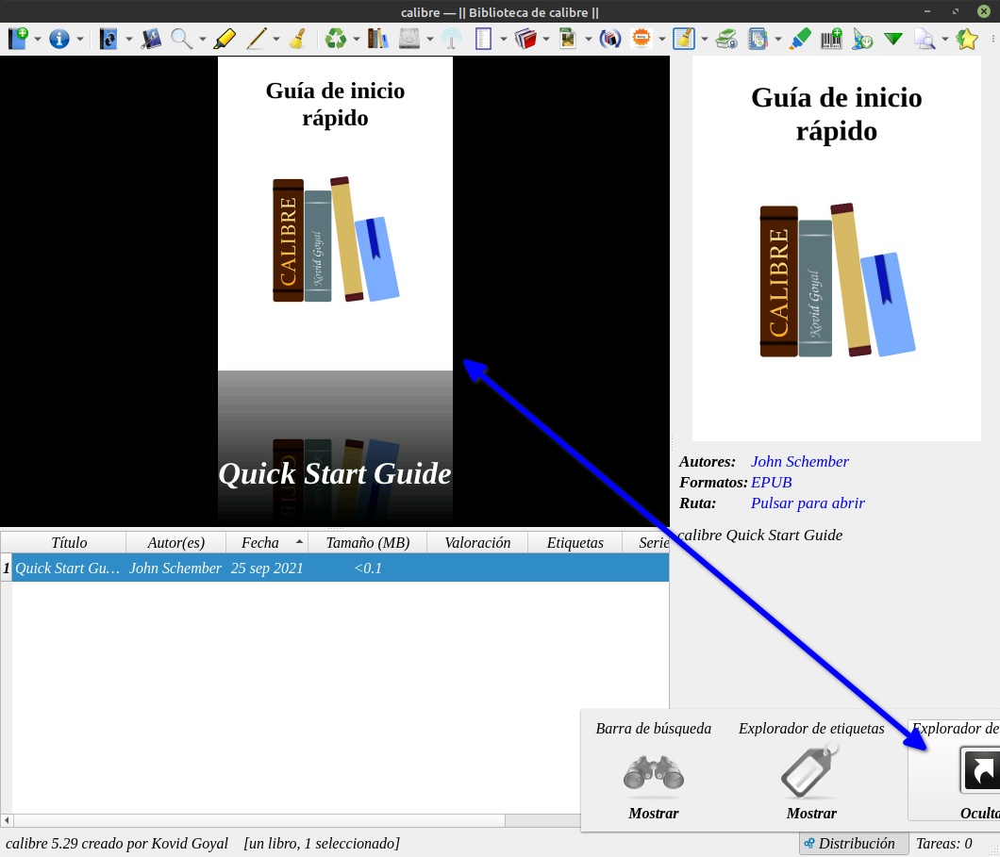

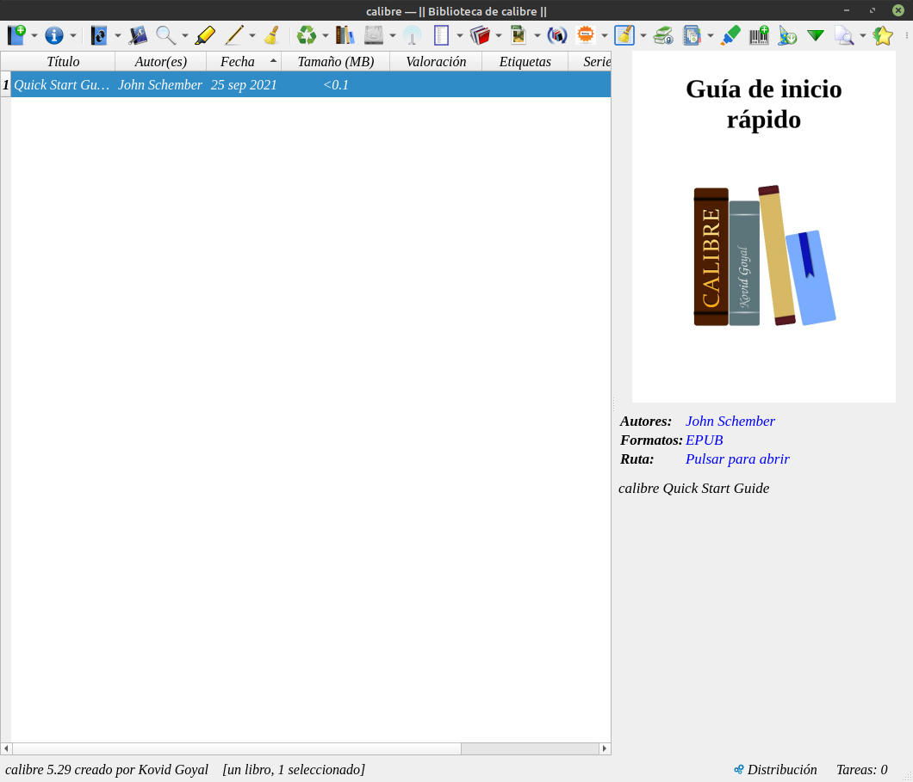

5.Muestra u oculta para ver solamente las portadas

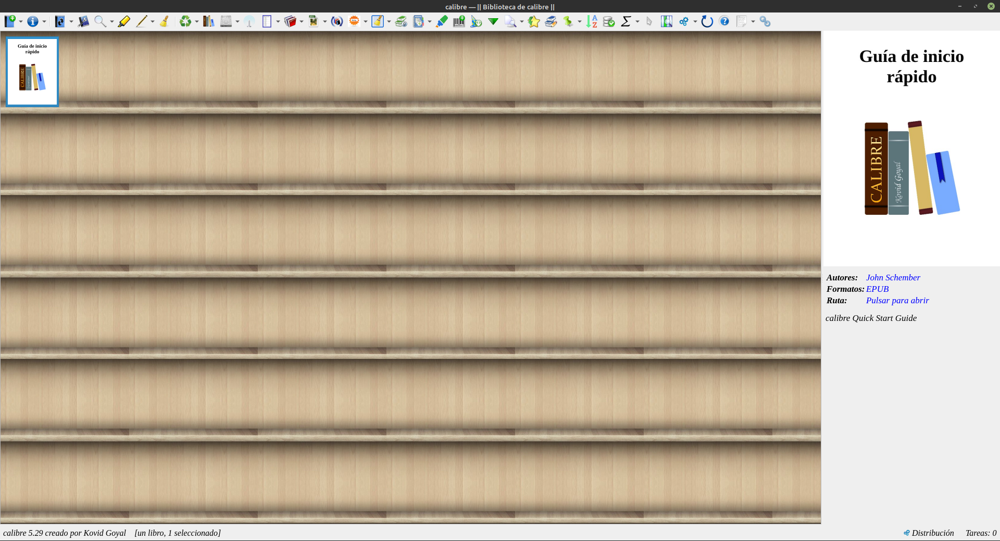

6.Muestra vista rápida

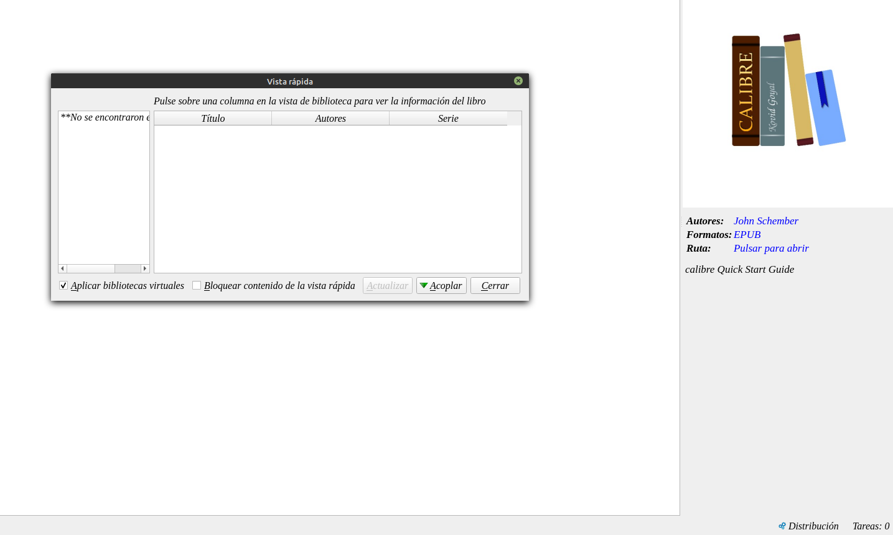

7.Muestra u oculta Detalle de libro

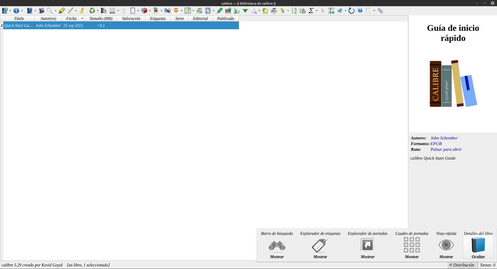

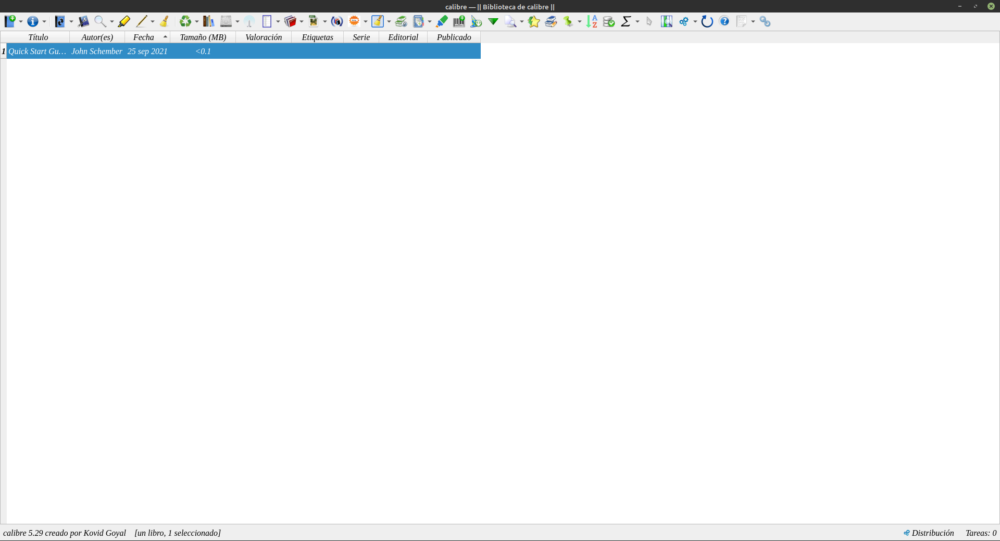

Y se pueden hacer combinaciones a gusto del cliente jajja

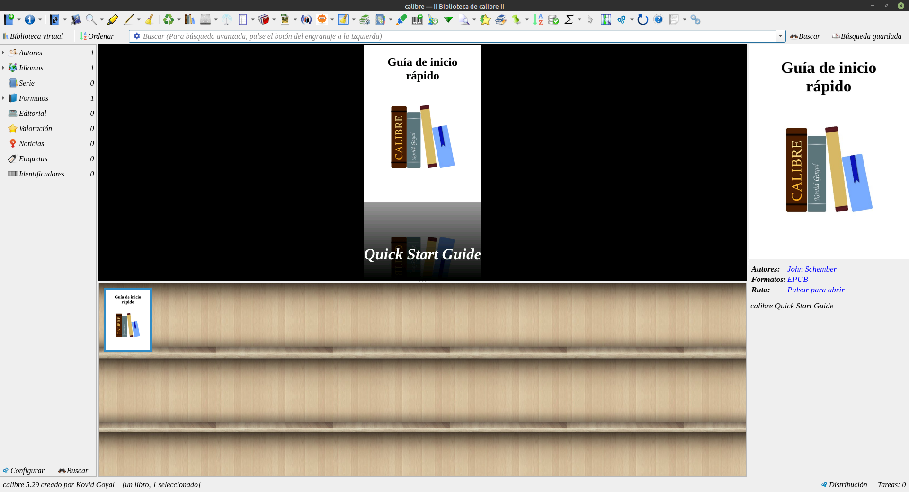

[https://t.me/calibreconfiguraciones](https://t.me/calibreconfiguraciones)

Si en algún momento vemos que el botón de distribución desaparece y en su lugar hay iconos con en esta imagen

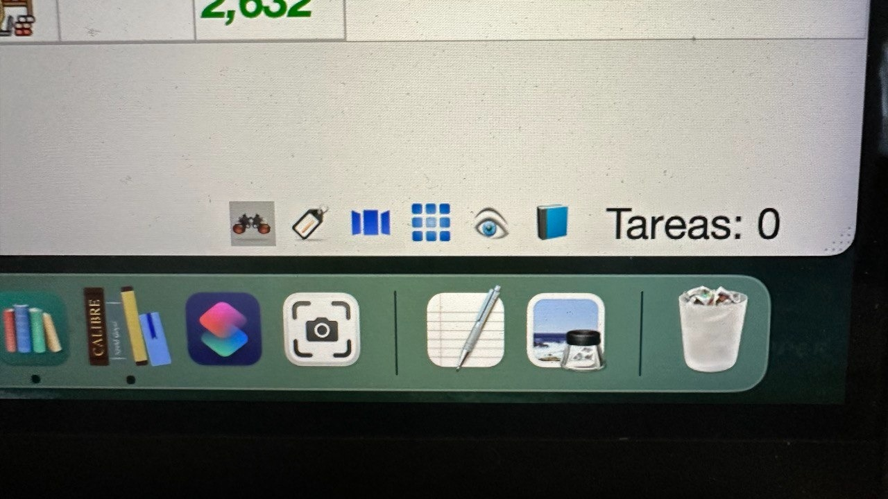

Para volver a tener el botón de distribución ( explicado por @jane\_morris)

Hay que ir a preferencia/ Apariencia

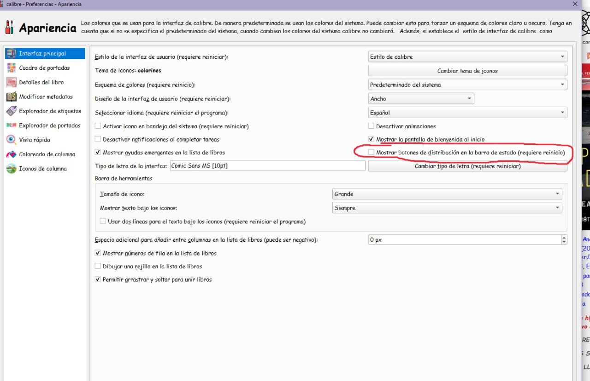

Y marcar está opción.

## [Volver al inicio](https://telegra.ph/Indice-Calibre-en-Espa%C3%B1ol-10-03)

 

---

[:material-arrow-left: Volver al índice](../../alfabetico.md) · [:fontawesome-brands-telegram: Preguntar en el grupo](https://t.me/calibreconfiguraciones){ target=_blank }
