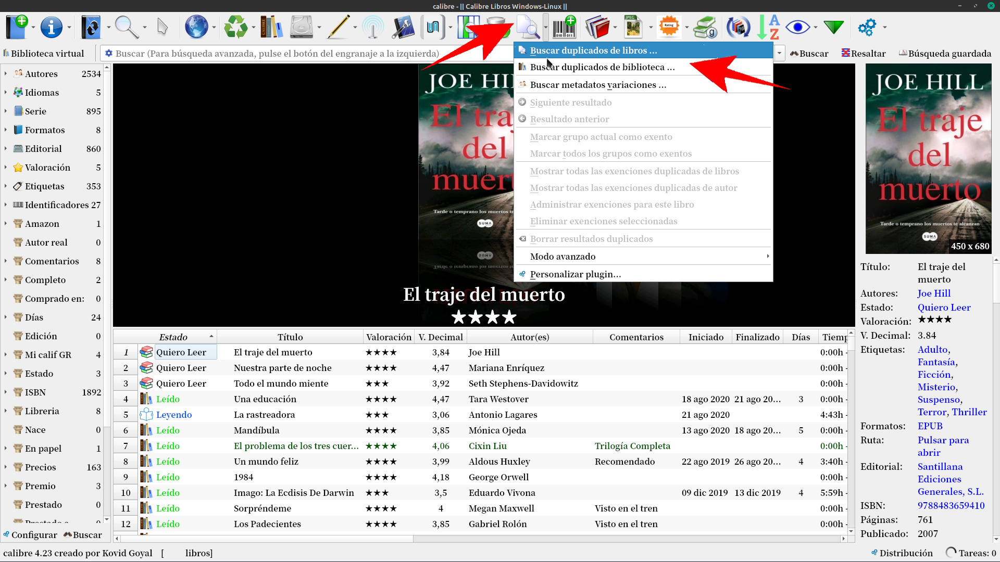
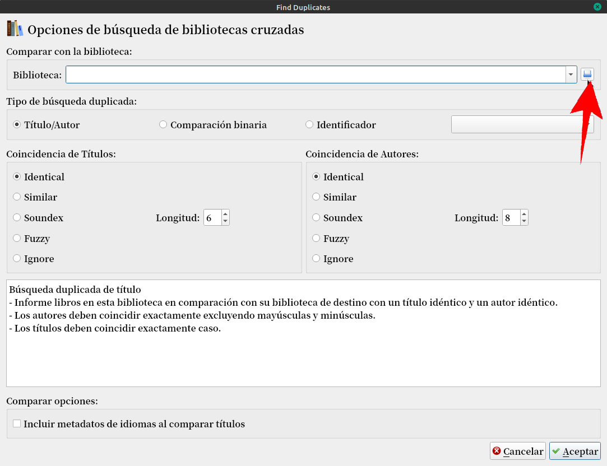
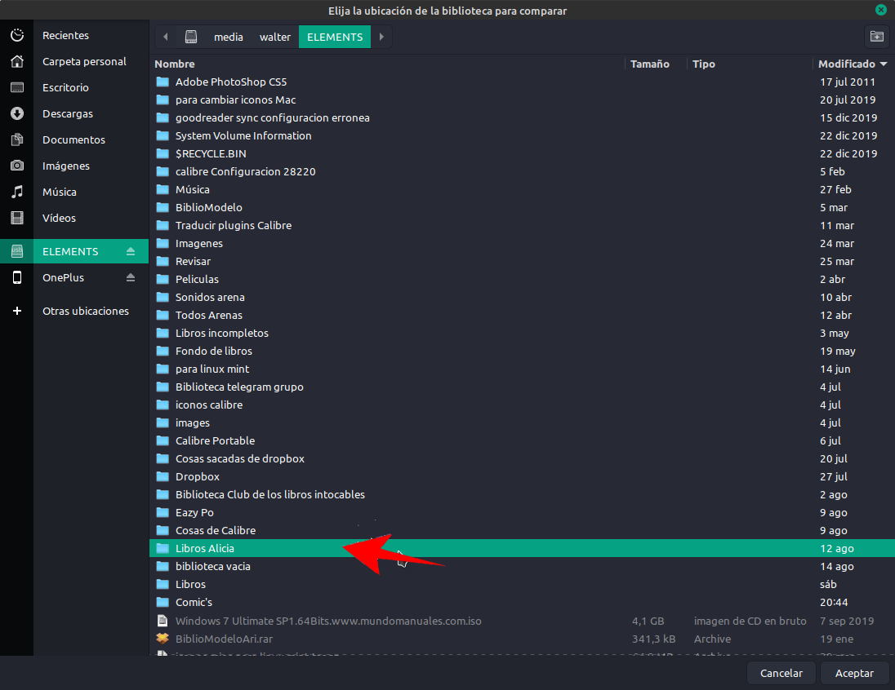
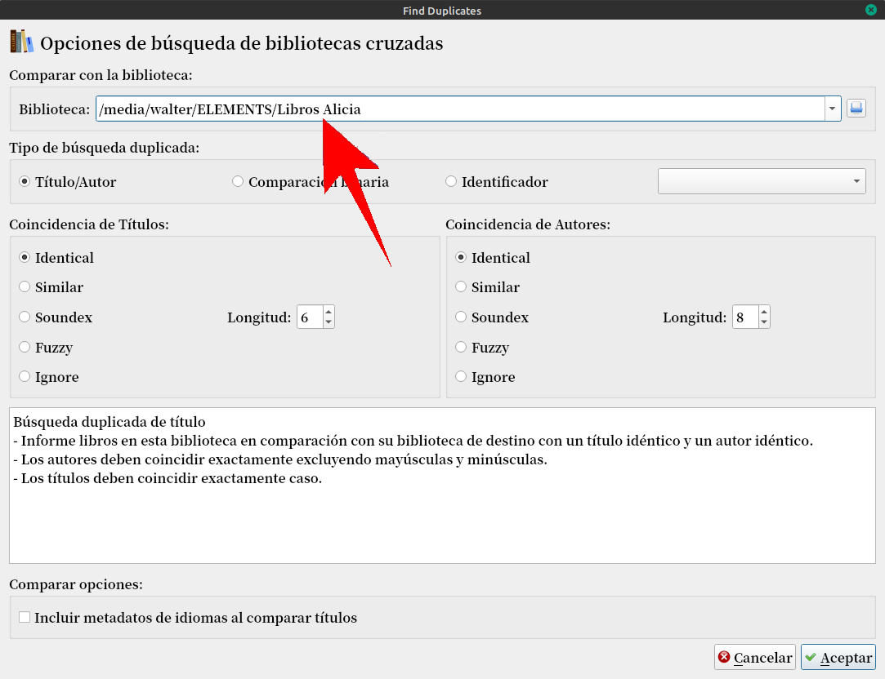
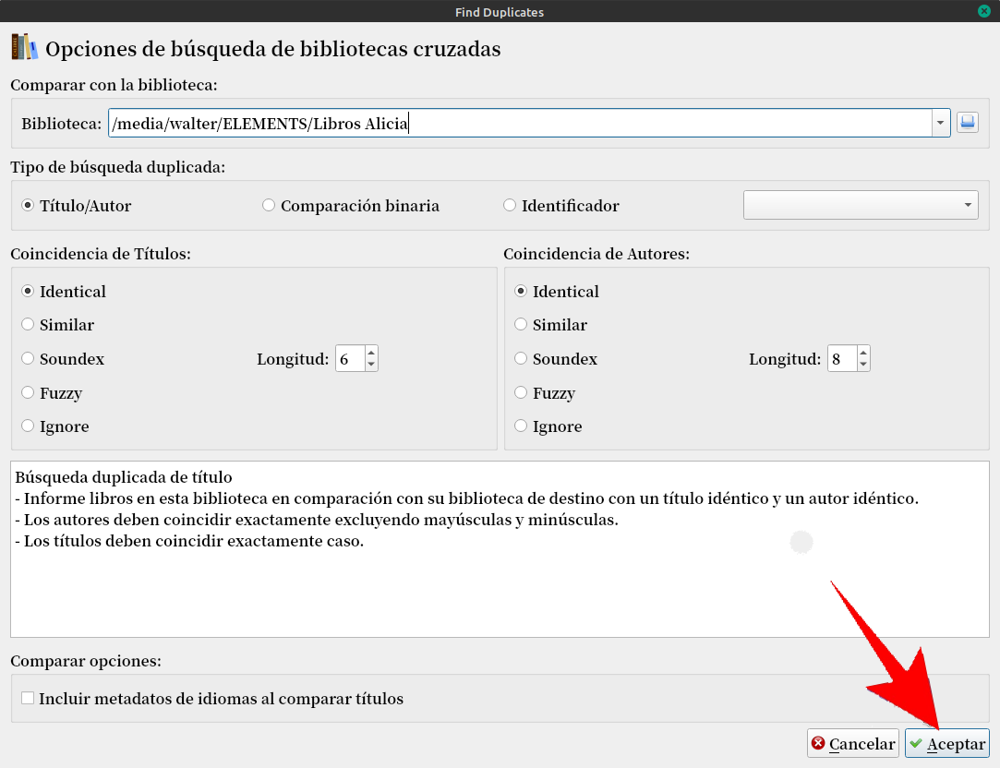
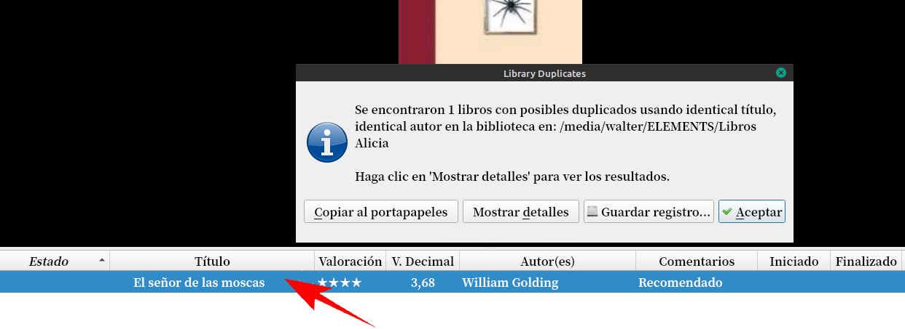
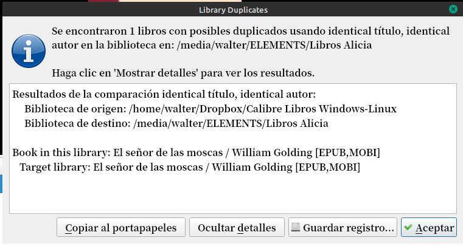

# Buscar duplicados entre dos bibliotecas

:material-account: [Walter](https://t.me/Dunhill69){ target=_blank } · :material-link-variant: [Ver el original en Telegraph](https://telegra.ph/Buscar-Duplicados-entre-dos-bibliotecas-08-25){ target=_blank }
{ .tut-datos }

---

Mientras hacia el paso a paso de este tutorial me di cuenta de que hay que tener bien en claro, si se quiere borrar el libro encontrado, la busqueda hay que hacerla desde la biblioteca donde se quiere eliminar. Para esto tenemos que tener instalado el plugin Find Duplicates [https://plugins.calibre-ebook.com/131017.zip](https://plugins.calibre-ebook.com/131017.zip)

Yo voy a comparar mi biblioteca Calibre libros Windows-linux con Libros de Alicia

Abro Calibre con mi biblioteca y toco la flecha lateral dereche del plugin Find Duplicate Buscar duplicados de Bibliotecas

Tocando en el cuadradito azul buscamos la ubicación de Libros de Alicia ( ya sea dentro de la misma maquina como en cualquier tipo de almacenamiento, el cual debe estar conectado en la Pc) En mi caso la tengo en un disco externo.

Buscamos la ubicación

Y se nos colocara la ruta de la biblioteca a comparar, como dice la pantalla C**omparar con la biblioteca:**

Seleccionamos el tipo de opción a nuestra preferencia ( En este caso mismo Título mismo Autor)

Y tocamos Aceptar

Acá nos muestra el resultado de la búsqueda, si tocamos Mostrar detalle

Nos muestra el detalle de la búsqueda.

## [Volver al inicio](https://telegra.ph/Indice-Calibre-en-Espa%C3%B1ol-10-03)

##  

 

 

 

---

[:material-arrow-left: Volver al índice](../../alfabetico.md) · [:fontawesome-brands-telegram: Preguntar en el grupo](https://t.me/calibreconfiguraciones){ target=_blank }
