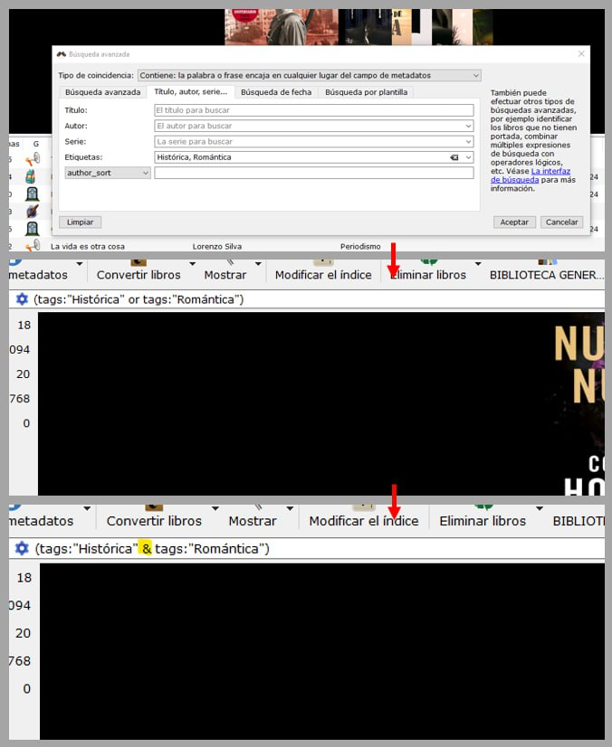
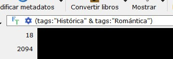
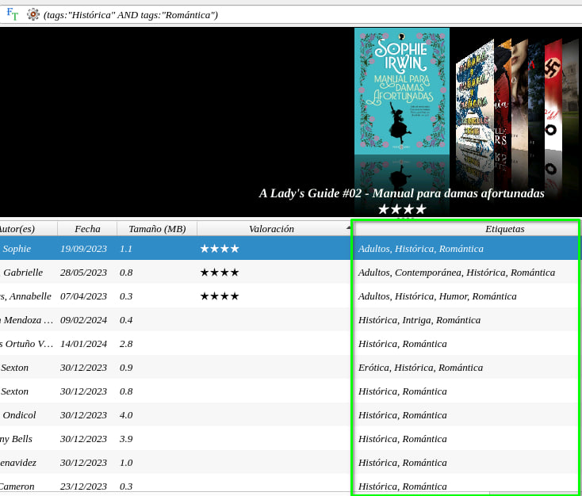
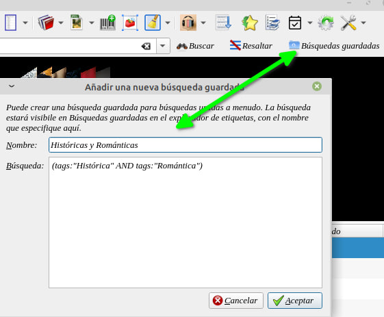
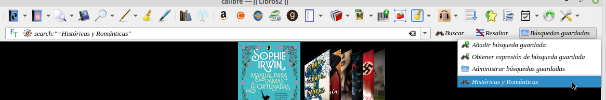

# Buscar por dos etiquetas

:material-account: [@enebat](https://t.me/Dunhill69){ target=_blank } · :material-link-variant: [Ver el original en Telegraph](https://telegra.ph/Buscar-por-dos-etiquetas-02-16){ target=_blank }
{ .tut-datos }

---

Lucia TR preguntó:

Hola!!

Si en un libro tengo dos etiquetas, hay manera de seleccionar en calibre los libros que tengan esas dos etiquetas?

Por ejemplo. Hay libros con la etiqueta histórica y libros con la etiqueta romántica.

Pero hay libros con las dos: histórica, romántica.

Puedo seleccionar los que tengan las dos etiquetas y que no me salgan los que tienen solo una de ellas?

@Enebat respondió:

Yo lo suelo hacer así Lucía, en modo dummies.

Utilizo el buscador avanzado (ruedita en la barra de búsqueda) y luego sustituyo el 'or' por '&'

 

Ir al mensaje: [https://t.me/calibreconfiguraciones/112333/157080](https://t.me/calibreconfiguraciones/112333/157080)

 

@enebat y @LuciToRi estuve revisando el tema de las búsquedas por dos etiquetas y como lo plantea @enebat con OR y después reemplazarlo por & trae todos los libros que tengas en este caso Histórica y Romántica. Pero no los únicos libros que tengan esas etiquetas. Haciendo varias pruebas funciona !!

Pero si reemplazamos el or por AND si las trae.

Y si le damos en el botón de añadir búsquedas en búsquedas guardadas la podemos usar desde ahí.

Ir al mensaje: [https://t.me/calibreconfiguraciones/112333/157233](https://t.me/calibreconfiguraciones/112333/157233)

## [Volver al inicio](https://telegra.ph/Indice-Calibre-en-Espa%C3%B1ol-10-03)

 

---

[:material-arrow-left: Volver al índice](../../alfabetico.md) · [:fontawesome-brands-telegram: Preguntar en el grupo](https://t.me/calibreconfiguraciones){ target=_blank }
