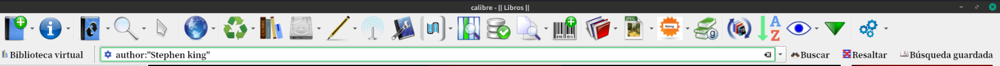

# Búsquedas especiales

:material-account: [Walter](https://t.me/Dunhill69){ target=_blank } · :material-link-variant: [Ver el original en Telegraph](https://telegra.ph/B%C3%BAsquedas-especiales-08-16){ target=_blank }
{ .tut-datos }

---

Por ejemplo, para buscar un libro en cuyo título aparezca la palabra "biografía", teclearíamos en el cuadro de búsqueda: "title:biografía" (sin las comillas).

Para buscar libros de un autor cuyo apellido fuera "Smith", pondríamos: "author:smith".

Los nombres de búsqueda de las columnas por defecto de Calibre son:

Título: title

Autor: author

Etiquetas: tags

Serie: series

Fecha de publicación: pubdate

Comentarios: comments

Para las columnas personales se usaría el nombre de búsqueda de la columna deseada precedido de la almohadilla (por ejemplo, "#paginas:200").



Si queremos buscar autores que tengan coma la busqueda seria Author:" , "

Si quisieramos buscar autores que no tengan coma la busqueda seria  not authors:”,”

con ella encontrarías todos los autores en cuyo nombre no hubiera coma, estén o no en formato NOM APE o APE NOM. Incluso aparecerían los que sólo tienen un nombre (p.e. Plutarco). Como a mi también me gusta este formato, a los nombres simples como el del ejemplo, les añado «,-» una coma y un guión. ( explicado por @Inatxo )

<br>

Si queremos buscar " en el título, escribimos esto en la barra de busqueda:

```
title:"~^\""
```

<br>

(Aportado por @Inatxo)

Esta expresión **false** que encontré en el manual de Calibre, es muy útil para buscar campos que no tienen contenido, como por ejemplo libros que no tengan ningún formato

format:false

o sin fecha de publicación,

pubdate:false

sin idioma

languages:false

o sin nª de versión

version:false

También podemos buscar ‘al revés’, es decir, los que si la tienen, p.e.

version:true

o que si tengan serie

series:"true"

<br>

Si queremos buscar solamante dos etiquetas debemos escribir en la barra de busqueda:

```
tags:"=Cadets" and tags:"=Science Fiction"
```

<br>

## <br>

## [Volver al inicio](https://telegra.ph/Indice-Calibre-en-Espa%C3%B1ol-10-03)

## <br>

<br>

---

[:material-arrow-left: Volver al índice](../../alfabetico.md) · [:fontawesome-brands-telegram: Preguntar en el grupo](https://t.me/calibreconfiguraciones){ target=_blank }
