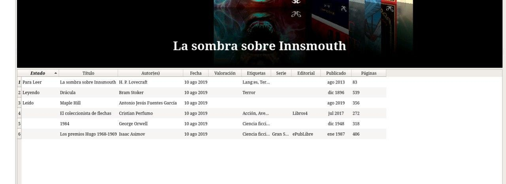
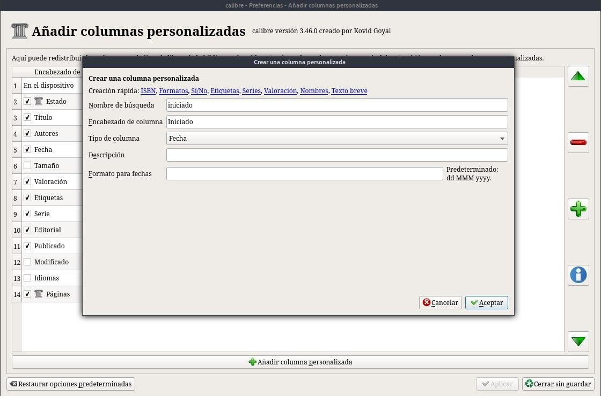
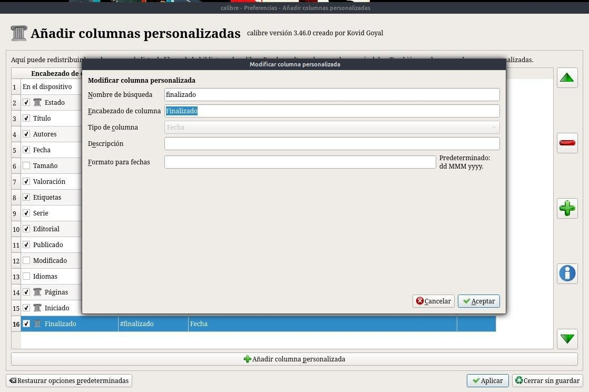
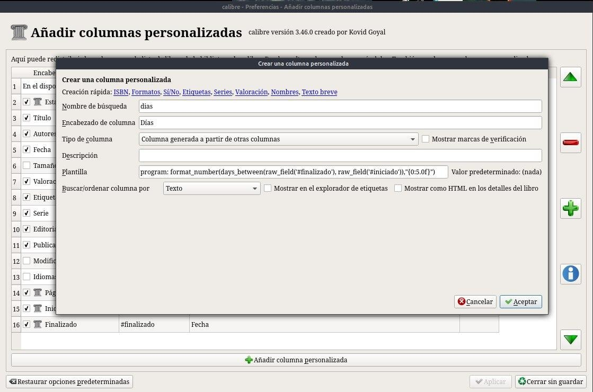
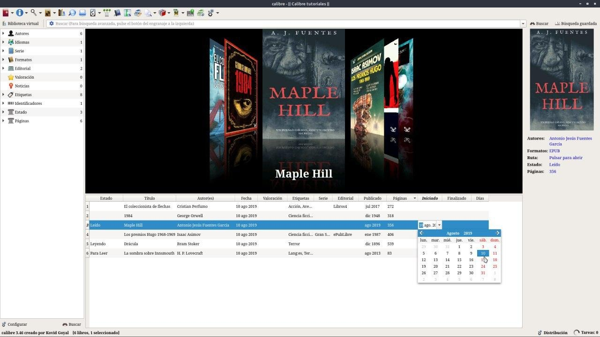
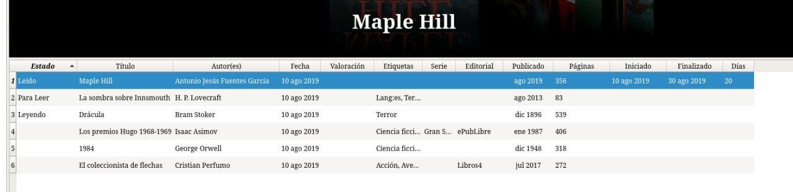

# Calcular días de lectura

:material-account: [Walter](https://t.me/Dunhill69){ target=_blank } · :material-link-variant: [Ver el original en Telegraph](https://telegra.ph/Calcula-d%C3%ADas-de-lectura-09-09){ target=_blank }
{ .tut-datos }

---

Hola gente hoy les voy a explicar como hacer para poner la fecha de inicio de lectura, fecha de finalizado de leer y que nos diga Calibre los días que tardamos. Para esto necesitamos hacer tres columnas personalizadas. Dos con formato fecha y otra que dependa de otras columnas. No se asusten les subiré imágenes... Empecemos

Primer columna personalizada para la fecha de inicio la configuramos de esta manera. Ponemos Aceptar.

Segunda columna personalizada para la fecha de finalización acá les dejo la configuración. Ponemos Aceptar

La magia viene acá para la columna de días la configuramos tal cual la imagen y les dejo la formula para que haga la cuenta de días si pueden copien y peguen esto:    program: format\_number(days\_between(raw\_field('#finalizado'), raw\_field('#iniciado')),"{0:5.0f}")

Ponemos aceptar y como ya terminamos ponemos aplicar, se reinicia calibre.

Designamos la fecha de inicio de lectura

Lo mismo hacemos con la fecha cuando terminamos el libro.

Y los días Calibre los calcula solo.

ir al mensaje: [https://t.me/calibreconfiguraciones/167](https://t.me/calibreconfiguraciones/167)

[https://telegra.ph/Calcula-d%C3%ADas-de-lectura-09-09](https://telegra.ph/Calcula-d%C3%ADas-de-lectura-09-09)

## [Volver al inicio](https://telegra.ph/Indice-Calibre-en-Espa%C3%B1ol-10-03)

## 

 

 

---

[:material-arrow-left: Volver al índice](../../alfabetico.md) · [:fontawesome-brands-telegram: Preguntar en el grupo](https://t.me/calibreconfiguraciones){ target=_blank }
