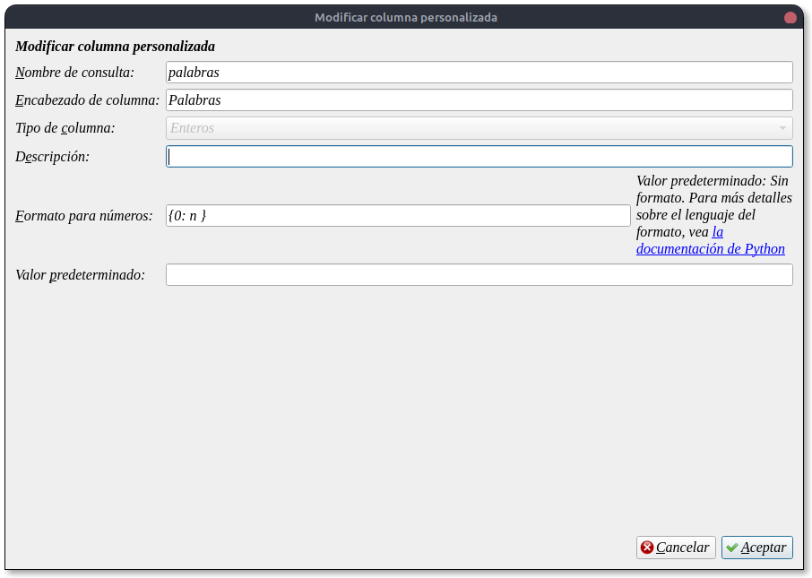
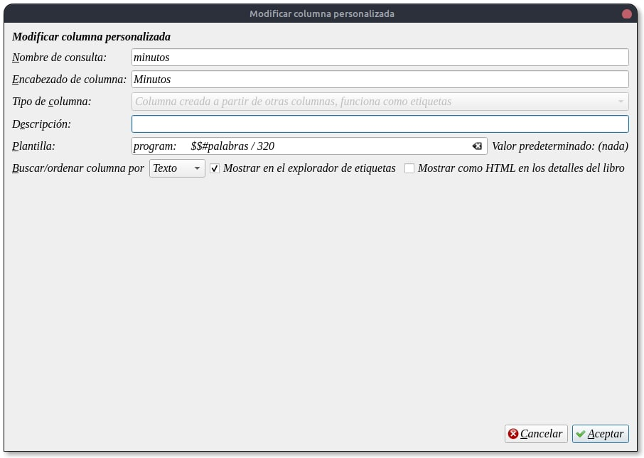
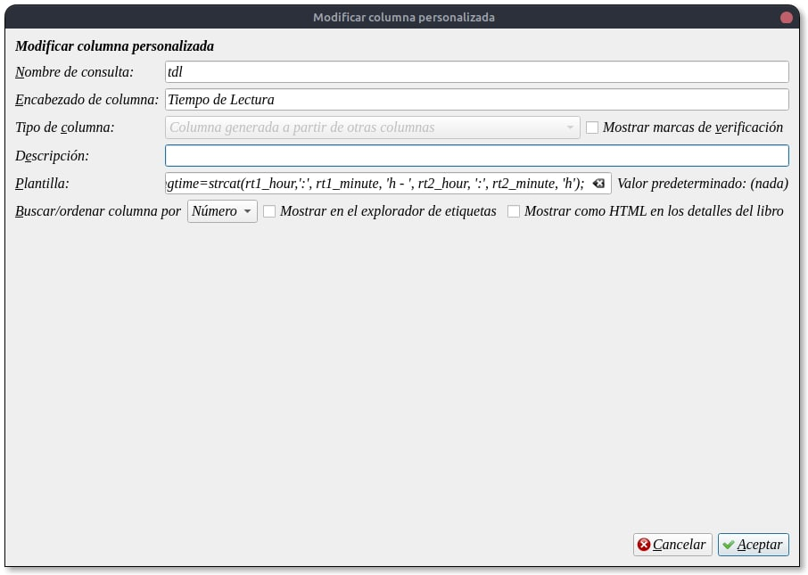
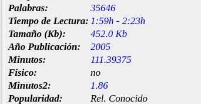
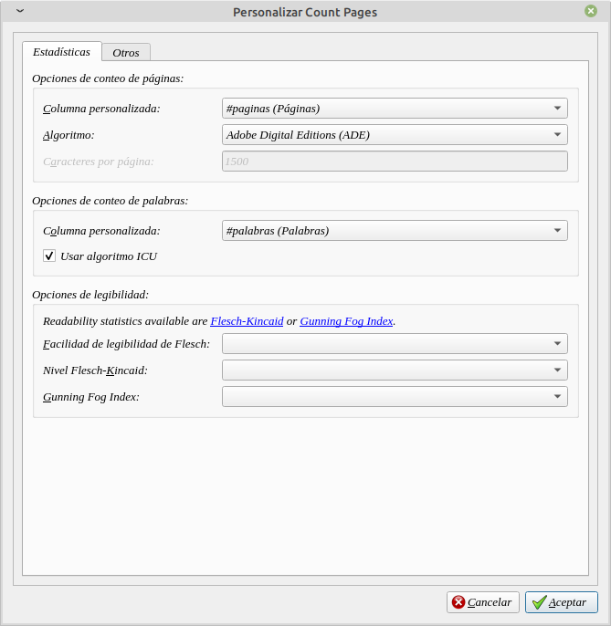

# Calcular tiempo de lectura

:material-account: [Walter](https://t.me/Dunhill69){ target=_blank } · :material-link-variant: [Ver el original en Telegraph](https://telegra.ph/Calcular-tiempo-de-Lectura-11-06){ target=_blank }
{ .tut-datos }

---

Partiendo del complemento count pages donde nos cuenta las páginas ([https://telegra.ph/Plugin---Count-Pages-09-07](https://telegra.ph/Plugin---Count-Pages-09-07)) que tiene el libro podemos también calcular las palabras.

Creamos una columna personalizada para las palabras de esta manera:

Después creamos una para los minutos:

Con esta plantilla: program: $$#palabras /320 (nuestro tiempo de lectura)

Y para tener el tiempo de lectura de nuestros libros teniendo en cuenta nuestro tiempo máximo y mínimo creamos esta.

Con esta plantilla:

program:

# Este programa calcula un tiempo de lectura por hora para un ebook

# Ajustes:

# w\_min -\> mínimo de palabras por minuto

# w\_max -\> máximo de palabras por minuto

w\_min=250;

w\_max=300;

# tiempo de lectura por hora=60

p\_time=60;

# Necesita una columna personalizada para el recuento de palabras (#palabras)

# cámbielo a su nombre de campo

words=raw\_field('#palabras');

time1=format\_number(divide(words,multiply(w\_max, p\_time)), '{0:.2f}');

time2=format\_number(divide(words,multiply(w\_min, p\_time)), '{0:.2f}');

# Desafortunadamente, Calibre no proporciona una forma simple de convertir un flotador

# En una cadena de tiempo -\> Usé una expresión regular

# # Los minutos se pueden configurar para usar 2 números usando el formato de número de Python,

# de lo contrario, los tiempos se muestran como 4:4h en lugar de 4:04h

rt1\_hour=re(time1, '\\.\\d\*', '');

rt1\_minute=format\_number(multiply(subtract(time1,rt1\_hour),60), '{0:02.0f}');

rt2\_hour=re(time2, '\\.\\d\*', '');

rt2\_minute=format\_number(multiply(subtract(time2,rt2\_hour),60), '{0:02.0f}');

readingtime=strcat(rt1\_hour,':', rt1\_minute, 'h - ', rt2\_hour, ':', rt2\_minute, 'h');

Se verá así:

La configuración del complemento count-pages deberia quedar algo así

(Recuerden que al principio del tutorial decimos que viniendo del complemento que nos cuenta las páginas)

Ir al mensaje: [https://t.me/calibreconfiguraciones/111213](https://t.me/calibreconfiguraciones/111213)

## [Volver al inicio](https://telegra.ph/Indice-Calibre-en-Espa%C3%B1ol-10-03)

 

 

 

---

[:material-arrow-left: Volver al índice](../../alfabetico.md) · [:fontawesome-brands-telegram: Preguntar en el grupo](https://t.me/calibreconfiguraciones){ target=_blank }
