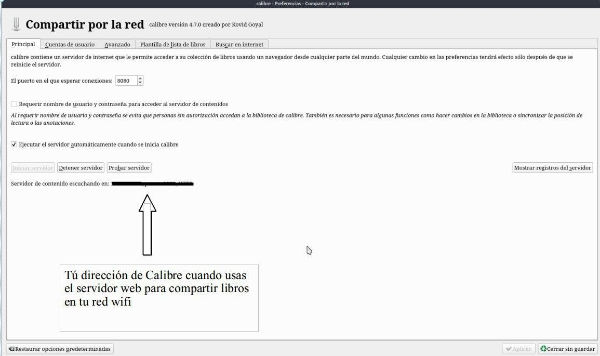
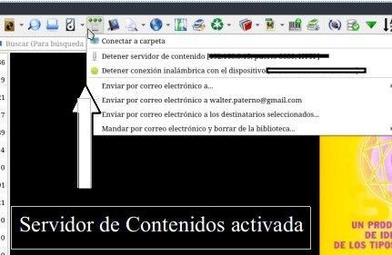
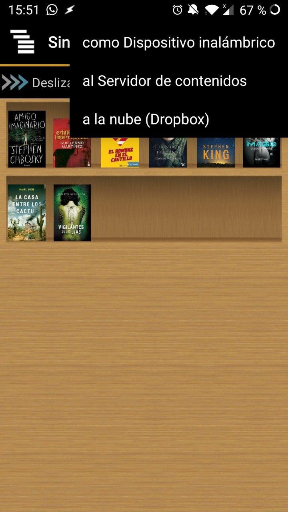
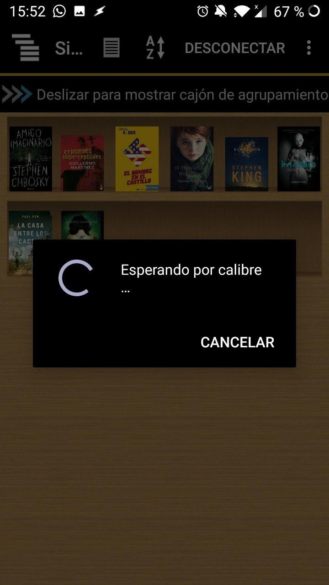
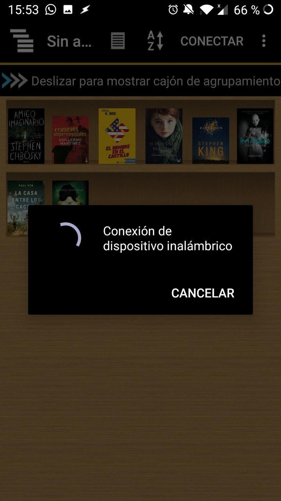
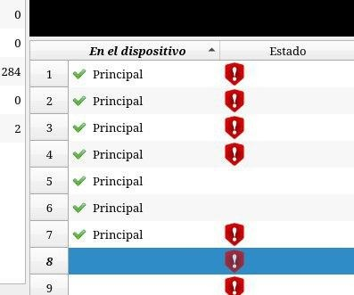
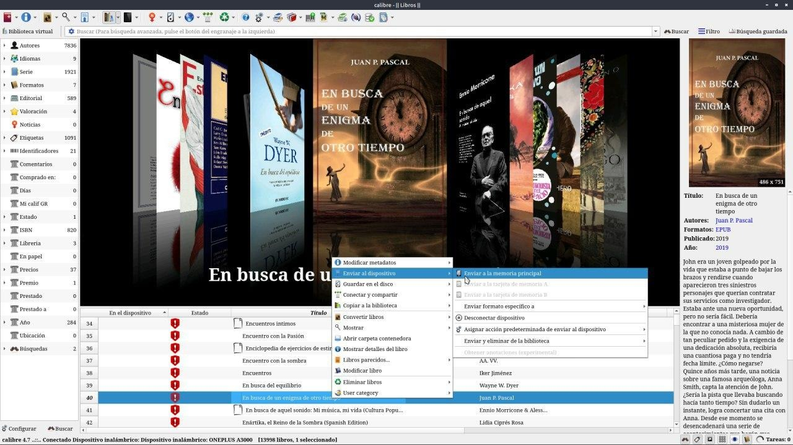
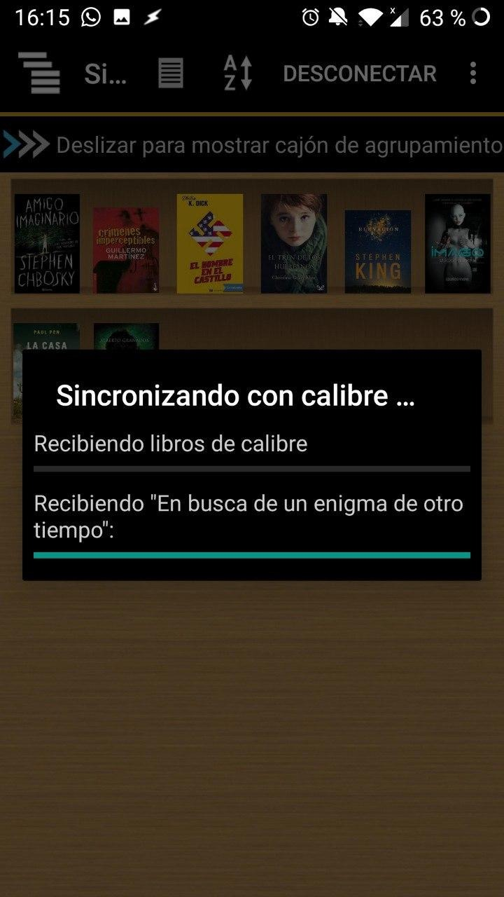
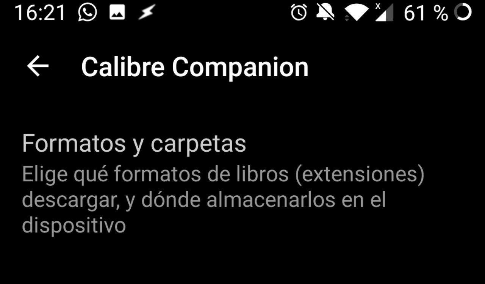
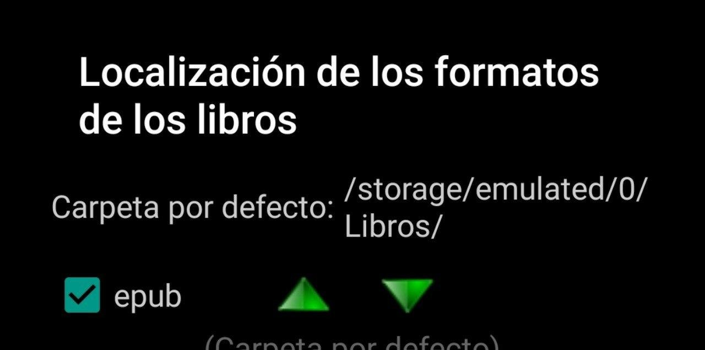

# Calibre Companion

:material-account: [Walter](https://t.me/Dunhill69){ target=_blank } · :material-link-variant: [Ver el original en Telegraph](https://telegra.ph/Calibre-companion-08-17){ target=_blank }
{ .tut-datos }

---

Como conectar Calibre Companion con calibre. Tenemos que tener el servidor web activado.Vamos a Preferencias/Compartir por red y tildamos Ejecutar el servidor al iniciar Calibre y abajo nos nuestra la dirección de Calibre para compartir a un navegador de Internet dentro de nuestra red Wifi.

Acá vemos que nuestro servidor web de calibre esta activo

Abrimos Calibre Companion y tocamos conectar y elegimos nuestras opciones en este caso Cómo dispositivo inalámbrico.

Nos va avisando.

Y cuando se conecta en calibre se nos aparece una columna que se llama En el dispositivo que nos indica que libros tenemos pasados o agregados en el teléfono o tablet donde hayamos instalado calibre companion. Obviamente deberemos tener una aplicación que abra el libro en android para su lectura.

Y así funciona seleccionamos un libro y le ponemos enviar al dispositivo/Enviar a la memoria principal

Y vemos como Calibre Companion nos avisa que esta recibiendo un libro de Calibre.

En opciones de Calibre Companion donde dice Formatos y carpetas está la ruta donde se descargan los libros, sería bueno que está carpeta sea también la que nuestro lector de android levante los libros 😉

## [Volver al inicio](https://telegra.ph/Indice-Calibre-en-Espa%C3%B1ol-10-03)

##  

 

---

[:material-arrow-left: Volver al índice](../../alfabetico.md) · [:fontawesome-brands-telegram: Preguntar en el grupo](https://t.me/calibreconfiguraciones){ target=_blank }
