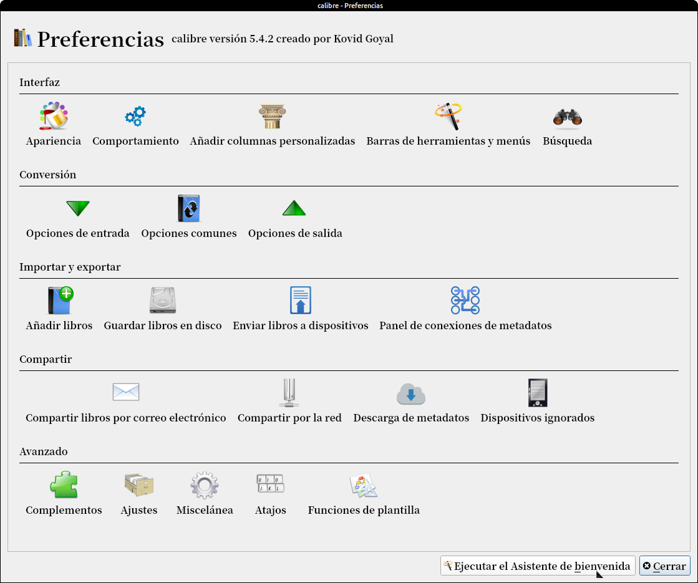
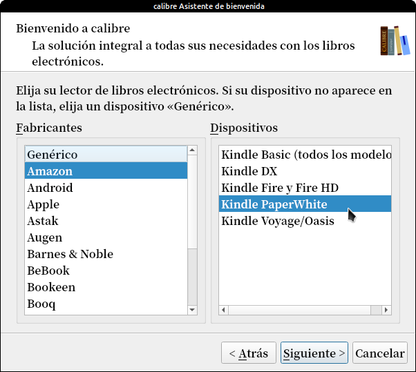

# Calibre no reconoce mi Kindle

:material-account: [Walter](https://t.me/Dunhill69){ target=_blank } · :material-link-variant: [Ver el original en Telegraph](https://telegra.ph/Calibre-no-reconoce-mi-kindle-11-03){ target=_blank }
{ .tut-datos }

---

Un de las opciones de que pase esto es que nuestro Calibre este desactualizado. Si una vez actualizado sigue sin reconocerlo deberemos ir a preferencias y **Ejecutar el Asistente de Bienvenida.**

Ponemos aceptar y en la segunda pantalla que es esta elegimos el fabricante y modelo de nuestro dispositivo.

Ponemos siguiente hasta reiniciar Calibre.

Ir al mensaje: [https://t.me/calibreconfiguraciones/22648](https://t.me/calibreconfiguraciones/22648)

[https://telegra.ph/Calibre-no-reconoce-mi-kindle-11-03](https://telegra.ph/Calibre-no-reconoce-mi-kindle-11-03)

 

## [Volver al inicio](https://telegra.ph/Indice-Calibre-en-Espa%C3%B1ol-10-03)

##  

 

 

---

[:material-arrow-left: Volver al índice](../../alfabetico.md) · [:fontawesome-brands-telegram: Preguntar en el grupo](https://t.me/calibreconfiguraciones){ target=_blank }
