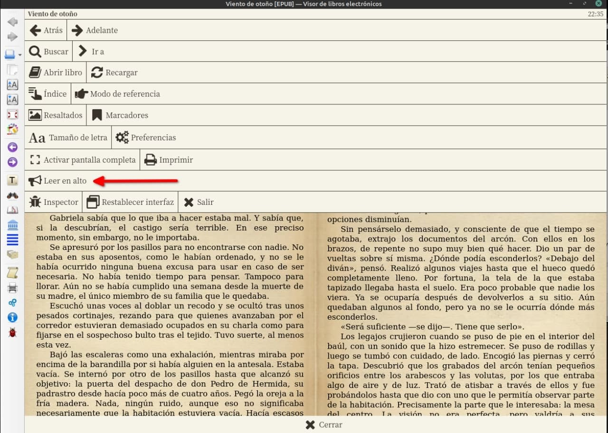
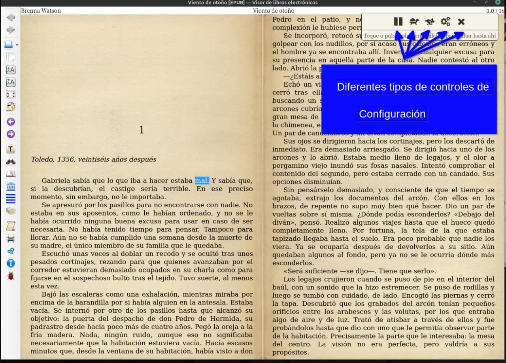
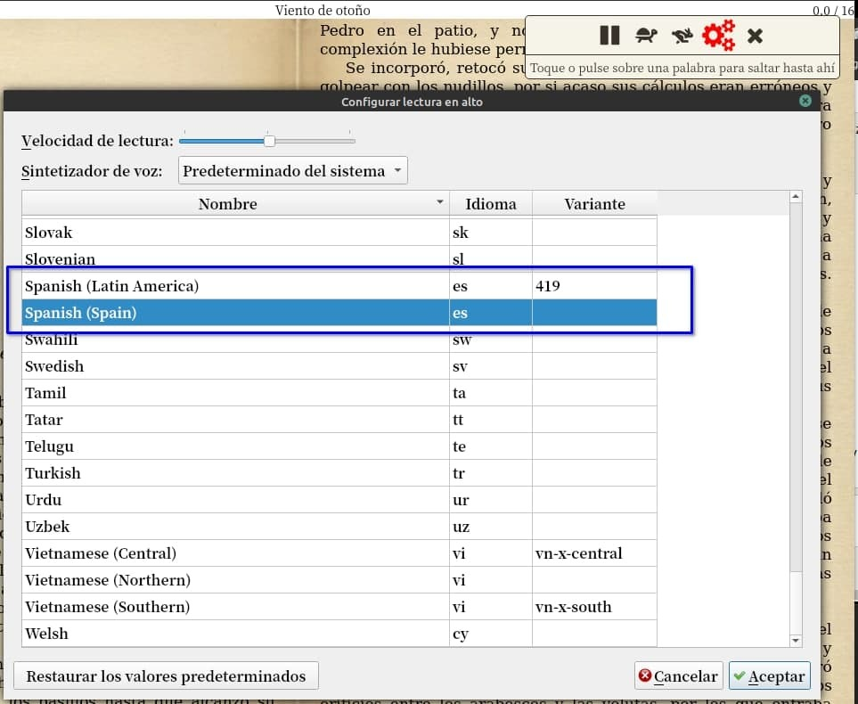

# Calibre nos lee en voz alta

:material-account: [Walter](https://t.me/Dunhill69){ target=_blank } · :material-link-variant: [Ver el original en Telegraph](https://telegra.ph/Calibre-nos-lee-en-voz-alta-09-19){ target=_blank }
{ .tut-datos }

---

Como calibre te lee en voz alta, hacemos click en el libro y botón derecho del mouse.

Y nos aparece el icono del megáfono.

Una barra con controles para la lectura en voz alta.

Y tocando los engranajes de la configuración podemos elegir voces o usar la predeterminada del sistema.

Ir al mensaje: [https://t.me/calibreconfiguraciones/26183](https://t.me/calibreconfiguraciones/26183)

## [Volver al inicio](https://telegra.ph/Indice-Calibre-en-Espa%C3%B1ol-10-03)

##  

 

---

[:material-arrow-left: Volver al índice](../../alfabetico.md) · [:fontawesome-brands-telegram: Preguntar en el grupo](https://t.me/calibreconfiguraciones){ target=_blank }
