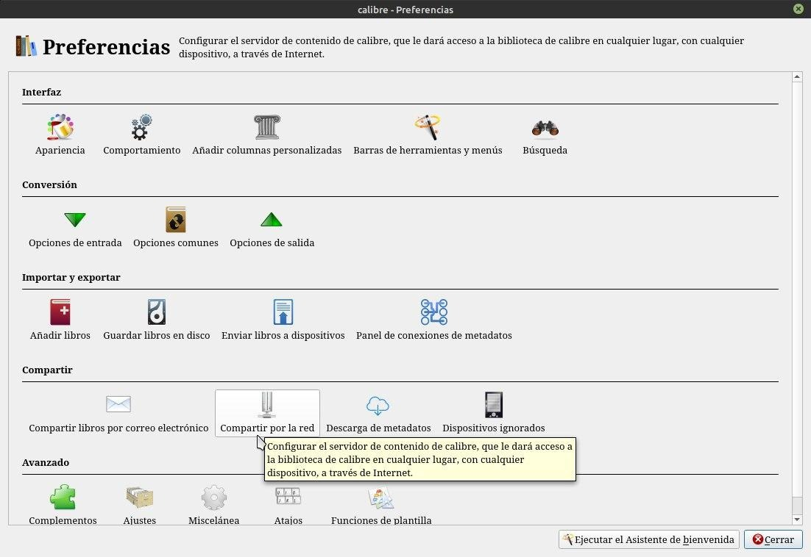
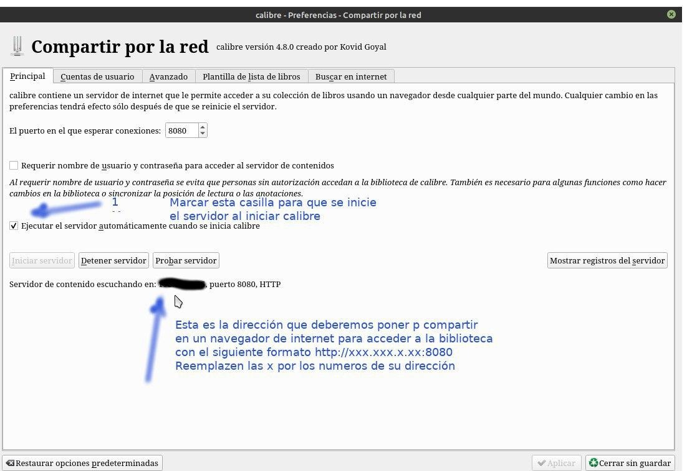
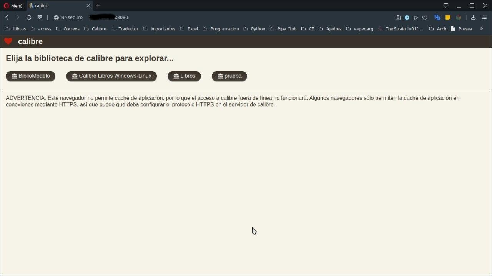
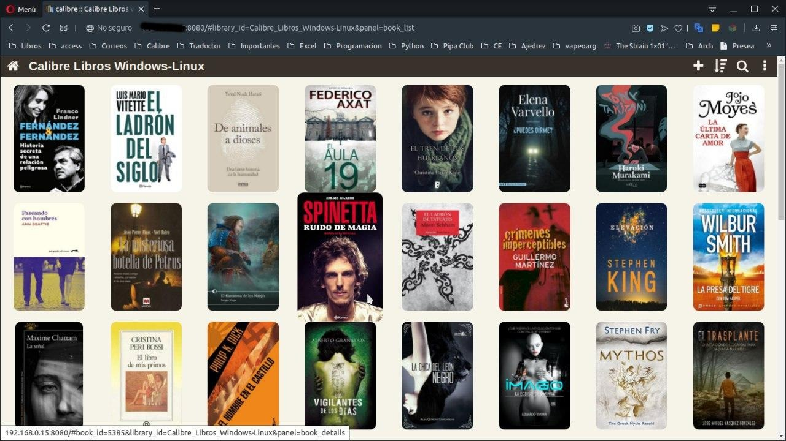
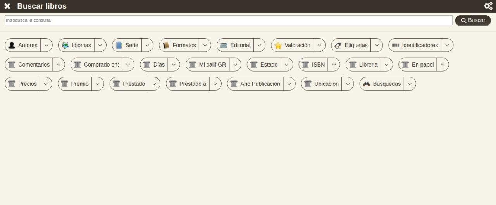
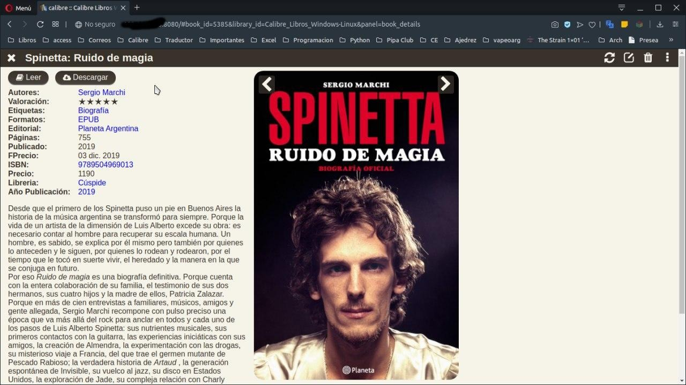
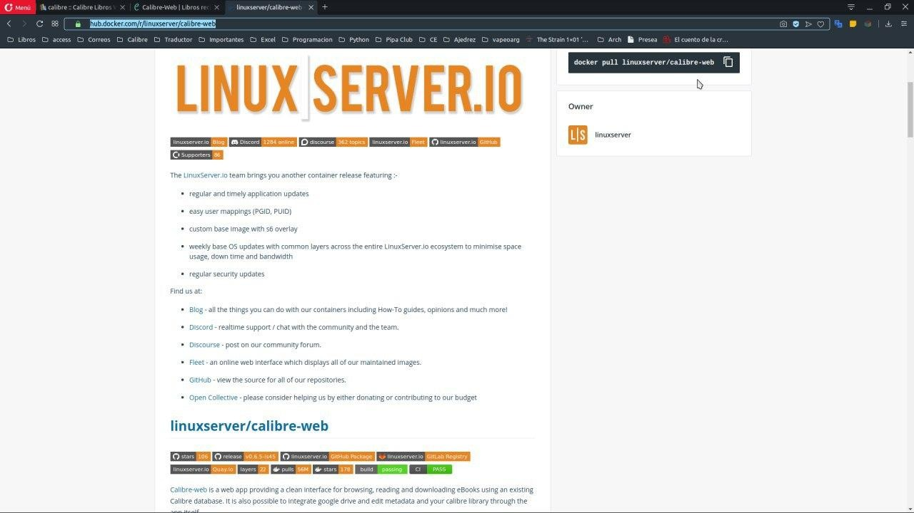
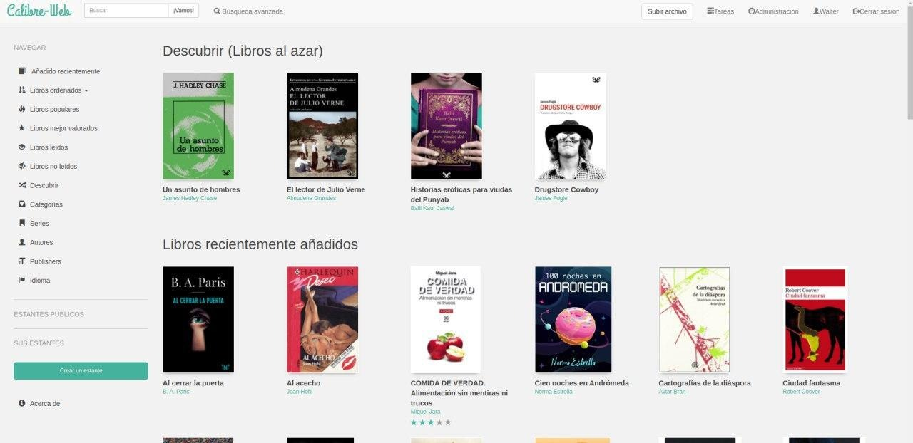

# Calibre servidor web

:material-account: [Walter](https://t.me/Dunhill69){ target=_blank } · :material-link-variant: [Ver el original en Telegraph](https://telegra.ph/Calibre-servidor-web-08-17){ target=_blank }
{ .tut-datos }

---

Este calibre con servidor web que voy a explicar es el servidor web nativo de Calibre. Después hay otras alternativas pero hay que instalar otras cosas. Esto es ideal para compartir bibliotecas y descargar libros de nuestras biblioteta desde cualquier navegador siempre y cuando este encendido Calibre. Vamos a Preferencias y compartir por red.

Marcamos la casilla para que el servidor se inicie al iniciar Calibre y abajo nos nuestra nuestra dirección para compartir y abrir en cualquier navegador web que deberemos copiar con el siguiente formato: http://xxx.xxx.x.xx:8080 reemplazen las x por los números de su dirección.

En cualquier navegador de cualquier dispositivo ingresamos la dirección http://xxx.xxx.x.xx:8080 y asi se ven la o las bibliotecas que tengamos gestionadas con Calibre.

Ingresamos en alguna y así es como se ven los libros.

Podemos hacer cualquier tipo de búsqueda.

Y así es como se ve si seleccionamos un libro, con la opción a descargar o leer.

Y el otro calibre-web que es un poquito más complicado de instalar es un contenedor de un programa que se llama Docker que se descarga de acá [https://hub.docker.com/r/linuxserver/calibre-web.](https://hub.docker.com/r/linuxserver/calibre-web.)

Pero solo nuestra una sola biblioteca y se ve así.

A la izquierda podrán ver los diferentes tipos de búsquedas.

## [Volver al inicio](https://telegra.ph/Indice-Calibre-en-Espa%C3%B1ol-10-03)

##  

 

---

[:material-arrow-left: Volver al índice](../../alfabetico.md) · [:fontawesome-brands-telegram: Preguntar en el grupo](https://t.me/calibreconfiguraciones){ target=_blank }
