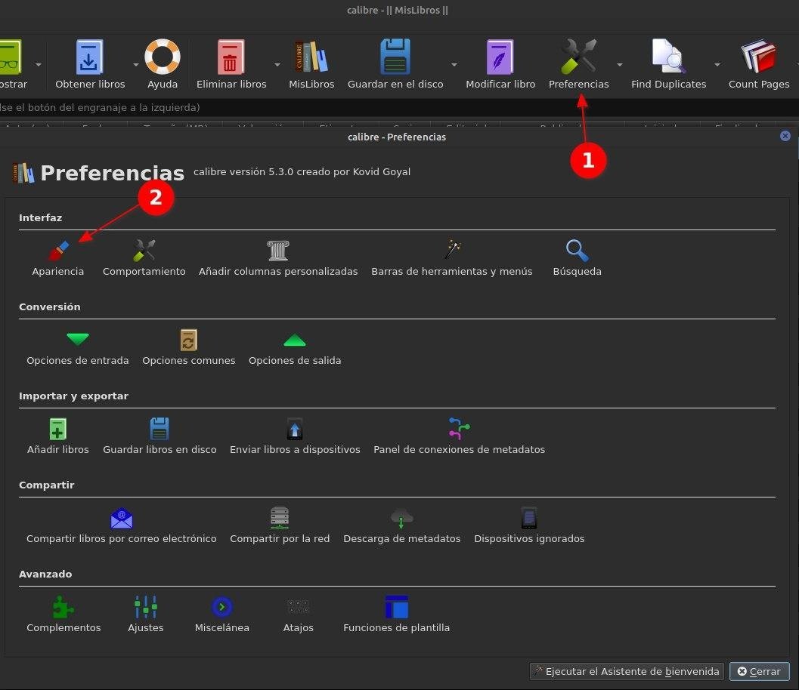
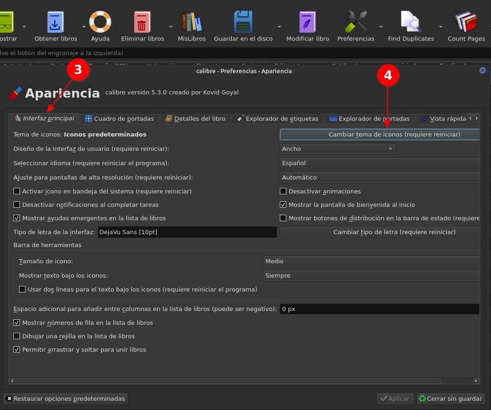
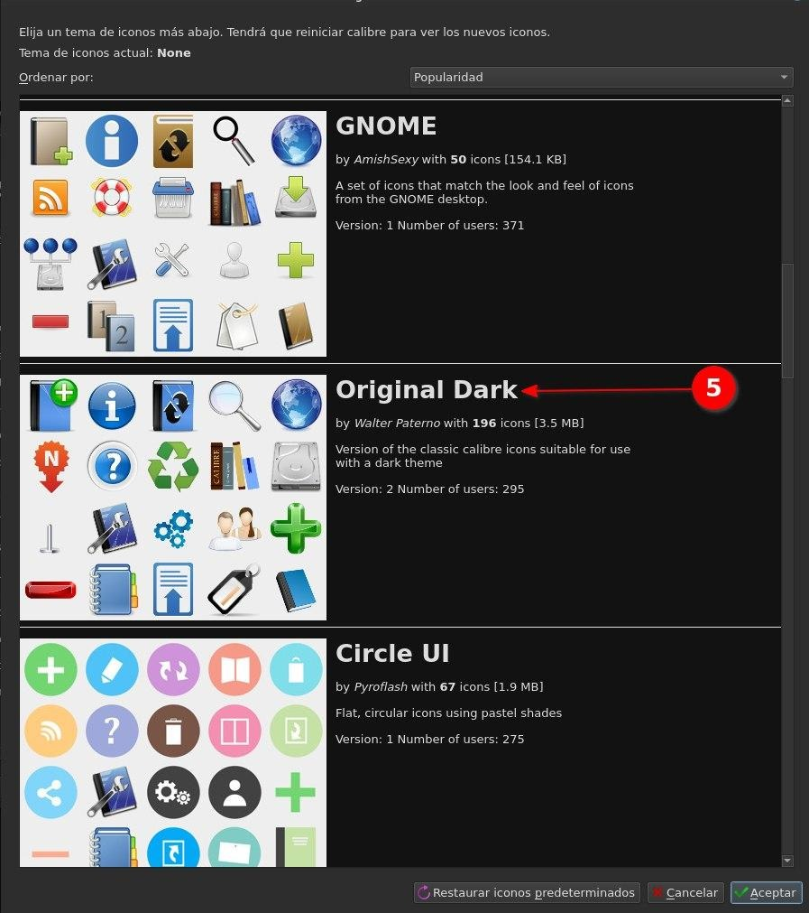

# Cambiar íconos de Calibre

:material-account: [@Llogur](https://t.me/Dunhill69){ target=_blank } · :material-link-variant: [Ver el original en Telegraph](https://telegra.ph/Cambiar-Iconos-de-Calibre-10-18){ target=_blank }
{ .tut-datos }

---

Como cambiar los iconos de nuestro Calibre explicado por @Llogur

Vamos a Preferencias/Apariencias

En interfaz principal tocamos donde dice Cambiar temas de iconos

En el listado de Popularidad veremos los paquetes de iconos más descargados, Seleccionamos el que más nos guste ( el que esta marcado es el mejor jajajjaja)

Le damos en aplicar y se reiniciara Calibre con el paquete de iconos seleccionado

Ir al mensaje: [https://t.me/calibreconfiguraciones/21488](https://t.me/calibreconfiguraciones/21488)

[https://telegra.ph/Cambiar-Iconos-de-Calibre-10-18](https://telegra.ph/Cambiar-Iconos-de-Calibre-10-18)

 

## [Volver al inicio](https://telegra.ph/Indice-Calibre-en-Espa%C3%B1ol-10-03)

 

---

[:material-arrow-left: Volver al índice](../../alfabetico.md) · [:fontawesome-brands-telegram: Preguntar en el grupo](https://t.me/calibreconfiguraciones){ target=_blank }
