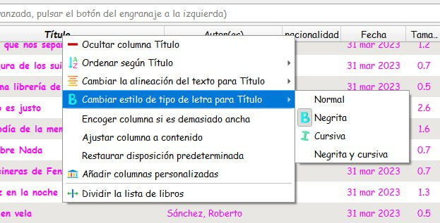

# Cambiar fuentes en columnas

:material-account: [Walter Paterno](https://t.me/Dunhill69){ target=_blank } · :material-link-variant: [Ver el original en Telegraph](https://telegra.ph/Cambio-de-fuentes-en-Columnas-04-23){ target=_blank }
{ .tut-datos }

---

Para poder tener letras negritas, cursivas o normales más allá del formato de fuente de Calibre.

Esto fue lo que nos explico @Inatxo

No se si os habeis dado cuenta que pinchando en el título de una columna se puede cambiar la alineación de ésta, así como poner la en negrita o en cursiva…

Ir al mensaje: [https://t.me/calibreconfiguraciones/112333/126054](https://t.me/calibreconfiguraciones/112333/126054)

Una imagen de @jane\_morris para ilustrar

ir al mensaje: [https://t.me/calibreconfiguraciones/112333/133133](https://t.me/calibreconfiguraciones/112333/133133)

## [Volver al inicio](https://telegra.ph/Indice-Calibre-en-Espa%C3%B1ol-10-03)

 

 

---

[:material-arrow-left: Volver al índice](../../alfabetico.md) · [:fontawesome-brands-telegram: Preguntar en el grupo](https://t.me/calibreconfiguraciones){ target=_blank }
