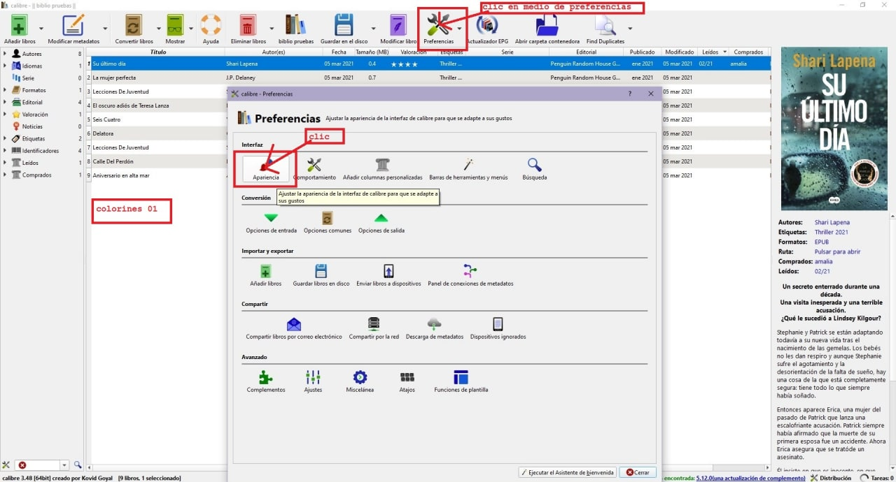
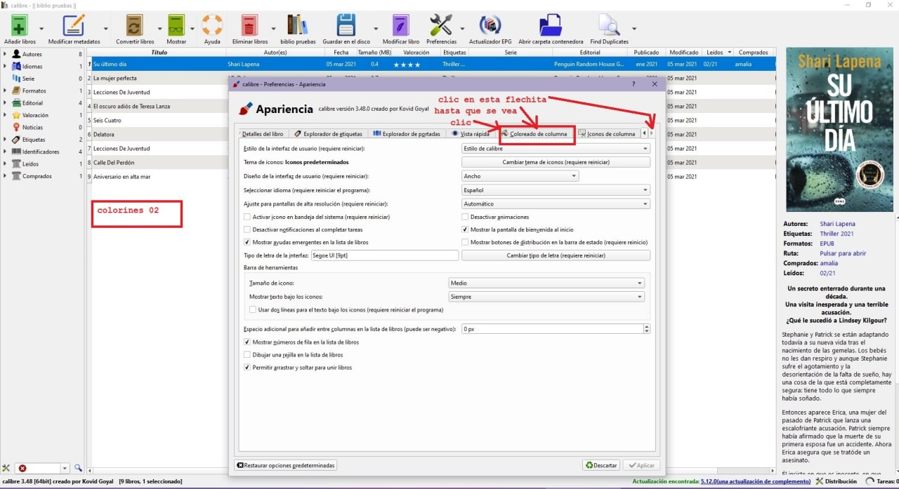
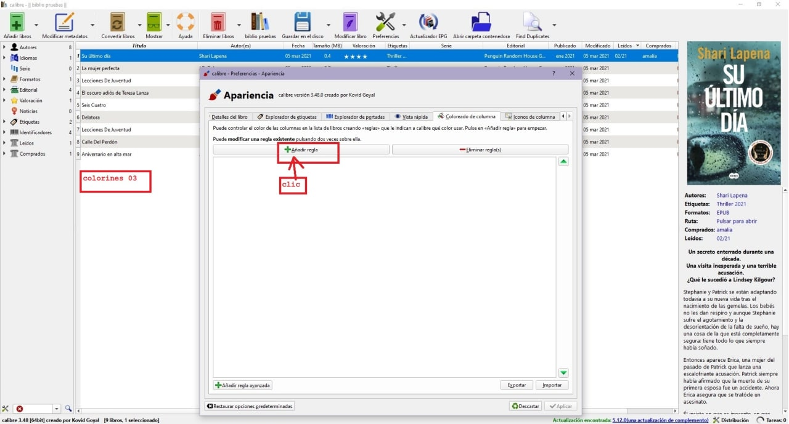
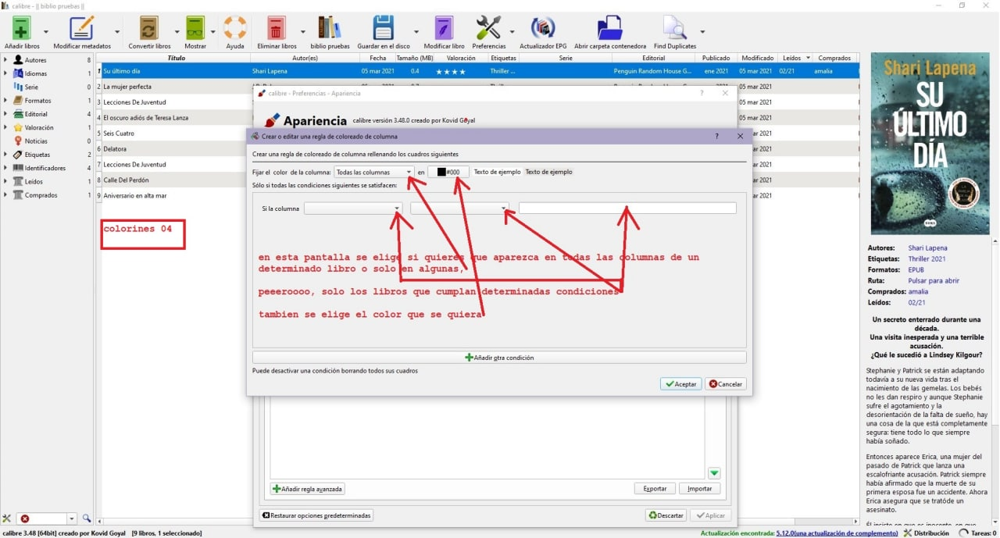
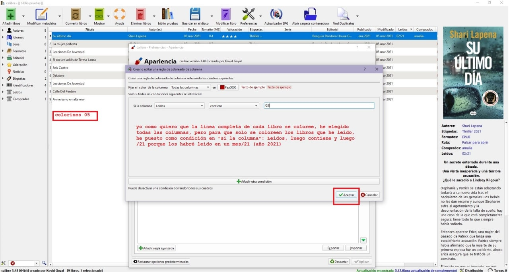
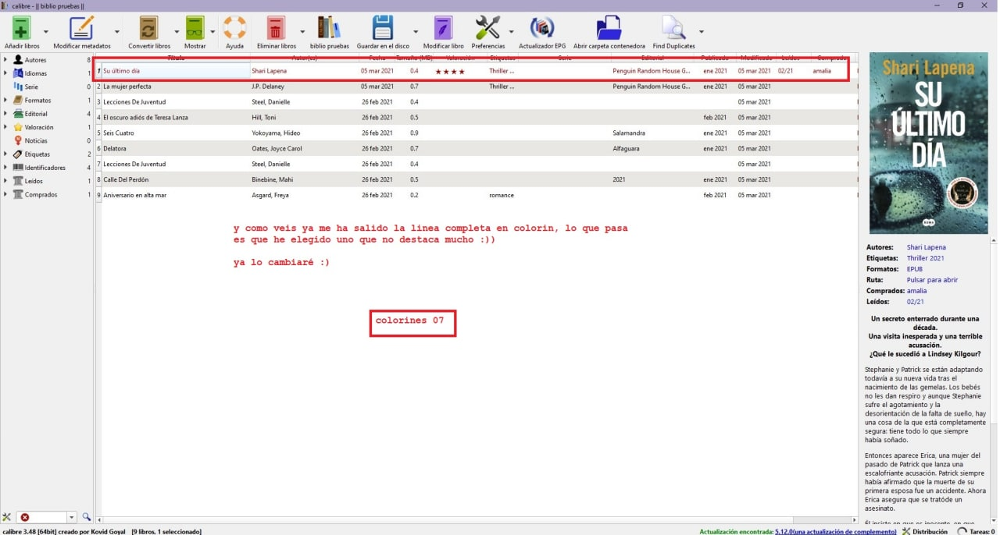
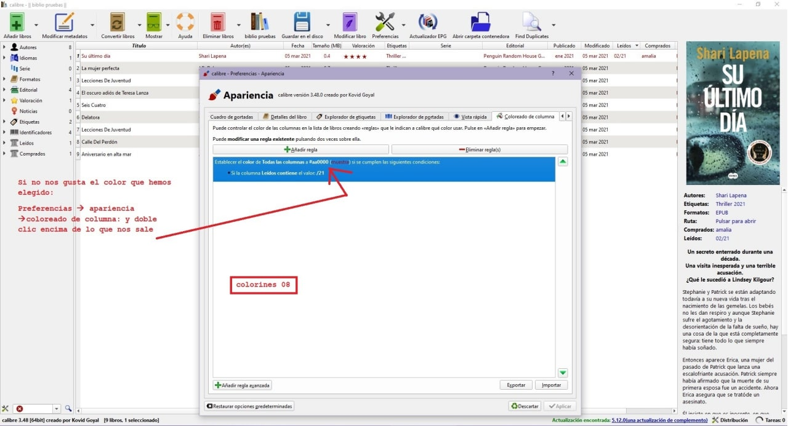
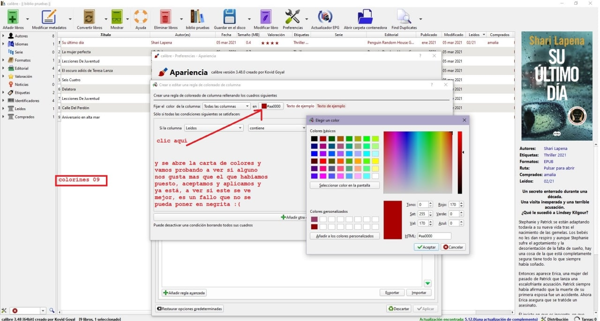
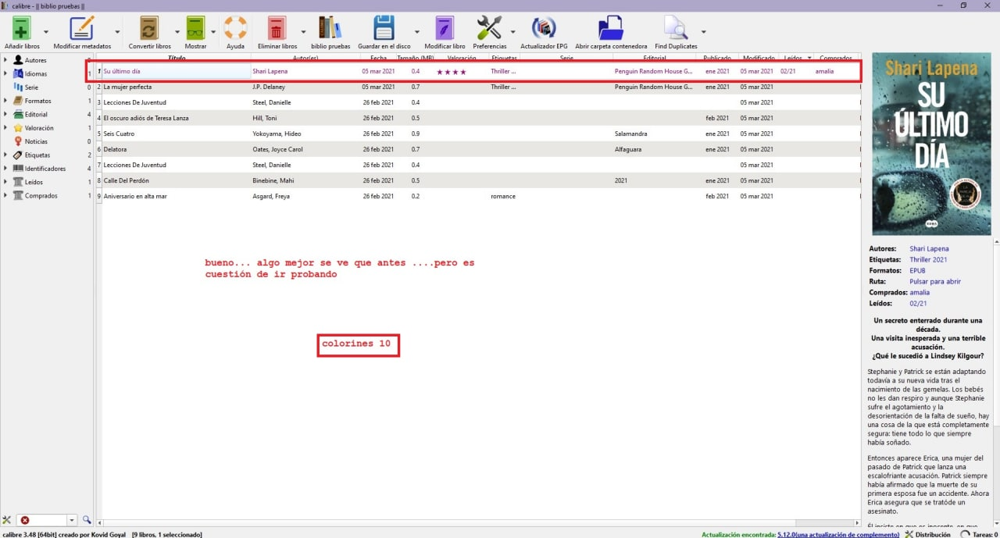

# Colorear con reglas (Colorines)

:material-account: [Walter](https://t.me/Dunhill69){ target=_blank } · :material-link-variant: [Ver el original en Telegraph](https://telegra.ph/Colirines-08-27){ target=_blank }
{ .tut-datos }

---

Ir al mensaje:[https://t.me/calibreconfiguraciones/32979](https://t.me/calibreconfiguraciones/32979)

## [Volver al inicio](https://telegra.ph/Indice-Calibre-en-Espa%C3%B1ol-10-03)

 

---

[:material-arrow-left: Volver al índice](../../alfabetico.md) · [:fontawesome-brands-telegram: Preguntar en el grupo](https://t.me/calibreconfiguraciones){ target=_blank }
