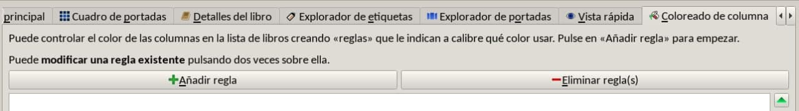
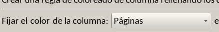
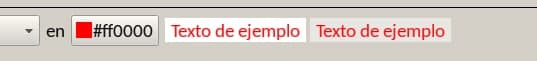
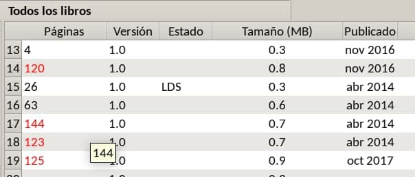
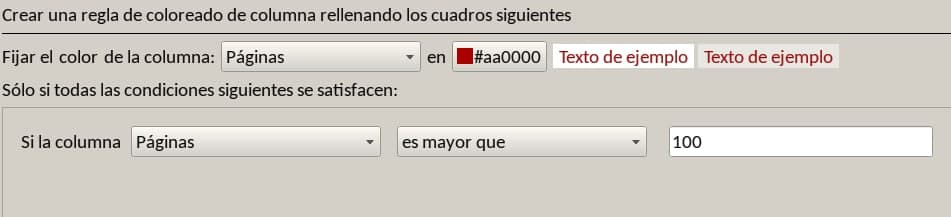
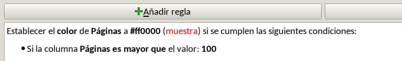
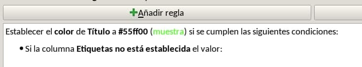
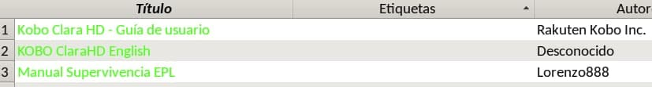
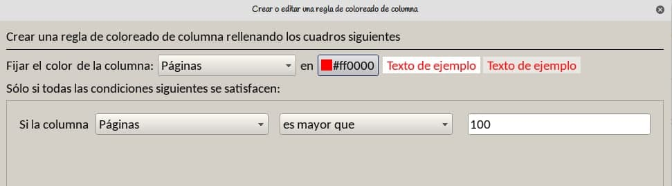

# Colorear con reglas

:material-account: [@LorenzoGar](https://t.me/Dunhill69){ target=_blank } · :material-link-variant: [Ver el original en Telegraph](https://telegra.ph/Colorear-con-reglas-08-27){ target=_blank }
{ .tut-datos }

---

Entramos en una biblioteca y vamos a Configuración, Apariencia, Coloreado de columna.

Pinchamos en Añadir regla

Le decimos si queremos que nos coloree una columna, cual o todas,

Con qué color

Ahora vemos que los libros de más de 100 páginas están en rojo en la columna Páginas.

Las combinaciones son casi infinitas

Y qué condiciones debe cumplir.

En el ejemplo la columna Páginas se pondrá en rojo si el libro tiene más de cien páginas

(El mensaje anterior de borró por accidente)

Una vez hecha la regla nos aparece así

Otro ejemplo, la columna título se pone verde si no hay etiquetas establecidas en la columna etiquetas

 

Y si no os gustan los colores, podéis eliminar las reglas y ya está.

Solo afecta a la manera en que se ve, nada más.

 

ir al mensaje: [https://t.me/calibreconfiguraciones/32933](https://t.me/calibreconfiguraciones/32933)

 

## [Volver al inicio](https://telegra.ph/Indice-Calibre-en-Espa%C3%B1ol-10-03)

 

---

[:material-arrow-left: Volver al índice](../../alfabetico.md) · [:fontawesome-brands-telegram: Preguntar en el grupo](https://t.me/calibreconfiguraciones){ target=_blank }
