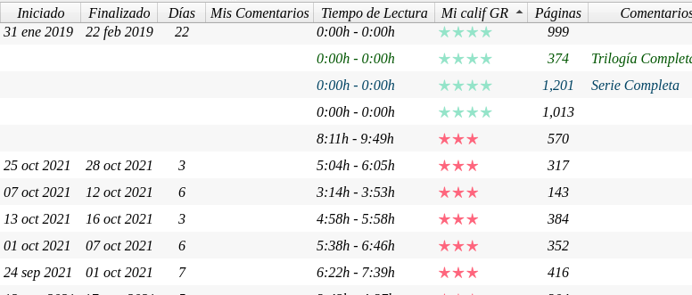
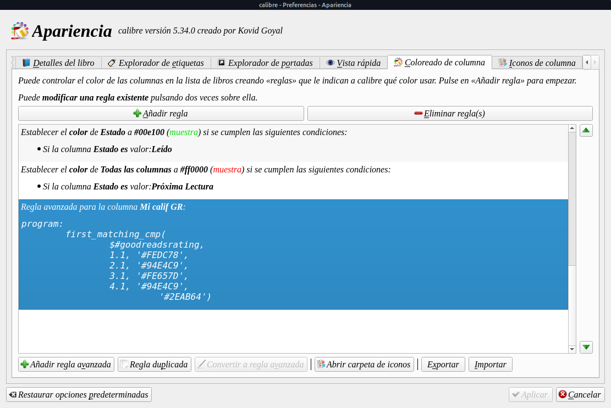

# Colorear estrellas de calificación

:material-account: [Walter](https://t.me/Dunhill69){ target=_blank } · :material-link-variant: [Ver el original en Telegraph](https://telegra.ph/Colorear-Estrellas-de-Calificaciones-01-18){ target=_blank }
{ .tut-datos }

---

Me pasaron un código para colorear las estrellas de Calificaciones, se vera así



Para lograrlo hay que ir a Preferencia\> Apariencia\> Color de columna\> Agregar regla avanzada (es un botón en la parte inferior izquierda del cuadro de diálogo)



En añadir regla avanzada nos sale una pantalla donde hay que pegar este código.

```
program: 

     r = $rating;
 

     if r >=#5 then '#2EAB64'
     elif r >=#4 then '#94E4C9'
     elif r >=#3 then '#FE657D'    
     elif r >=#2 then '#FCB2A9'
     elif r >=#1 then '#FEDC78'
 

     fi
```

Donde rating tiene que tener el nombre de nuestra columna en este caso esta para la columna por defecto de Calibre.

Ir al mensaje: [https://t.me/calibreconfiguraciones/63328](https://t.me/calibreconfiguraciones/63328)

<br>

## [Volver al inicio](https://telegra.ph/Indice-Calibre-en-Espa%C3%B1ol-10-03)

<br>

<br>

---

[:material-arrow-left: Volver al índice](../../alfabetico.md) · [:fontawesome-brands-telegram: Preguntar en el grupo](https://t.me/calibreconfiguraciones){ target=_blank }
