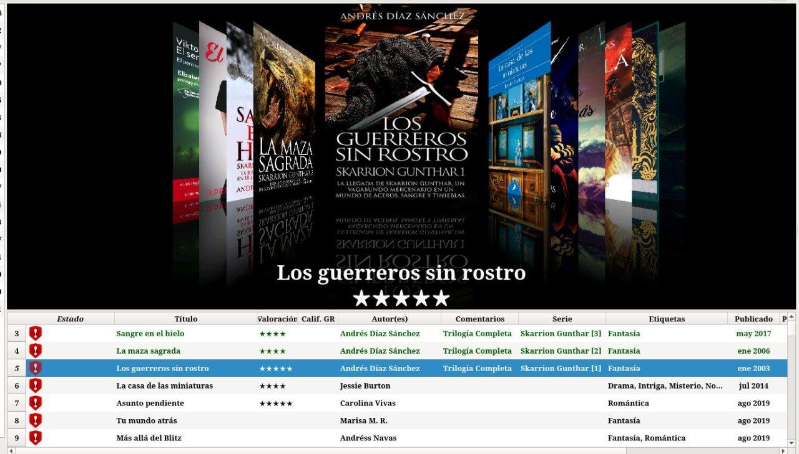
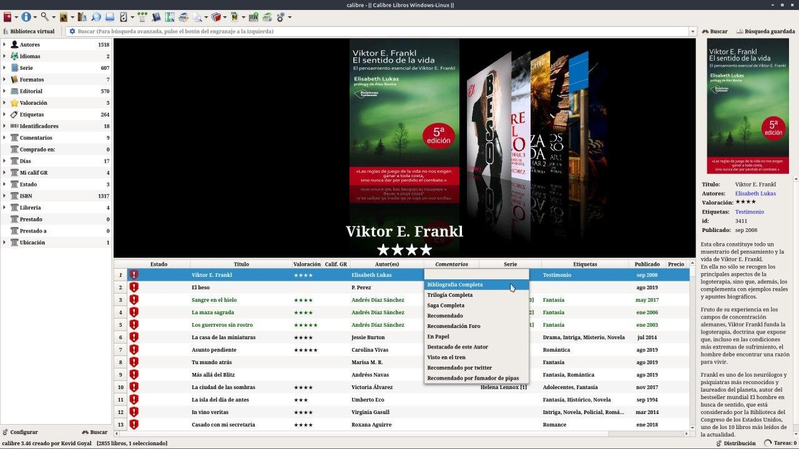
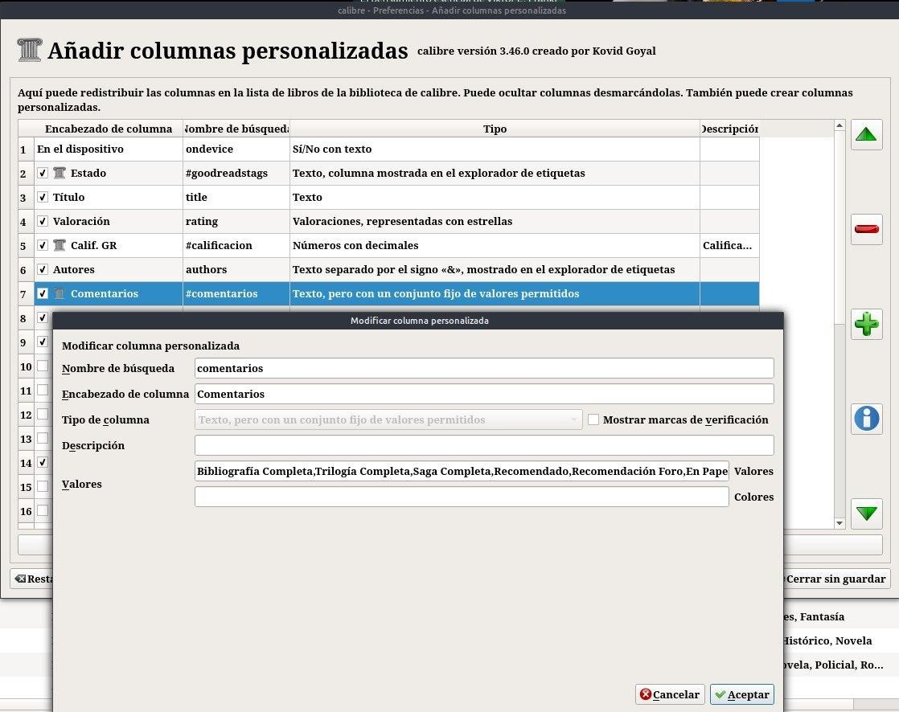
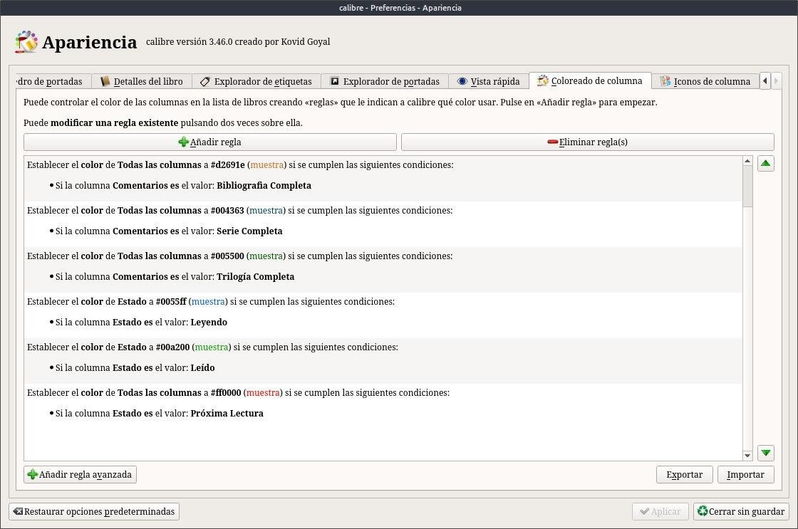
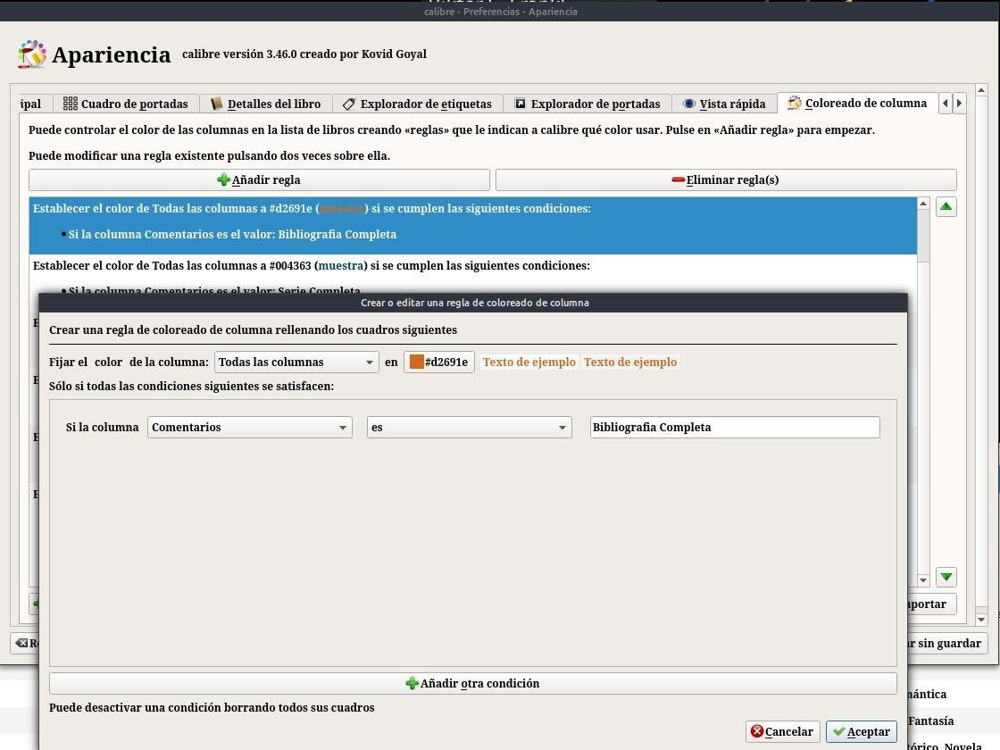

# Colorear filas

:material-account: [Walter](https://t.me/Dunhill69){ target=_blank } · :material-link-variant: [Ver el original en Telegraph](https://telegra.ph/Colorear-Filas-09-14){ target=_blank }
{ .tut-datos }

---

Como colorear la fila para saber si tenemos la serie completa, trilogía o lo que se les ocurra no se si se puede apreciar, en este caso trilogía completa en verde.

Yo en comentarios tengo cargado estos datos: Bibliográfica Completa, Trilogía Completa, Saga Completa, Recomendado, y lo que se les ocurra poner...

Para eso creamos una columna personalizada con los siguientes parámetros

Después de esto vamos a Preferencias / Apariencia y nos desplazamos hasta Coloreado de Columna, Acá les dejo las reglas que use para cada caso, ustedes pueden elegir el color que quieran.

Para crear la regla tocamos en Añadir regla y le ponemos las condiciones de esta manera. Que lo disfruten !!

ir al mensaje: [https://t.me/calibreconfiguraciones/205](https://t.me/calibreconfiguraciones/205)

## [Volver al inicio](https://telegra.ph/Indice-Calibre-en-Espa%C3%B1ol-10-03)

##  

 

 

---

[:material-arrow-left: Volver al índice](../../alfabetico.md) · [:fontawesome-brands-telegram: Preguntar en el grupo](https://t.me/calibreconfiguraciones){ target=_blank }
