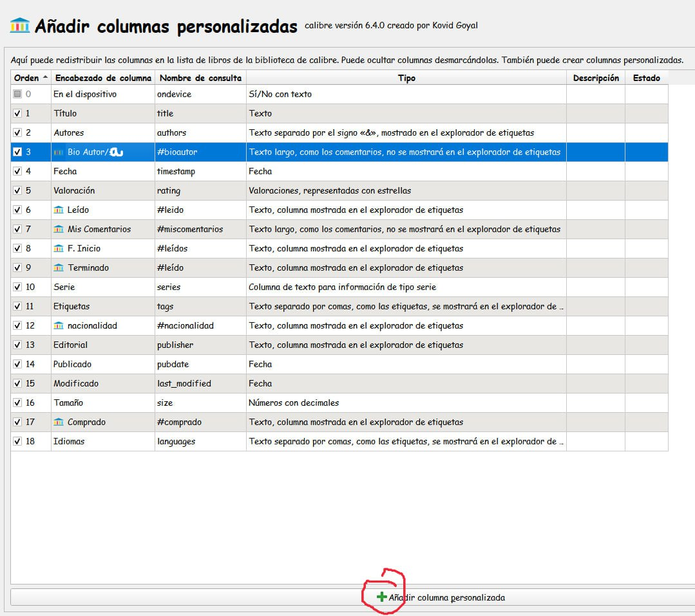
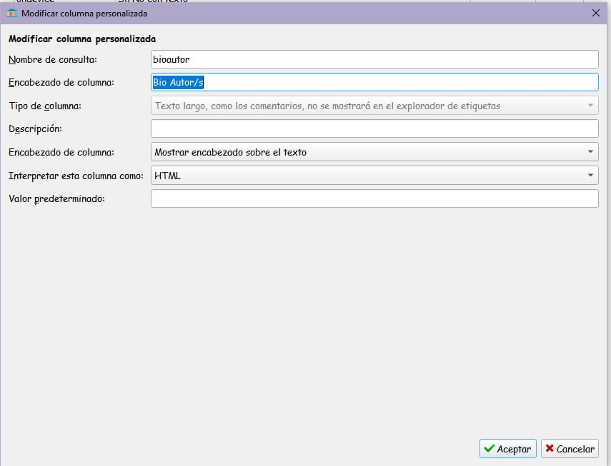
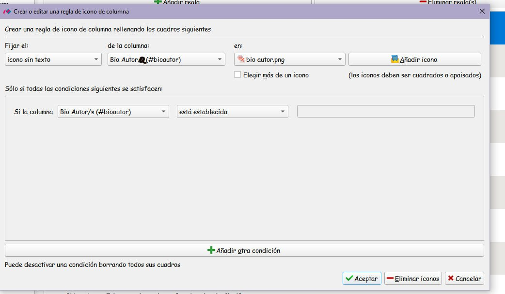
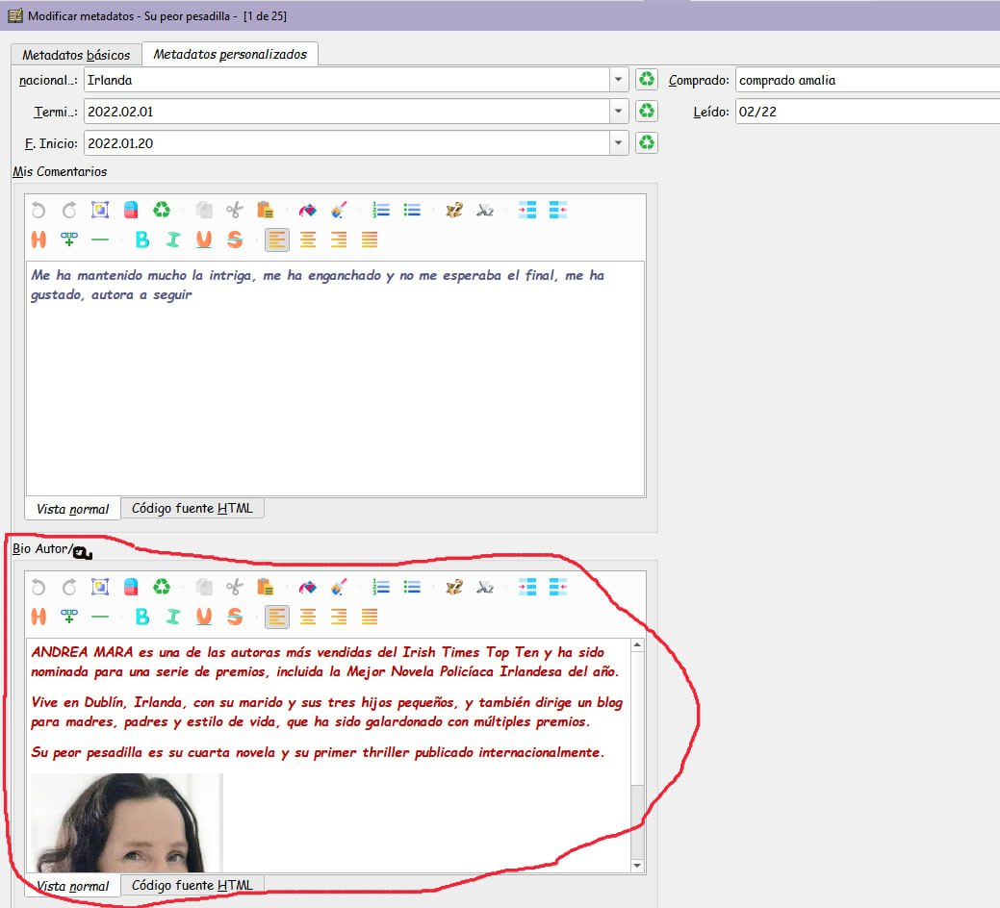
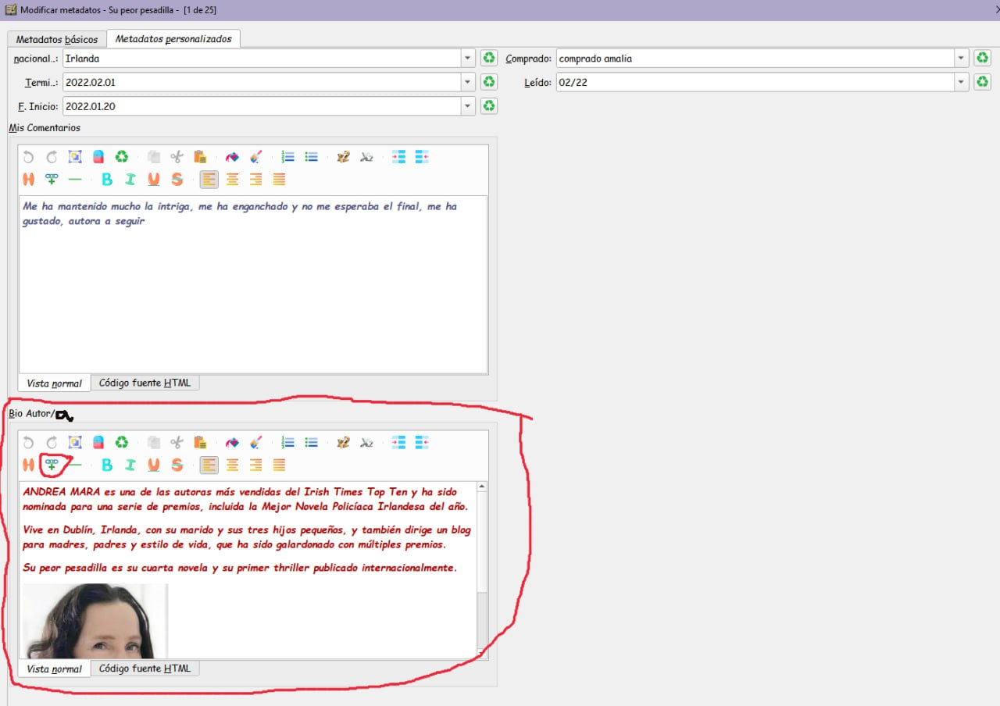
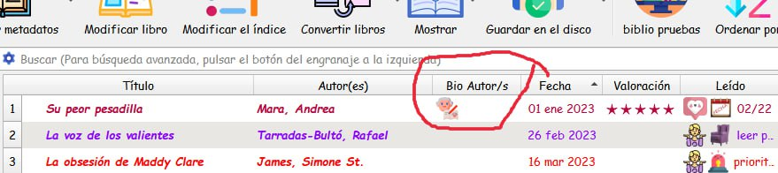
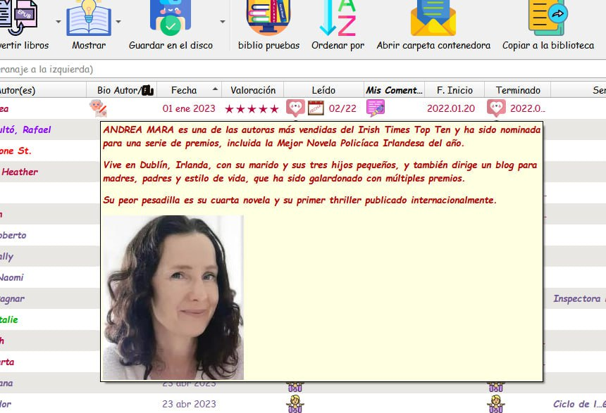

# Columna personalizada - Biografía del autor (sin complemento)

:material-account: [Walter](https://t.me/Dunhill69){ target=_blank } · :material-link-variant: [Ver el original en Telegraph](https://telegra.ph/Columna-personalizada-Biograf%C3%ADa-Autor-02-03){ target=_blank }
{ .tut-datos }

---

Explicada por @jane\_morris

Crear una columna personalizada

2) Hacerla

NOTA: es Bio Autor/a (no s)

3) Apariencia—\>Iconos de columna—\>Añadir regla

NOTA: es Bio Autor/a

4) Ir Modificar metadatos por separado —\>pestaña Metadatos personalizados

y rellenar esta ficha.

5) Para rellenar esta ficha:

Lo primero de todo hacer una carpeta que se llame fotos autores, en un sitio que sepamos donde esta, siempre el mismo sitio y que no se puede cambiar de nombre ni quitar las fotos de ahí, solo añadir. Buscar en google la foto del autor que nos ocupe descargarla en nuestro ordenador y reducirla hasta que mida como mucho 200x200 (no tiene que ser igual el ancho que el largo, pero máximo el lado mas largo 200)

6) Ir a la ficha que he redondeado en rojo.

Escribir la bio, si se quiere eligiendo cursiva, negrita, color de letra ...

Situarse justo debajo de lo que hemos escrito, y clicar en el circulito chiquitin que he puesto en rojo

No comunicara con nuestro ordenador, buscamos la carpeta nueva que se llama Bio Autor buscamos dentro la foto de nuestro autor y encima le damos doble click, veremos que sale debajo del texto en nuestra ficha

aceptamos y ya está

7) Y ya en calibre si lo hemos hecho todo bien, nos aparecerá asi

 

8) Y si pasamos el ratón suavemente por el muñequito nos aparecerá así.

Ir al mensaje: [https://t.me/calibreconfiguraciones/144967/146793](https://t.me/calibreconfiguraciones/144967/146793)

 

Columna bio autor/a para que la imagen quede rodeada del texto 1

primero haces todo en vista normal porque en html no salen los iconitos de poner cursiva negrita colores ... lo unico es que pones lo primero de todo la foto en vez de abajo

y luego te pasas a html, y al final de la foto , justo despues de png le pegas esto

style="float:left;"

y la imagen por supuesto la coges ya con transparente derecha y abajo claro

Ir al mensaje: [https://t.me/calibreconfiguraciones/144967/146896](https://t.me/calibreconfiguraciones/144967/146896)

 

## [Volver al inicio](https://telegra.ph/Indice-Calibre-en-Espa%C3%B1ol-10-03)

 

---

[:material-arrow-left: Volver al índice](../../alfabetico.md) · [:fontawesome-brands-telegram: Preguntar en el grupo](https://t.me/calibreconfiguraciones){ target=_blank }
