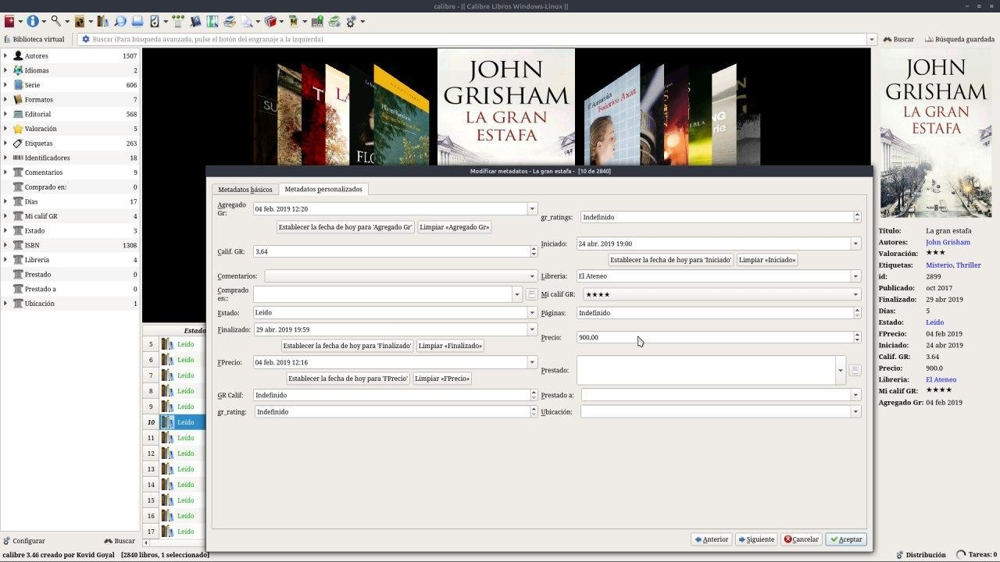

# Columna personalizada - Datos del libro

:material-account: [Walter](https://t.me/Dunhill69){ target=_blank } · :material-link-variant: [Ver el original en Telegraph](https://telegra.ph/Columna-Personalizada---Datos-del-libro-09-20){ target=_blank }
{ .tut-datos }

---

Otra de las cosas que podríamos agregar como datos de los libros es el precio y fecha de compra, lugar de compra, ubicación o la librería donde lo compramos.

ir al mensaje: [https://t.me/calibreconfiguraciones/186](https://t.me/calibreconfiguraciones/186)

[https://telegra.ph/Columna-Personalizada---Datos-del-libro-09-20](https://telegra.ph/Columna-Personalizada---Datos-del-libro-09-20)

## [Volver al inicio](https://telegra.ph/Indice-Calibre-en-Espa%C3%B1ol-10-03)

##  

 

---

[:material-arrow-left: Volver al índice](../../alfabetico.md) · [:fontawesome-brands-telegram: Preguntar en el grupo](https://t.me/calibreconfiguraciones){ target=_blank }
