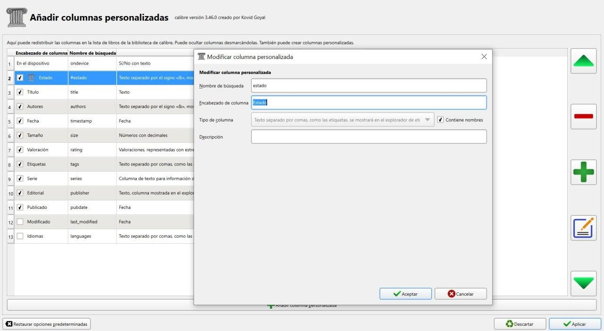
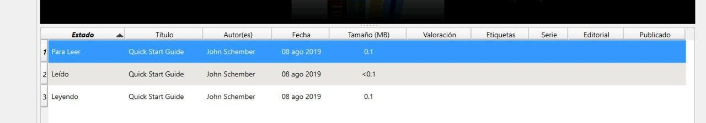
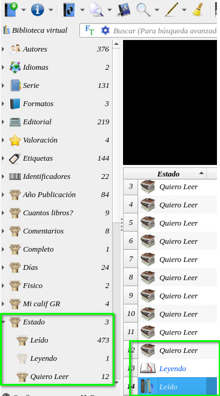
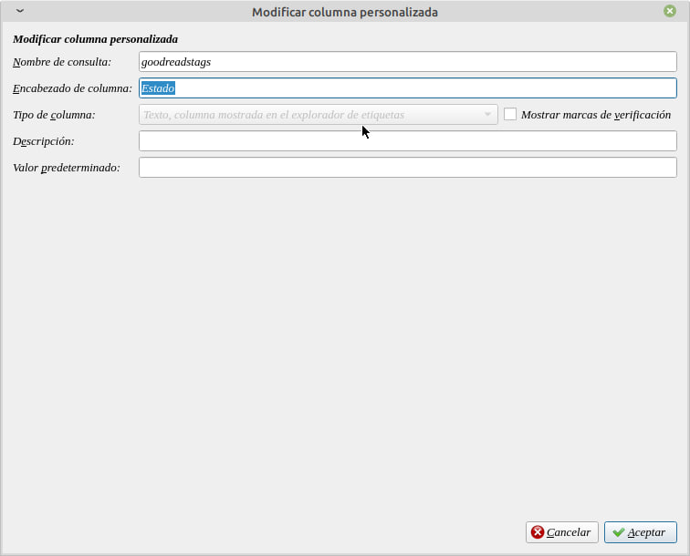
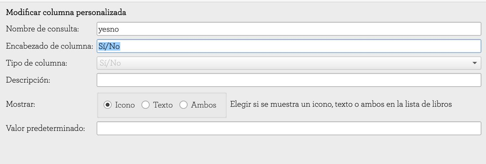

# Columna personalizada - Estado del libro

:material-account: [Walter](https://t.me/Dunhill69){ target=_blank } · :material-link-variant: [Ver el original en Telegraph](https://telegra.ph/Columna-Personalizada---Estado-del-libro-08-17){ target=_blank }
{ .tut-datos }

---

Acá les envió la primera configuración: Como Agregar una columna que me diga el estado del libro: Leído, Leyendo o Para Leer ( bien básico) Vamos a crear una columna personalizada, para ello vamos a tocar en la barra de herramienta de calibre la opción "Preferencias" y añadir columna personalizada ponemos los datos de la segunda foto aceptar y aplicar. Se reinicia Calibre solo y ya tenemos la columna Estado En la última posición la ponemos arrastrando al primer lugar, solo tenemos que escribir el estado del libro por única vez para que aparezca en la lista después aparecerá solo.

 

Ir al mensaje: [https://t.me/calibreconfiguraciones/1/82](https://t.me/calibreconfiguraciones/1/82)

Para obtener este resultado debemos seguir estos pasos:

tengo una columna Estado que se ve como etiqueta y de esa manera me da los valores de los estados del libro (Leído, Leyendo y Quiero leer)

Acá te muestro como tengo configurada la columna. Para no perder los datos de tu biblioteca ya que debes configurar la columna nueva, puedes crear otra el titulo se puede cambiar pero lo que no se puede cambiar es la configuración de la columna.

Ir al mensaje: [https://t.me/calibreconfiguraciones/112333/136869](https://t.me/calibreconfiguraciones/112333/136869)

 

***Otra explicación:*** de @Inatxo

Me vais a permitir que os diga como he resuelto yo los libros que he leido y los que querría leer…

He creado una columna tal como se ve en la siguiente imagen.

Donde SI (o su icono, la V verde de confirmación de la que tanto hablasteis) significa LEIDO

Y, NO (o su icono, la aspa roja) señalan los libros que DESEO LEER próximamente.

Sé que soy muy simple pero es efectivo y directo…

Ah!, en el caso de querer saber el número de libros leidos, tengo una búsqueda guardada con el siguiente esquema:

#yesno:"yes"

y, para los que deseo leer:

#yesno:"no"

Ir al mensaje: [https://t.me/calibreconfiguraciones/112333/136884](https://t.me/calibreconfiguraciones/112333/136884)

 

## [Volver al inicio](https://telegra.ph/Indice-Calibre-en-Espa%C3%B1ol-10-03)

##  

 

---

[:material-arrow-left: Volver al índice](../../alfabetico.md) · [:fontawesome-brands-telegram: Preguntar en el grupo](https://t.me/calibreconfiguraciones){ target=_blank }
