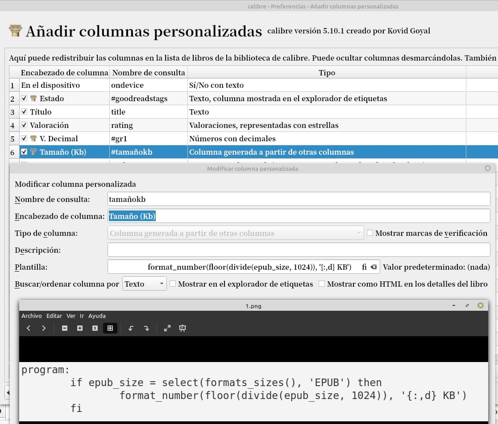
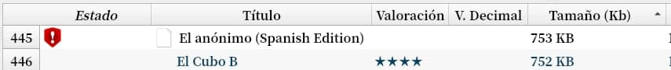

# Columna personalizada - Tamaño en KB

:material-account: [Walter](https://t.me/Dunhill69){ target=_blank } · :material-link-variant: [Ver el original en Telegraph](https://telegra.ph/Columna-Personalizada---Tama%C3%B1o-en-kb-08-27){ target=_blank }
{ .tut-datos }

---

Quisiera que Calibre me muestre el tamaño o peso de un libro.

He buscado y puedo en la configuración tildar tamaño pero me lo expresa en MB, o sea hace la conversión de KB, que me es más familiar, donde se modifica en que tipo de volumen me lo tiene que mostrar @Dunhill69

Sobre la pregunta de @susanaines sobre una columna del tamaño en kb acá les dejo algo que solo funciona para libros epub, si manejan otro formato reemplacen epub por el formato que más usen.

Creamos una columna personalizada, que dependa de otra columna.

con este código, que lo agregamos en el campo plantilla:                                                                  program:

if epub\_size = select(formats\_sizes(), 'EPUB') then

format\_number(floor(divide(epub\_size, 1024)), '{:,d} Kb')

fi

Y así se ve la columna personalizada

 

ir al mensaje: [https://t.me/calibreconfiguraciones/30054](https://t.me/calibreconfiguraciones/30054)

 

## [Volver al inicio](https://telegra.ph/Indice-Calibre-en-Espa%C3%B1ol-10-03)

 

 

 

---

[:material-arrow-left: Volver al índice](../../alfabetico.md) · [:fontawesome-brands-telegram: Preguntar en el grupo](https://t.me/calibreconfiguraciones){ target=_blank }
