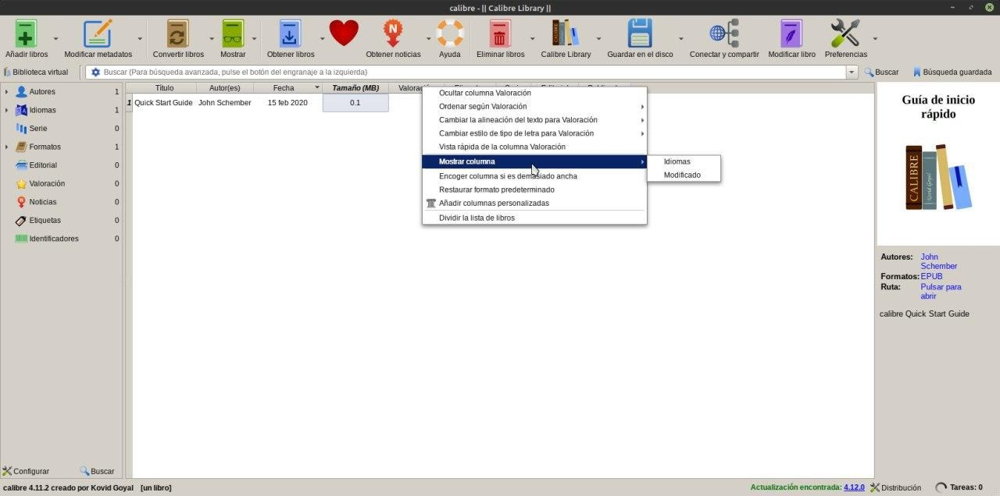

# Columnas ocultas

:material-account: [Walter](https://t.me/Dunhill69){ target=_blank } · :material-link-variant: [Ver el original en Telegraph](https://telegra.ph/Columnas-ocultas-08-17){ target=_blank }
{ .tut-datos }

---

Como ver columnas ocultas sobre la cabecera de las columnas, botón izquierdo del mouse. Mostrar columna y ahí estarán las que están ocultas.

## [Volver al inicio](https://telegra.ph/Indice-Calibre-en-Espa%C3%B1ol-10-03)

##  

 

---

[:material-arrow-left: Volver al índice](../../alfabetico.md) · [:fontawesome-brands-telegram: Preguntar en el grupo](https://t.me/calibreconfiguraciones){ target=_blank }
